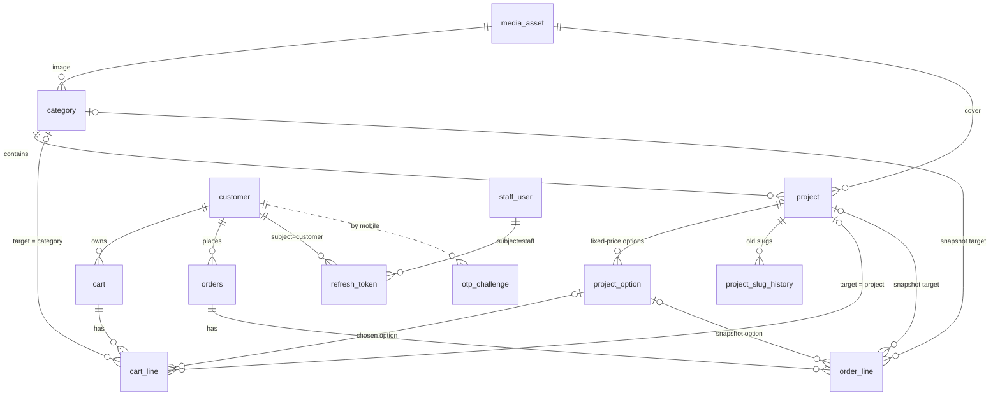
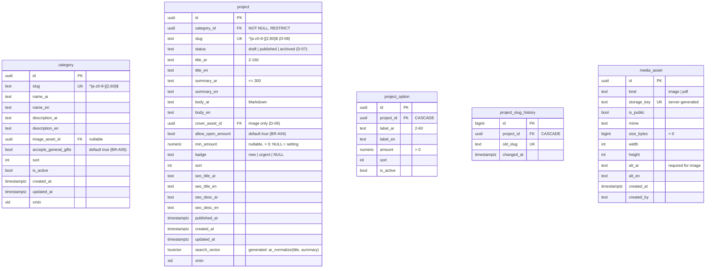
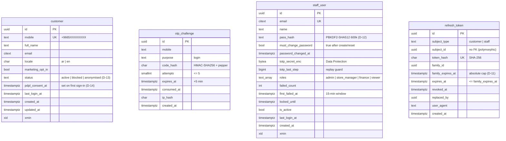
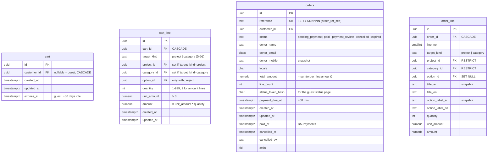
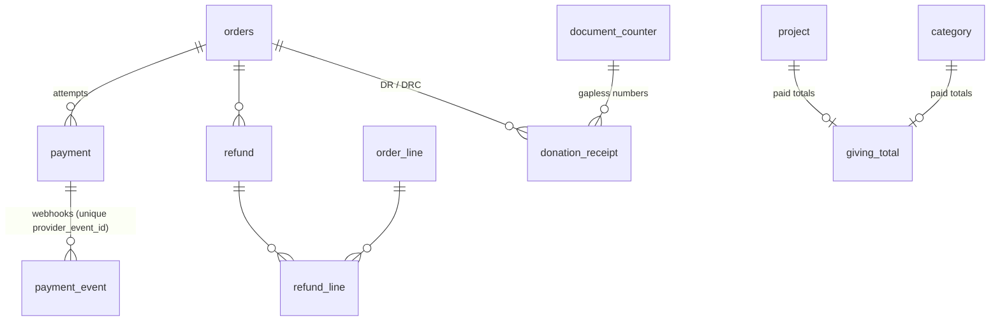

# 02: Store API ERD (r5 donations MVP)

**Schema:** `store` · PostgreSQL 18 · EF Core 10 (snake_case). **The source of truth is the EF model plus one fresh `InitialSchema` migration.** No reference DDL is kept in the repo.

**Conventions:**

- **Primary keys:** `uuid` generated as `Guid.CreateVersion7()`; `bigint identity` for ledger tables.
- **Enums:** `text` + `CHECK`.
- **Bilingual text:** `*_ar NOT NULL`, `*_en NULL`.
- **Money:** `numeric(12,2)`.
- **Time:** `timestamptz` UTC.
- **Optimistic concurrency:** `xmin`.

**Business rules:** D-xx refer to [01-api-business-requirements.md](01-api-business-requirements.md).

**Built in:** R5-Core = **19 tables**, 1 sequence, 1 view. R5-Payments (next session) adds 7 tables (§3).

---

## 1. R5-Core: overview



Platform tables with no FK into the graph: `setting`, `audit_log`, `idempotency_key`, `outbox_message`, `message_template`, `notification`.

---

## 2. Tables

### 2.1 Catalogue



**Indexes and constraints:**

- **Project:**
  - `ix_project_listing (status, category_id, sort)`;
  - GIN `search_vector`, plus trigram on `ar_normalize(title_ar)`;
  - `ck_project_min (min_amount IS NULL OR min_amount > 0)`.
- **Project option:** `ux_option_label (project_id, label_ar)`.
- **Category:** `ix_category_sort (is_active, sort)`.
- **Media:**
  - `ck_media_alt (kind <> 'image' OR alt_ar IS NOT NULL)`;
  - an image used as a `cover_asset_id` or `image_asset_id` must have `kind = image` (checked in code, D-06).

### 2.2 Identity



**Indexes:**

- `ix_otp_mobile_recent (mobile, created_at DESC)`;
- `ix_otp_ip_recent (ip_hash, created_at DESC)`;
- `ix_refresh_subject (subject_type, subject_id)`;
- `ix_refresh_family (family_id)`.

### 2.3 Donations: cart and orders



**Constraints:**

- `ck_line_target` (on both `cart_line` and `order_line`):

  ```sql
  (target_kind = 'project'  AND project_id IS NOT NULL AND category_id IS NULL)
  OR
  (target_kind = 'category' AND category_id IS NOT NULL AND project_id IS NULL AND option_id IS NULL)
  ```

- `ck_line_amount`: `amount = unit_amount * quantity AND quantity BETWEEN 1 AND 999 AND unit_amount > 0`.
- `ux_cart_customer (customer_id) WHERE customer_id IS NOT NULL`: one cart per donor.
- `ux_cart_option_line (cart_id, option_id) WHERE option_id IS NOT NULL`: option lines merge (D-04).
- `ix_orders_customer (customer_id, created_at DESC)`, `ix_orders_status (status, payment_due_at)`.
- `ix_order_line_project (project_id)`, `ix_order_line_category (category_id)`.
- **Sequence:** `order_ref_seq`.
- `status` already allows the R5-Payments values, so no enum migration is needed later. R5-Core only sets `pending_payment` and `cancelled`.

### 2.4 Platform

```mermaid
erDiagram
    setting {
        text key PK
        jsonb value
        timestamptz updated_at
        text updated_by
    }
    audit_log {
        bigint id PK
        timestamptz at
        text actor "staff email | system | customer:{id}"
        text action "e.g. project.publish, staff.login_failed"
        text entity
        text entity_id
        jsonb diff
        char ip_hash
    }
    idempotency_key {
        text scope PK "checkout:{customerId}"
        text key PK
        char request_hash
        text status "in_progress | completed"
        int response_status
        jsonb response_body
        timestamptz created_at
        timestamptz expires_at "+24 h"
    }
    outbox_message {
        uuid id PK
        text type "OtpRequested | CatalogChanged | ..."
        jsonb payload
        timestamptz occurred_at
        int attempts
        timestamptz next_attempt_at
        timestamptz claimed_until "lease"
        timestamptz processed_at
        text last_error
        bool dead_lettered
    }
    message_template {
        text key PK
        text channel PK "sms | email"
        char locale PK "ar | en"
        text subject
        text body "Scriban"
        timestamptz updated_at
        text updated_by
    }
    notification {
        uuid id PK
        text channel
        text recipient_hash
        text template_key
        text dedupe_key UK
        text status "sent | failed"
        text provider_ref
        timestamptz created_at
    }
```



**Settings seeded:**

| Key | Default |
|---|---|
| `min_gift_amount` | 10.00 |
| `max_line_amount` | 100000.00 |
| `cart_max_lines` | 50 |
| `cart_max_total` | 100000.00 |
| `payment_window_minutes` | 60 |
| `amount_presets` | 50, 100, 500 |
| `site_name_ar` / `site_name_en`, `support_mobile` | — |

**View `v_catalog_stats`** (staff only): for each project and category, the number of `pending_payment` orders. Paid totals arrive in R5-Payments.

---

## 3. R5-Payments (next session): shown for context, not built now



| Table | Purpose |
|---|---|
| `payment`, `payment_event` | Hosted-page payment attempts. The webhook is the truth. The unique `(provider, provider_event_id)` makes events idempotent |
| `refund`, `refund_line` | Finance-only refunds |
| `donation_receipt` | DR (receipt) and DRC (cancellation) PDFs |
| `document_counter` | Gapless numbering per series and year |
| `giving_total` | `target_kind` + `target_id`: `paid_amount`, `donor_count`, `last_gift_at`. Updated inside the settlement transaction and reconciled nightly |

---

## 4. Removed against the current repo (49 tables)

| Table | Status |
|---|---|
| `course_detail`, `course_module`, `book_detail`, `book_format`, `stock_movement`, `customer_address`, `invoice`, `enrolment`, `download_grant`, `download_log`, `shipment` | Removed (commerce) |
| `sponsorship_offer`, `sponsored_unit`, `sponsored_unit_event`, `sponsorship_pool`, `pool_contribution`, `unit_funding`, `distribution`, `beneficiary`, `allocation_batch` | Removed (sponsorship) |
| `cause_detail`, `goal_progress`, `goal_adjustment`, `cause_update`, `dedication`, `zakat_ledger` | Removed. **They're not in the MVP** and can be re-added later as new migrations |
| `product`, `cart_line`, `order_line` | Replaced by `project`, plus the redesigned `cart_line` and `order_line` |
| `payment`, `payment_event`, `refund`, `refund_line`, `donation_receipt`, `document_counter` | Moved to R5-Payments |
| `v_goal`, `v_sales_daily`, `v_allocation_backlog`, `v_zakat_balance` | Removed |

The old migrations (`InitialSchema`, `GrantPaymentEventColumnUpdate`) are deleted and **replaced by one new `InitialSchema`**. This is allowed because nothing has been deployed: no staging or production database exists.
