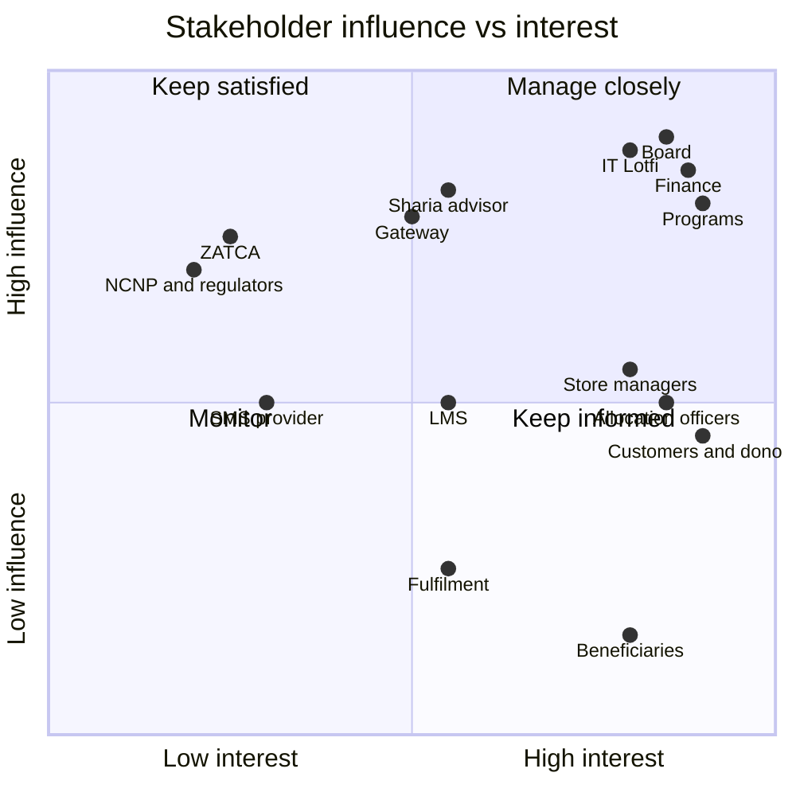

# 02 — Stakeholders and Personas

**Revision:** S1 draft r1 · 29 September 2026 · reconciled with the r1 canonical changes

Who has a stake in the ta3lom store, what each party needs from it, and the people the screens are
designed for. Requirements are cited by ID: `BR-S` ([01](01-business-requirements.md)), `RUL-`
([03](03-business-rules.md)), `FR-S` ([04](04-functional-requirements.md)).

---

## 1. Stakeholders

Influence and interest are rated **H** high · **M** medium · **L** low.

| # | Stakeholder | Interest | Influence | What they need from the store | Key IDs | Open questions they own |
|---|---|---|---|---|---|---|
| SH-01 | **Association board** (مجلس الإدارة) | H | H | Earned income (OBJ-1), donor trust (OBJ-4), no reputational or legal exposure; approves the general-fund spending plan and the refund policy | BR-S01–S04, BR-S08, BR-S11 | Q-07, Q-09 |
| SH-02 | **Programs team** | H | H | Beneficiary criteria per offer, a working allocation backlog, completion evidence for sponsors and the annual report | BR-S03, BR-S08, RUL-47–52, FR-S50–S57 | Q-04 |
| SH-03 | **Finance** | H | H | One reconciled record per riyal; separate sales invoices and donation receipts; zakat ledger with disbursement vouchers for causes (RUL-20); VAT report; controlled refunds, which only the `finance` role performs, not `admin` implicitly (RUL-62); no spreadsheet reconciliation (OBJ-5) | BR-S06, BR-S07, BR-S11, BR-S13, RUL-20, RUL-56–59, FR-S61–S64, FR-S75 | Q-01, Q-02 |
| SH-04 | **Allocation officers** (role `allocation_officer`) | H | M | FIFO backlog per offer, fast batch allocation, validation that stops a wrong match (including a missing mobile for course seats, RUL-47e), access to beneficiary PII only when needed and audited. Only this role allocates or reveals PII; `admin` does not implicitly (RUL-62) | RUL-47–51, FR-S52–S57 | Q-04 |
| SH-05 | **Fulfilment staff** (role `fulfilment`) | M | L | A shipping queue, packing slips, tracking entry, accurate stock with reservations | RUL-26, RUL-30, RUL-40, FR-S42, FR-S43 | Q-06 |
| SH-06 | **Store managers** (role `store_manager`) | H | M | Publish products, offers and causes without a developer; post delivery updates; see campaign progress | BR-S10, FR-S50, FR-S58, FR-S59, FR-S72, FR-S74 | — |
| SH-07 | **IT / Lotfi** (developer and operator) | H | H | A maintainable .NET modular monolith, one VPS to run, clear rules to test against, safe deployments, backups that restore. Holds `admin` only; needs no finance or allocation powers (RUL-62) | ADR-S01–S08, NFR-S (06) | Q-05, Q-08 (with the association) |
| SH-08 | **Sharia advisor** | M | H | Zakat accepted only on eligible causes, ring-fenced, spent only on zakat-eligible beneficiaries, never on overheads; written sign-off of the eligible list | BR-S06, RUL-19, RUL-20, RUL-47d | Q-03 |
| SH-09 | **Payment gateway** (provider pending Q-01; Moyasar recommended) | M | H | Hosted payment page only, signed webhooks acknowledged quickly, correct refund API use, merchant category for sales and donations | RUL-32–38, FR-S33–S37, FR-S64 | Q-01 |
| SH-10 | **SMS provider** (Saudi, registered sender ID) | L | M | Registered sender ID, templates compliant with CST rules, volumes within plan | RUL-22, RUL-52, RUL-60, RUL-63, FR-S81 | — |
| SH-11 | **LMS** (existing, new or in-house; Q-05) | M | M | An enrolment API or an agreed manual process; completion and progress data back to the store | RUL-42, FR-S23, FR-S40, FR-S55 | Q-05 |
| SH-12 | **ZATCA** (Zakat, Tax and Customs Authority) | L | H | If VAT-registered: compliant simplified tax invoices, Phase 2 integration | BR-S13, RUL-27, RUL-59, FR-S62, FR-S65 | Q-02 |
| SH-13 | **Regulators — NCNP** (National Center for Non-Profit Sector) and consumer/data authorities (MoC for e-commerce, SDAIA for PDPL) | L | H | Licensed-entity identity on every page and receipt, lawful fundraising, e-commerce disclosures, personal-data protection | Constraints in 01 §6, FR-S63, NFR-S (06) | Q-08 |
| SH-14 | **Customers and donors** (represented by personas P1–P7) | H | M | Low-friction buying and giving, clear totals, receipts, proof that a gift arrived | BR-S01–S09 | — |
| SH-15 | **Beneficiaries** (persona P8) | H | L | A seat or copy that actually reaches them, a simple first login, privacy | BR-S03, RUL-50–52 | — |

### Influence / interest map

---

## 2. Personas

All names are fictional. Each persona lists the requirements that matter most to them. These are
the requirements to demo to that audience at sign-off and to prioritise in usability testing.

### Summary

| ID | Persona | Type | Primary journeys | Main device |
|---|---|---|---|---|
| P1 | Majed — teacher buying a course | Customer | Discover → buy course → learn | Laptop + phone |
| P2 | Amal — parent buying books | Customer | Book page → print + digital → ship | Phone |
| P3 | Turki — quick mobile donor | Donor | Shared link → quick give → Apple Pay | Phone (iOS) |
| P4 | Nasser — seat sponsor | Donor | Sponsor 25 seats → follow allocation | Desktop |
| P5 | Latifa — zakat payer | Donor | Zakat on eligible causes → receipt | Tablet + phone |
| P6 | Fahad — giving on behalf of his late father | Donor | Cause units → dedication | Phone |
| P7 | Munira — dedication recipient | Recipient | SMS → card page | Basic smartphone |
| P8 | Hessa — rural teacher, beneficiary | Beneficiary | SMS invite → OTP → My courses | Android phone |
| P9 | Rawan — store manager | Staff | Catalogue, causes, updates | Desktop |
| P10 | Ibrahim — finance officer | Staff | Payment review, refunds, reports, zakat | Desktop |
| P11 | Norah — allocation officer | Staff | Beneficiary register → FIFO allocation | Desktop |

> The request asked for 8–10 personas but named 11 roles. All 11 are kept, because P6/P7 and
> P10/P11 have journeys that do not overlap.

---

### P1 — Majed Al-Otaibi · teacher buying a course for himself

| | |
|---|---|
| **Profile** | 31, computer-science teacher at a boys' intermediate school in Jeddah. Pays for his own professional development. |
| **Goals** | Buy *المعلّم الرقمي* (`digital-teacher`, 350 SAR, struck-through 450) and start the same evening; get a certificate he can add to his professional file. |
| **Frustrations** | Sites that force account creation with a password; payment pages that fail on mada; not knowing whether access is immediate; refund policies hidden in the small print; losing his cart when a payment fails (the store restores it, RUL-29). |
| **Key journeys** | Store home → Courses → course page → "Enrol myself" → cart → OTP at checkout → mada → thank-you page → My courses → Start. |
| **Devices** | Laptop at home (Chrome), phone for the OTP and on the move. |
| **Matters most** | BR-S01, BR-S09 · RUL-04, RUL-13, RUL-42, RUL-57 (7 days, < 20%) · FR-S04, FR-S10, FR-S21, FR-S23, FR-S30, FR-S35, FR-S40 |

### P2 — Amal Al-Ghamdi · parent buying books

| | |
|---|---|
| **Profile** | 38, mother of three primary-school children in Dammam. Shops almost entirely on her phone. |
| **Goals** | Two printed copies of *نجوم العلوم* (`science-stars-book`, print 65 SAR) and the digital *حكايات الحروف* (`letters-tales`, 25 SAR) to read on the tablet tonight. |
| **Frustrations** | Shipping costs revealed only at the last step; typing a full address on a phone; downloads that expire before she gets to them; paying shipping for an order cancelled before it ships (refunded in full, RUL-57). |
| **Key journeys** | Books → book page → format selector → quantity 2 → add digital → cart (purchases 155 SAR + shipping 25 SAR) → Short National Address → pay → My books → Download. |
| **Devices** | Android phone (Chrome), 360 px wide. |
| **Matters most** | BR-S02 · RUL-05, RUL-26, RUL-30, RUL-41 · FR-S05, FR-S11, FR-S18, FR-S22, FR-S24, FR-S41, FR-S42 |

### P3 — Turki Al-Shammari · quick mobile donor

| | |
|---|---|
| **Profile** | 24, junior engineer in Riyadh. Gives small amounts when a friend shares a campaign in a WhatsApp group, usually in Ramadan. |
| **Goals** | From a shared link, give 50 SAR to *سقيا الطلاب* (`water-for-schools`) in under a minute with Apple Pay; see the bar move. |
| **Frustrations** | Having to open a product page, pick units, create an account; forms that do not fit a phone; no confirmation that the money arrived (the order reaches `paid` within about 10 minutes even if he closes the browser, RUL-38). |
| **Key journeys** | WhatsApp link → cause page or donation card → quick give 50 SAR → "Give now" → OTP → Apple Pay → thank-you page with receipt. |
| **Devices** | iPhone, Safari, Apple Pay. |
| **Matters most** | BR-S04, BR-S09 · RUL-08, RUL-12 (min 10 SAR), RUL-23, RUL-33 · FR-S06, FR-S07, FR-S08, FR-S15, FR-S16, FR-S21, FR-S33, FR-S35 |

### P4 — Nasser Al-Rashed · sponsor funding seats for teachers

| | |
|---|---|
| **Profile** | 52, owner of a contracting company in Riyadh. Funds education as personal sadaqa and wants to report the impact to his family. |
| **Goals** | Sponsor 25 seats in `digital-teacher` for *معلمات المدارس الأهلية الناشئة في القرى والهجر* (25 × 350 = 8,750 SAR); see each seat allocated and completed. |
| **Frustrations** | Donations that disappear into a general pot; no evidence a seat was used; being asked for the beneficiary's identity, which he does not want. |
| **Key journeys** | Sponsor page → course → "Sponsor seats" preset 25 → cart → checkout → donation receipt `DR-2026-…` → My giving seat map (awaiting / allocated / completed) → monthly email digest (job `SponsorDigest`, RUL-63). |
| **Devices** | Desktop (Edge) at the office; reads the digest on his phone. |
| **Matters most** | BR-S03, BR-S08 · RUL-06, RUL-43, RUL-48, RUL-49, RUL-50 · FR-S12, FR-S25, FR-S51, FR-S53, FR-S63 |

### P5 — Latifa Al-Suwailem · zakat payer

| | |
|---|---|
| **Profile** | 45, school principal in Buraidah. Calculates her zakat each Ramadan and wants it spent strictly on those entitled to it. |
| **Goals** | Pay 3,800 SAR of zakat as 4 tablets on `tablet-for-student` (950 SAR each, zakat-eligible), and 1,200 SAR on `learning-data`; receive a receipt that shows the zakat amount separately. |
| **Frustrations** | Charities that mix zakat with general funds; unclear eligibility; receipts that do not state "zakat". |
| **Key journeys** | Give → cause page with the "يقبل الزكاة" tag → sadaqa/zakat selector → zakat notice → cart → checkout → receipt with the zakat line → My giving delivery updates. Finance records the spending as disbursement vouchers in the zakat ledger (RUL-20). |
| **Devices** | iPad at home; phone for OTP. |
| **Matters most** | BR-S06 · RUL-19, RUL-20, RUL-47d, RUL-59 · FR-S13, FR-S61, FR-S63, FR-S25 |

### P6 — Fahad Al-Juhani · giving on behalf of his late father

| | |
|---|---|
| **Profile** | 40, government employee in Madinah. Gives a *صدقة جارية* in his late father's name each year and wants his mother to know. |
| **Goals** | 2 water coolers (2 × 1,500 = 3,000 SAR) on `water-for-schools`, dedicated with the template *صدقة جارية عن روح الفقيد* and a card sent by SMS to his mother. |
| **Frustrations** | Dedication cards that show the amount; cards sent before payment went through; not being able to choose a respectful message. |
| **Key journeys** | Cause page → units 2 → "تبرع عن غيرك" toggle → recipient name, mobile `05XXXXXXXX`, sender name, template → cart shows the dedication → pay → thank-you page with card preview → the photo update "cooler installed" later in My giving. |
| **Devices** | Android phone. |
| **Matters most** | BR-S05, BR-S08 · RUL-21, RUL-22, RUL-23, RUL-54 · FR-S13, FR-S14, FR-S59, FR-S60 |

### P7 — Munira Al-Juhani · dedication recipient

| | |
|---|---|
| **Profile** | 68, Fahad's mother, in Madinah. Uses WhatsApp and SMS; does not shop online and has no store account. |
| **Goals** | Understand from the SMS who gave, in whose memory, and to what; open a card that reads well in Arabic. |
| **Frustrations** | Links that ask her to log in or install something; tiny text; anything that looks like a scam. |
| **Key journeys** | SMS from the registered sender ID → `/store/card/{token}` → read the card (her name, message, sender name, product title — no amount). |
| **Devices** | Entry-level Android phone, large system font. |
| **Matters most** | BR-S05 · RUL-22 · FR-S60 · NFR-S accessibility and RTL (06) |

### P8 — Hessa Al-Balawi · beneficiary (rural teacher receiving a seat)

| | |
|---|---|
| **Profile** | 27, teacher at a small private girls' school in a village in Al-Qassim. Registered by her school as `teacher` in the group `rural_private_school_teachers`. |
| **Goals** | Take `digital-teacher` for free, at her own pace, and earn the certificate. |
| **Frustrations** | Complicated registration; being asked to pay; not knowing the invitation is genuine; losing access if she starts late. |
| **Key journeys** | Allocation creates her `customer` row and enrolment and links it to beneficiary `B-000123` (RUL-47, RUL-52) → SMS invitation (`beneficiary_invite`) → first OTP login on the registered number simply signs her in → My courses → Start. If she does not start within 60 days the seat lapses, her enrolment is revoked with a short SMS, and she may be allocated again later (RUL-50). |
| **Devices** | Android phone on mobile data (Slow 4G), occasionally a school laptop. |
| **Matters most** | BR-S03 · RUL-47(e), RUL-50, RUL-52, RUL-60 · FR-S21, FR-S23, FR-S54, FR-S55 |

### P9 — Rawan Al-Mansour · store manager

| | |
|---|---|
| **Profile** | 34, communications officer who also runs the store. Not technical. Role `store_manager`. |
| **Goals** | Launch a Ramadan campaign (a new cause with a 1,500 SAR unit and a target) in under 15 minutes; post "cooler installed at school X" with a photo; change a price without calling the developer. |
| **Frustrations** | Needing a rebuild for every price change; images rejected without explanation; not seeing progress at a glance. |
| **Key journeys** | Admin → Products → new cause → unit, target, dates, zakat flag (after Sharia sign-off) → media with alt → preview → publish; Causes → Delivery update → notify donors; Dashboard. |
| **Devices** | Desktop (Chrome), two languages. |
| **Matters most** | BR-S10 · RUL-02, RUL-07, RUL-09, RUL-10, RUL-54 · FR-S07, FR-S50, FR-S58, FR-S59, FR-S72, FR-S74, FR-S77 |

### P10 — Ibrahim Al-Khaldi · finance officer

| | |
|---|---|
| **Profile** | 46, accountant for the association. Role `finance`. Closes the month and prepares the NCNP financial report. |
| **Goals** | Resolve `payment_review` orders (including captures that arrive after an order expired or was cancelled, RUL-35), issue refunds that respect the policy, record zakat disbursement vouchers for causes, export sales & VAT, gifts by product and the zakat ledger, and reconcile against the gateway settlement. |
| **Frustrations** | Refunds done by hand at the gateway; mixed invoices and receipts; zakat balances in spreadsheets; documents renumbered after the fact. |
| **Key journeys** | Orders → filter `payment_review` → compare captured vs `grand_total` → accept (full settlement) or refund; duplicate-course alerts (RUL-13) → refund; Refund → select lines → eligibility reasons → gateway refund → credit note / cancellation receipt; Zakat → disbursement voucher; Reports → CSV. |
| **Devices** | Desktop, large screen. |
| **Matters most** | BR-S07, BR-S11, BR-S13 · RUL-20, RUL-27, RUL-35, RUL-56–59 · FR-S38, FR-S61–S64, FR-S73, FR-S75, FR-S78 |

### P11 — Norah Al-Tamimi · allocation officer

| | |
|---|---|
| **Profile** | 36, programs coordinator. Role `allocation_officer`. Works with partner schools, homes and libraries that nominate beneficiaries. |
| **Goals** | Import a school's nomination list with a mobile for each course-seat candidate (own or guardian's, RUL-47e), approve eligible people, and allocate the oldest waiting seats in batches of 20 without mistakes. |
| **Frustrations** | Allocating a seat to someone who already has the course; mixing zakat and non-zakat money; donors asking "where is my seat?" after a month. |
| **Key journeys** | Beneficiaries → import CSV → verify → approve, set `zakat_eligible` → Allocation console per offer → FIFO backlog (awaiting / overdue) → select N beneficiaries → allocate batch → invitations sent. Alerts at 30 / 90 days. |
| **Devices** | Desktop. |
| **Matters most** | BR-S03, BR-S06, BR-S08 · RUL-47, RUL-48, RUL-49, RUL-51, RUL-52 · FR-S52, FR-S53, FR-S55, FR-S56, FR-S57 |

---

## 3. Persona × requirement focus

| Area | P1 | P2 | P3 | P4 | P5 | P6 | P7 | P8 | P9 | P10 | P11 |
|---|---|---|---|---|---|---|---|---|---|---|---|
| Catalogue & product pages (FR-S01–S09) | ● | ● | ● | ● | ● | ● | | | ● | | |
| Buy box & cart (FR-S10–S20) | ● | ● | ● | ● | ● | ● | | | | | |
| OTP & account (FR-S21–S28) | ● | ● | ● | ● | ● | ● | | ● | | | |
| Checkout & payment (FR-S30–S39) | ● | ● | ● | ● | ● | ● | | | | ● | |
| Fulfilment (FR-S40–S43) | ● | ● | | | | | | ● | | | |
| Giving operations (FR-S50–S61) | | | ● | ● | ● | ● | ● | ● | ● | ● | ● |
| Documents & refunds (FR-S62–S65) | ● | ● | ● | ● | ● | ● | | | | ● | |
| Admin & reporting (FR-S70–S79) | | | | | | | | | ● | ● | ● |

---

## 4. Open points

| # | Point | Raised by | Relates to |
|---|---|---|---|
| OP-02-1 | Dedications "on behalf of a late parent" (P6) are sent to a living relative. RUL-21 requires a recipient mobile, so a dedication with no recipient to notify (only the name of the deceased) is not possible. Confirm this is acceptable, or add a "no card" option (`dedication.sms_status = 'skipped'` exists in the DDL but no rule says when it is used). | P6 | RUL-21, RUL-22 |
| OP-02-2 | *(Still open; RUL-47(e) now requires a mobile for course seats only.)* Beneficiaries who are organisations (`kind` = `school` / `library`, e.g. book copies for `public_primary_libraries`) have no personal invitation journey. Confirm that distribution proof (`distribution.proof_asset_id`) is the only confirmation. | P11 | RUL-47, RUL-52 |
| OP-02-3 | The regulator named by the association for fundraising oversight (NCNP) and any required fundraising permit number to display on cause pages need confirmation. | SH-13 | 01 §6 |
| OP-02-4 | **FR-S71 vs. RUL-62.** Resolved — FR-S71 reworded to follow RUL-62 segregation of duties. | SH-03, SH-07 | FR-S71, RUL-62 |
