# 07 — Store Process Flows

**Revision:** S1 draft r1 · 29 September 2026

Sequence, state and flow diagrams for the store's main processes. The diagrams show how the business
rules in [03](03-business-rules.md) play out across the browser (`ta3lom-web`), the store API
(`Ta3lom.Store.Api`), PostgreSQL (schema `store`), the payment gateway (`IPaymentGateway`, provider
pending Q-01), and the background workers (`OutboxDispatcher`, Quartz jobs).

**Conventions**

- State names are the exact values allowed by the CHECK constraints in `001_store_schema.sql`.
- Table and column names are the DDL's.
- "tx" means one database transaction. Every business event commits with its `outbox_message` rows in
  the same transaction (database design §1.6).
- Messages to customers and staff are sent after commit, by the `OutboxDispatcher` (RUL-63). An SMS
  or email failure never rolls back a payment. **The one exception is the OTP SMS**, which is sent
  directly within the request so that the plain code is never stored (RUL-63, flow l).
- Endpoint paths follow [11 — API contract](11-api-contract.md).
- Revision r1 applies the canonical changes in `_changes-r1.md`. Open points they settle are marked
  "Resolved — RUL-nn" at the end of this document.
- Outbox message types are written in PascalCase (`OrderPaid`, `DedicationCard`, …), as in the
  `outbox_message.type` comment. Template keys are the seeded `message_template.key` values (`otp`,
  `order_paid`, `dedication_card`, `beneficiary_invite`, `shipment_shipped`, `refund_done`,
  `cause_update`).

| # | Flow | Rules |
|---|---|---|
| a | [Purchase a course, end to end](#a-purchase-a-course-end-to-end) | RUL-13, 15, 24, 25, 33, 39, 42 |
| b | [Sponsor seats with a dedication](#b-sponsor-seats-with-a-dedication) | RUL-06, 21, 22, 23, 43 |
| c | [Partial share pooling](#c-partial-share-pooling) | RUL-45 |
| d | [Quick give](#d-quick-give-donation) | RUL-07, 12, 19, FR-S15 |
| e | [Checkout, hosted payment, webhook settlement, outbox](#e-checkout--hosted-payment--webhook-settlement--outbox) | RUL-24, 28–39, 61 |
| f | [Order state machine](#f-order-state-machine) | RUL-29, 35, 57 |
| g | [Sponsored unit lifecycle](#g-sponsored-unit-lifecycle) | RUL-50, 57 |
| h | [Allocation by the allocation officer](#h-allocation-by-the-allocation-officer) | RUL-47, 48, 49, 52, 62 |
| i | [Beneficiary invitation and first login](#i-beneficiary-invitation-and-first-login) | RUL-52, 60 |
| j | [Refund decision](#j-refund-decision) | RUL-13, 56, 57, 58, 62 |
| k | [Campaign end and pool sweep](#k-campaign-end-and-pool-sweep) | RUL-09, 20, 46 |
| l | [OTP sign-in with rate limits](#l-otp-sign-in-with-rate-limits) | RUL-17, 60, 61, 63 |
| m | [Digital download](#m-digital-download-signed-url--watermark) | RUL-41 |
| n | [Print shipment lifecycle](#n-print-shipment-lifecycle) | RUL-26, 30, 40 |

---

## a. Purchase a course, end to end

A visitor enrols in a course for themselves. The page is prerendered. The price is fetched live. The
order becomes `paid` only through the gateway webhook (or reconciliation), and never through the
browser's return.

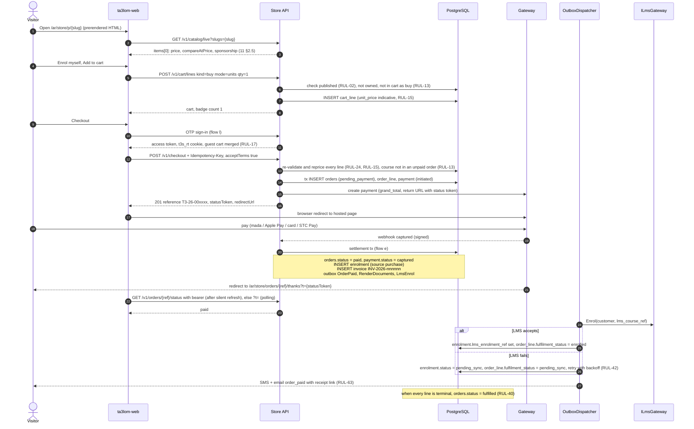

**Notes**

- **Duplicate course (RUL-13).** Checkout refuses a course that is already owned, already in the cart
  as `buy`, or already in one of the customer's `pending_payment`/`payment_failed` orders
  (`cart.course_in_unpaid_order`). If a duplicate is paid anyway (a race), settlement creates no second
  enrolment (`ux_enrolment_live`), marks the line for refund and sends `FinanceAlert` (flow j).
- The customer is never charged twice for an LMS failure. The enrolment exists from the settlement
  transaction, and only the LMS sync is retried (RUL-42).
- The default `InternalAccessLmsGateway` (until Q-05) succeeds without a remote call. Progress and
  completion come back through the hourly `LmsProgressSync` job.
- The order moves to `fulfilled` once the course line is `enrolled`. A course purchase can still be
  refunded afterwards within the RUL-57 window (flow j).

---

## b. Sponsor seats with a dedication

A donor sponsors 5 seats (course offer with `seat_price` 350.00) on behalf of their father. The father
gets a card by SMS after payment. The seats are later allocated by the association (flows g, h).

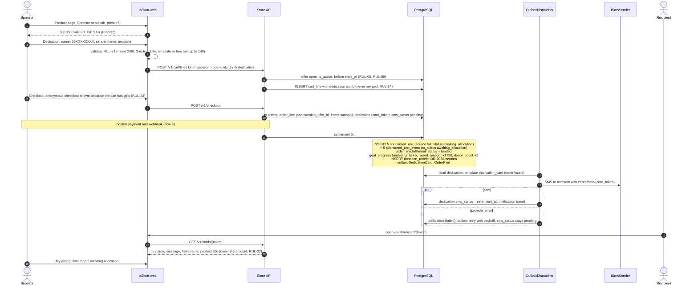

**Notes**

- The card SMS is sent **at most once per line**, and only after payment (RUL-22). Staff can resend it
  (FR-S60). A resend is an explicit staff action, logged in `audit_log`.
- **Sender shown on the card.** It is the typed `from_name`. If none was typed and the order is
  anonymous, it is "فاعل خير" (RUL-23). If none was typed and the order is not anonymous, the rules do
  not say (open point 1).
- A dedication does **not** give the recipient the seats. The units stay in the allocation pool
  (BR-S05).

---

## c. Partial share pooling

Partial sponsorship contributions (`sponsor`, mode `amount`) go into the offer's pool in arrival order.
Each time the pool holds a full seat price, one unit is created and its funders are recorded (RUL-45).
This runs inside the settlement transaction of the order that brought the money.

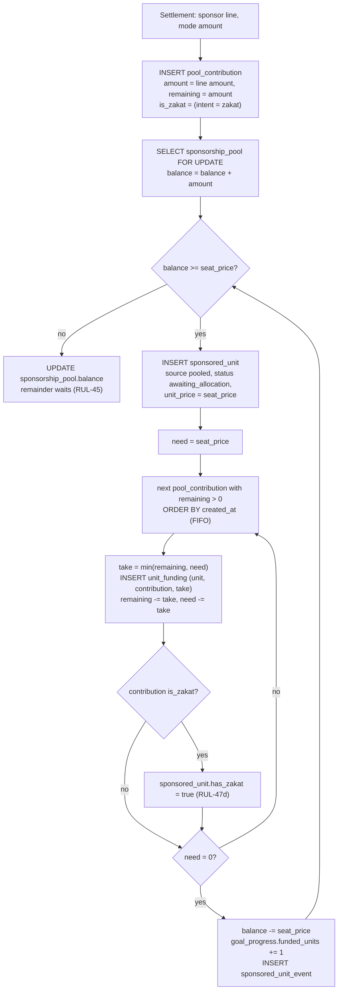

**Numeric example.** Offer with `seat_price` = 350.00. Three donors contribute 100, 150 and 120, in that
order, each in their own paid order.

| Step | Event | Pool balance | Units created | `pool_contribution.remaining` (A / B / C) |
|---|---|---|---|---|
| 1 | A pays 100.00 | 100.00 | — | 100 / — / — |
| 2 | B pays 150.00 | 250.00 | — | 100 / 150 / — |
| 3 | C pays 120.00 | 370.00, which is ≥ 350 | **U1** (source `pooled`) | A → 0, B → 0, C → 20 |
| | after U1 | 20.00 | | 0 / 0 / 20 |

`unit_funding` rows for U1: (U1, A, 100.00), (U1, B, 150.00), (U1, C, 100.00). The total is 350.00.

- **Zakat branch.** The `is_zakat` branch exists in the schema, but it is inactive in S1, because
  offers are not zakat-eligible until S2 (RUL-20).
- **Invariant.** `sponsorship_pool.balance` (20.00) = Σ `remaining` of unswept contributions
  (20.00). This is nightly integrity check 4.
- **What donors see (FR-S25).** A: "0.29 of a seat, converted into a seat". B: "0.43, converted". C:
  "0.34: 100 SAR converted, 20 SAR waiting in the pool".
- **If the offer ends now,** C's 20.00 is swept to the general fund (flow k).
- **Goal counters.** `goal_progress.raised_amount` rises with every paid contribution (+100, +150, +120).
  `funded_units` rises only when U1 is created.

---

## d. Quick give (donation)

A donor gives an open amount from a donation card without opening the product page (FR-S15, the Kafeef
pattern).

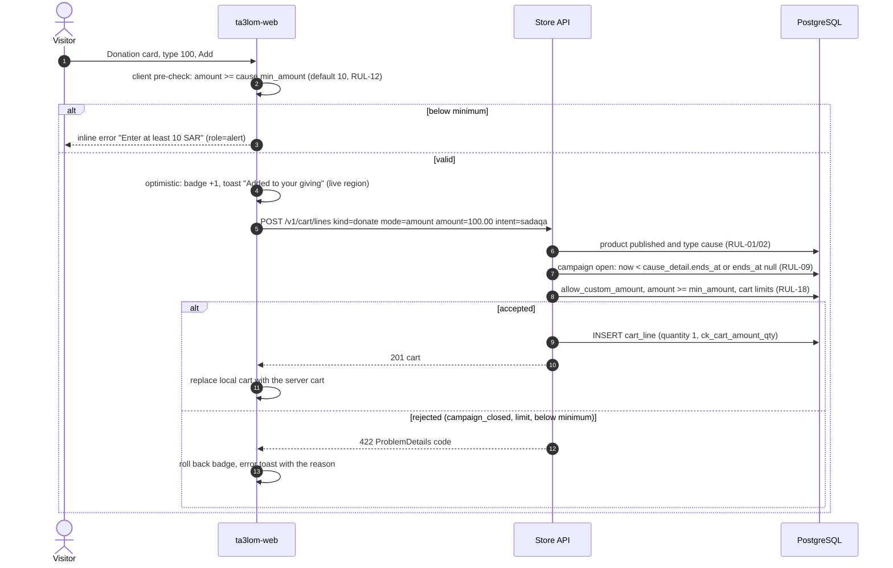

**Notes**

- Quick give always creates `intent = sadaqa`. To give zakat, the donor opens the product page, where
  the sadaqa/zakat selector is shown for zakat-eligible causes (RUL-19).
- The quick-give field is shown only when the cause allows custom amounts. A cause with
  `allow_custom_amount = false` shows a "Give" link to its product page instead.
- The line is paid through the normal checkout (flow e). On settlement:
  - `goal_progress.raised_amount += 100` and `donor_count += 1`;
  - `order_line.fulfilment_status = received` (RUL-40);
  - the gift appears in the public feed, anonymised if the order is anonymous (RUL-23).

---

## e. Checkout → hosted payment → webhook settlement → outbox

This is the most important flow. It has three parts: e.1 order creation and hand-off, e.2 the
webhook and settlement, and e.3 failure, retry, expiry and reconciliation. The outbox dispatch is e.4.

### e.1 Order creation and hand-off

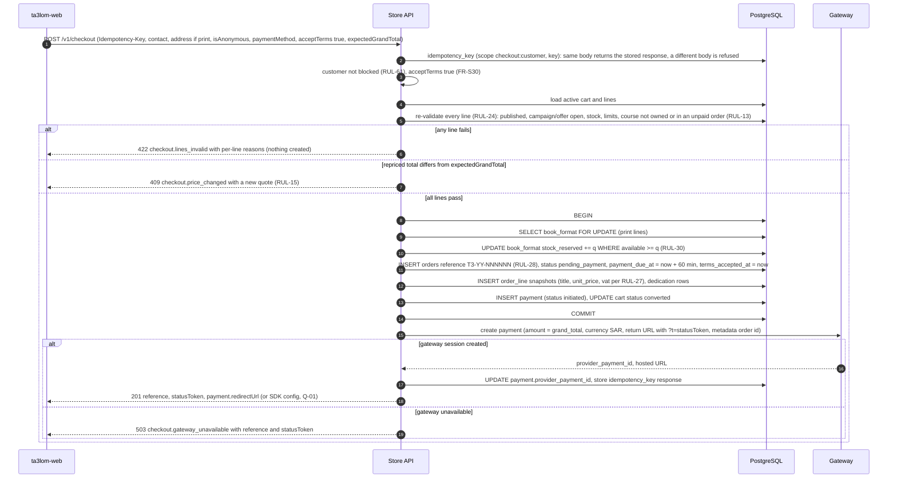

- **Gateway call outside the transaction.** It is not wrapped in the database transaction. If it fails,
  the order stays `pending_payment` with an `initiated` payment and no `provider_payment_id`. The API
  returns `503 checkout.gateway_unavailable`, the client can retry through
  `POST /v1/orders/{ref}/retry-payment`, and the expiry job releases stock at `payment_due_at`.
- **Status token.** `statusToken` is an HMAC of the order id. `GET /v1/orders/{ref}/status` accepts the
  customer's bearer **or** `?t={statusToken}`, and never the reference alone.
- **Totals.** `grand_total = purchases_total + shipping_total + gifts_total`, enforced by
  `ck_order_total` (RUL-31).

### e.2 Webhook and settlement

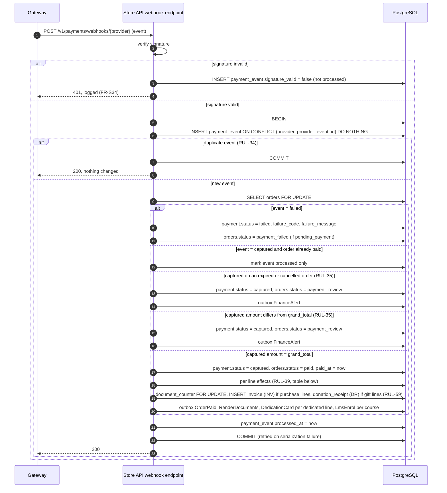

| Line | Effect in the settlement transaction (RUL-39) | `order_line.fulfilment_status` |
|---|---|---|
| `buy` course | INSERT `enrolment` (source `purchase`), guarded by `ux_enrolment_live`. If one already exists (RUL-13 race): no second enrolment, line marked for refund, `FinanceAlert` | `enrolled` (or `pending_sync` after an LMS failure) |
| `buy` digital | INSERT `download_grant` (`max_downloads` = `download_limit`) | `available` |
| `buy` print | `stock_on_hand -= q`, `stock_reserved -= q`, `stock_movement` (reason `sale`), UPSERT `shipment` (`preparing`) | `preparing` |
| `sponsor` units | N × `sponsored_unit` (source `full`, `awaiting_allocation`) + events | `funded` |
| `sponsor` amount | `pool_contribution` + pooling (flow c) | `funded` |
| `donate` | nothing per unit (RUL-53) | `received` |
| any gift | `goal_progress` (raised, funded units, donor count), `zakat_ledger` (`in`) for zakat intent | — |

### e.3 Failure, retry, expiry and reconciliation

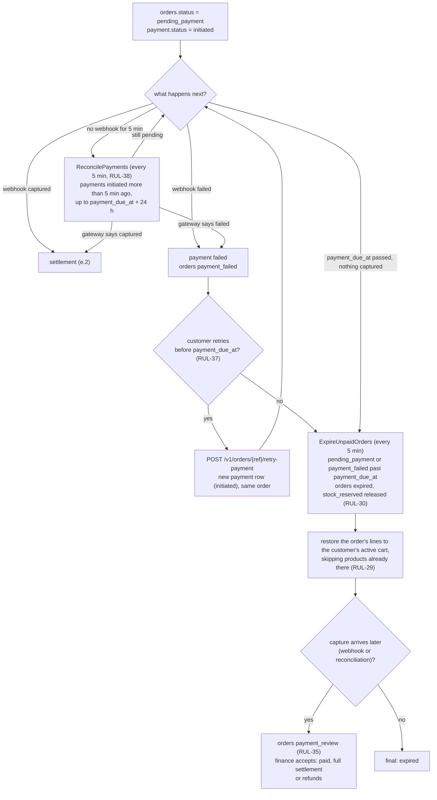

- **Proof of payment.** The browser's return URL plays no part in this flow (RUL-33). The thank-you
  page polls `GET /v1/orders/{ref}/status` with the bearer or the status token (see 10-frontend §9).
- **Browser closed after paying.** The order still becomes `paid` within about 10 minutes, through
  reconciliation, even if every webhook is lost (RUL-38).
- **Cart restore.** When the order expires, its lines are restored to the customer's active cart, and
  a product already in the cart is not duplicated (RUL-29). The status response then carries
  `cartRestored: true`, and the web client reloads its cart (10-frontend §6.1). An order that finance
  later accepts from `payment_review` is settled normally. What happens to its restored lines is
  open point 12.
- **Staff cancellation.** Staff (`staff:finance`) can cancel from `pending_payment` or
  `payment_failed` (RUL-29). This releases reserved stock in the same transaction. A capture that
  arrives after cancellation also goes to `payment_review` (RUL-35).

### e.4 Outbox dispatch

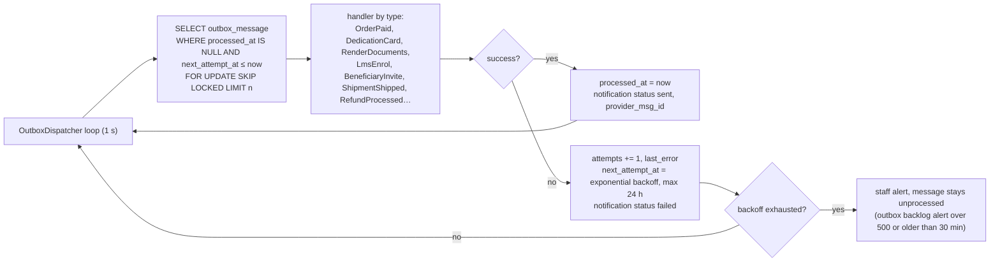

- **Recording.** Every SMS and email is recorded in `notification`, linked to the order through
  `related_order_id` (FR-S80).
- **At-least-once delivery.** Handlers must be idempotent.
  - `notification.outbox_message_id` with the unique index `ux_notification_once (outbox_message_id,
    channel, recipient)` stops a retried message from sending the same SMS or email twice.
  - `DedicationCard` also checks `dedication.sms_status`. `RenderDocuments` checks for an existing
    `pdf_asset_id`.
- **Not in the outbox.** The OTP SMS is sent directly (RUL-63, flow l).

---

## f. Order state machine

These are the exact `orders.status` values from the DDL CHECK constraint, with the transitions that
RUL-29 and RUL-35 allow.

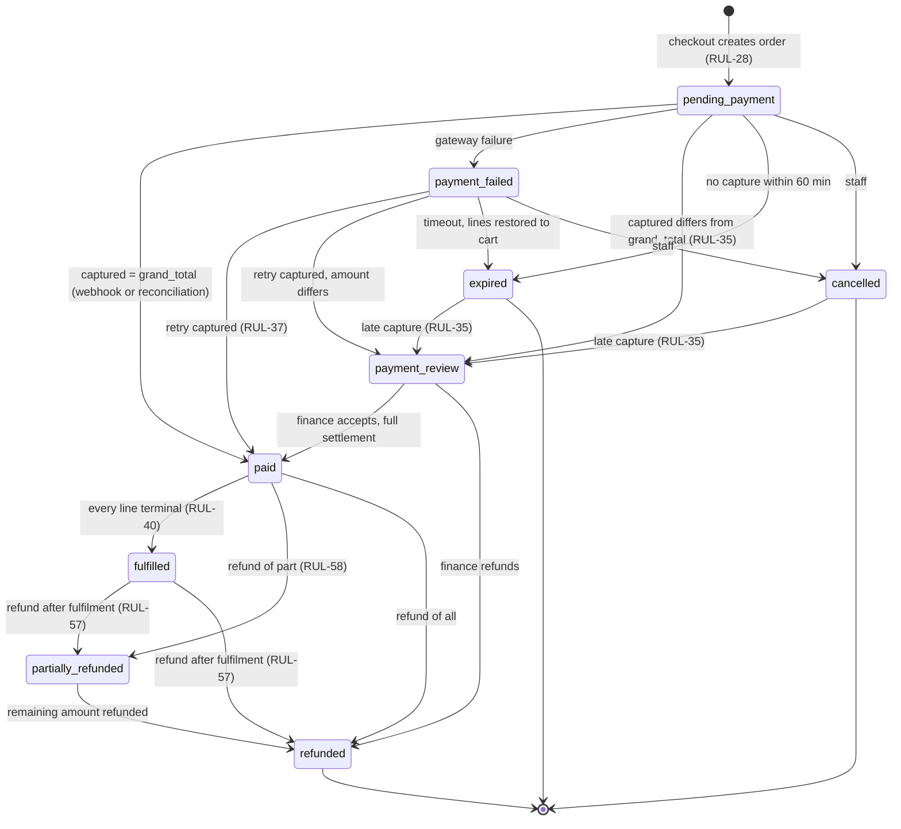

| State | Set by | Side effects |
|---|---|---|
| `pending_payment` | `POST /v1/checkout` | Stock is reserved. `payment_due_at` = `placed_at` + `order_payment_timeout_min`. `terms_accepted_at` is set |
| `paid` | Settlement tx, or finance accepting a `payment_review` | RUL-39 effects, documents, outbox |
| `payment_failed` | Webhook or reconciliation | Stock stays reserved until `payment_due_at` |
| `payment_review` | Settlement tx, when the amount does not match or the capture lands on an `expired`/`cancelled` order | Nothing is fulfilled. `FinanceAlert` is sent. Finance resolves it with `POST /v1/admin/orders/{ref}/payment-review/resolve` |
| `expired` | `ExpireUnpaidOrders` | Stock is released. The lines go back to the active cart, skipping products already there (RUL-29) |
| `cancelled` | Staff (`cancelled_at`) | Stock is released. The change is audited |
| `fulfilled` | Fulfilment events (enrolment, delivery, …) | `fulfilled_at` |
| `partially_refunded` / `refunded` | Refund success (flow j), also from `fulfilled` | `refunded_total`, RUL-58 reversals |

---

## g. Sponsored unit lifecycle

These are the exact `sponsored_unit.status` values. Every transition writes a `sponsored_unit_event`
row (`from_status`, `to_status`, `at`, `actor`). Sponsors see the status, group and region only. They
never see who the beneficiary is (RUL-50, PDPL).

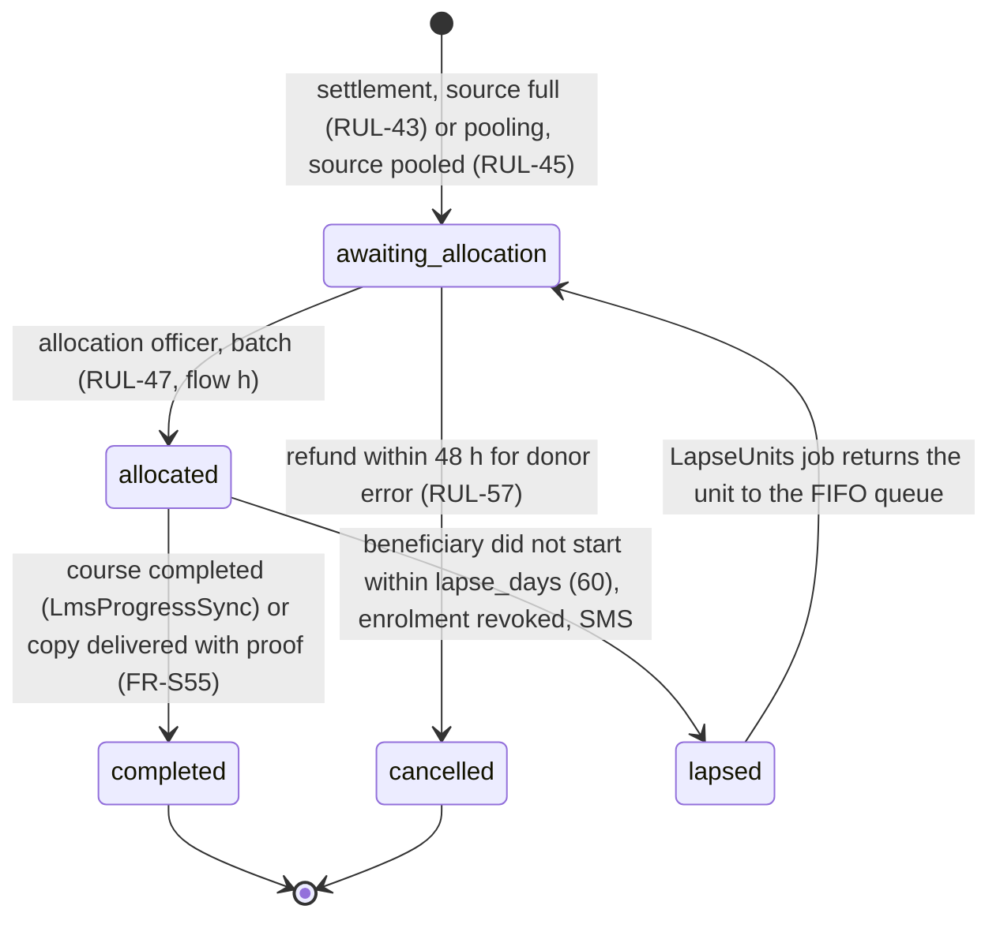

| Transition | Trigger | Data |
|---|---|---|
| → `awaiting_allocation` | Settlement | `funded_at` (drives FIFO, RUL-48), `has_zakat` (always false in S1, because offers are not zakat-eligible until S2) |
| → `allocated` | `POST /v1/admin/allocation/products/{productId}/allocate` | `beneficiary_id`, `allocation_batch_id`, `allocated_at`, `allocated_by`. Creates an `enrolment` (source `sponsored`, owned by the beneficiary's `customer`, flow h) or a `distribution` |
| → `completed` | `LmsProgressSync` (hourly) sees the course completed, or a staff member marks a book copy delivered with `distribution.proof_asset_id` (`POST /v1/admin/units/{unitId}/complete`) | `completed_at` |
| → `lapsed` | `LapseUnits` job, 02:00 Riyadh: allocated units whose enrolment has no `started_at` after `lapse_days` | `lapsed_at`. The beneficiary's `enrolment.status` becomes `revoked`, and a short SMS is sent (RUL-50) |
| `lapsed` → `awaiting_allocation` | Same job run | `beneficiary_id` is cleared. The same person may be allocated again later (RUL-50). Whether the unit keeps its original `funded_at` is open point 4 |
| → `cancelled` | Refund success (flow j) | `refund_line.units` |

Alerts (RUL-49):

- `AllocationAlerts`, 07:00 Riyadh, raises a staff alert for units in `awaiting_allocation` for more
  than 30 days (`allocation_alert_days`), and escalates at 90 days (`allocation_escalate_days`).
- Sponsors see status changes in their account straight away. The email summary is monthly, from the
  `SponsorDigest` job (RUL-63).

---

## h. Allocation by the allocation officer

Only staff who explicitly hold `allocation_officer` can allocate (`staff:allocate`). The `admin` role
does not grant it (RUL-62, segregation of duties).

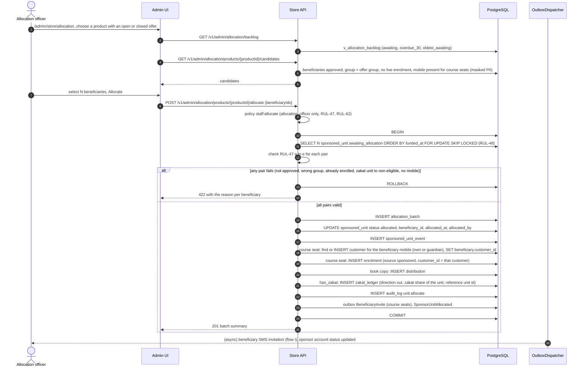

**Notes**

- **Concurrency.** `FOR UPDATE SKIP LOCKED` lets two officers work on the same product without
  taking the same units.
- **PII access.** Revealing a beneficiary's decrypted name or mobile is a separate audited action
  (`POST /v1/admin/beneficiaries/{id}/reveal`, `staff:reveal-pii`, which is `allocation_officer` only).
  Allocation itself works on codes (`B-000123`), group and region.
- **Customer row at allocation (RUL-47, RUL-52).** The customer is found or created at this step, so
  the enrolment has an owner before the beneficiary ever signs in. That customer row carries only the
  mobile until the beneficiary completes their profile.
- **Zakat pairing (RUL-47d).** It only matters from S2. In S1 no sponsored unit carries zakat, because
  offers are not zakat-eligible and pools hold no zakat (RUL-20, RUL-46). The batch is all-or-nothing
  as drawn. Partial success is open point 5.

---

## i. Beneficiary invitation and first login

When a course seat is allocated, the beneficiary's `customer` row and enrolment already exist
(flow h). The invitation SMS points them to the store. Their first OTP login simply signs them in,
and the sponsored course is already under "My courses" (RUL-52, FR-S54).

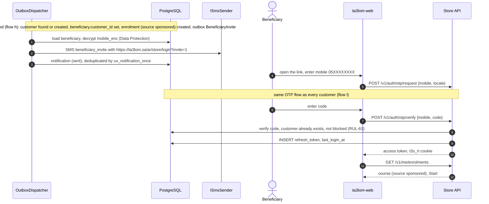

**Notes**

- **Mobile.** Every course seat has a mobile, either the beneficiary's own or a guardian's for a minor
  (RUL-47e). A seat cannot be allocated without one. Book copies go to organisations and need no
  invitation.
- **Resending.** Staff can resend the invitation with `POST /v1/admin/beneficiaries/{id}/invite`.
- **Donor privacy.** A beneficiary who is also a donor keeps one account. Donors never see beneficiary
  identities (RUL-50).

---

## j. Refund decision

Only staff who explicitly hold `finance` can refund (`staff:refund`), and only through the gateway's
refund API (RUL-56). The `admin` role does not grant it (RUL-62). The system checks each line against
RUL-57 and shows why a line is not refundable (`GET /v1/admin/orders/{ref}/refund-eligibility`,
FR-S64). Database effects are applied only after the gateway confirms. Refunds are allowed from
`paid`, `fulfilled` and `partially_refunded` (RUL-29).

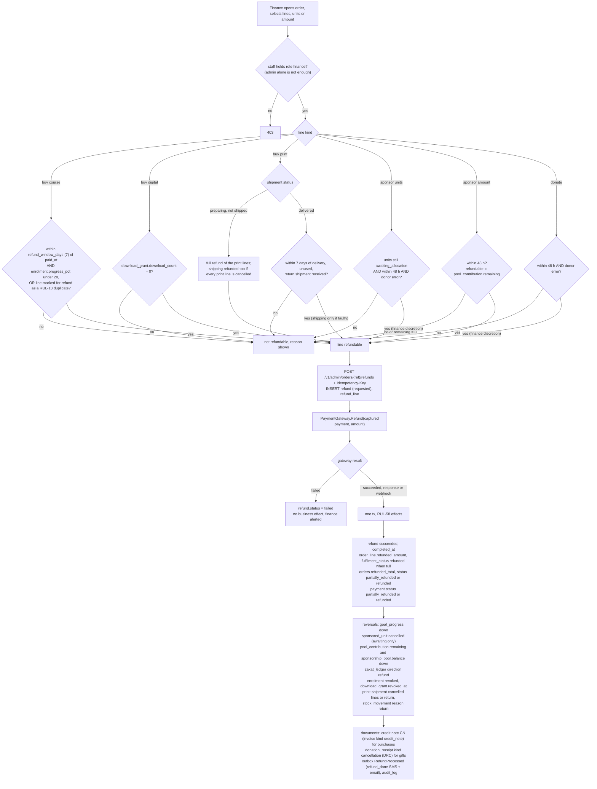

**Notes**

- **Windows and thresholds.** These are settings: `refund_window_days`, `refund_progress_max_pct` and
  `gift_refund_window_hours` (RUL §M). The course window is counted from purchase (`orders.paid_at`).
- **Pool contributions.** Only the unconverted part can be refunded. In the flow c example, C can get
  back at most 20.00 within 48 hours. A and B get nothing back, because their money is already in unit
  U1.
- **Double submission.** The Idempotency-Key (stored in `idempotency_key`, scope `refund:{staffId}`)
  and the `refund` row prevent a second gateway refund.
- **Refunding a `payment_review` order.** This uses the same gateway refund, and the order moves
  `payment_review → refunded`.

---

## k. Campaign end and pool sweep

A campaign stops accepting new lines at `ends_at`, Asia/Riyadh time (RUL-09). This is checked on every
add and at checkout. The nightly job handles the pool remainder (RUL-46). The sweep is recorded as a
**`goal_adjustment` pair**, so that both products' goal counters still match integrity check 6.

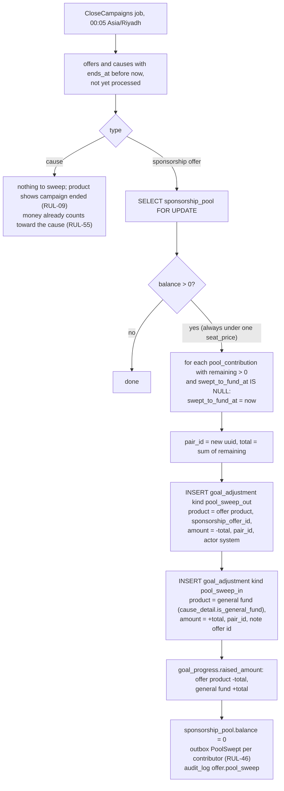

In the flow c example, C's remaining 20.00 is swept. The job writes `pool_sweep_out` (−20.00) on the
course and `pool_sweep_in` (+20.00) on the education fund, linked by one `pair_id`. C's "My giving" line
then reads: "20 SAR of your share moved to the Education support fund when the campaign ended."

- **Invariants.**
  - `sponsorship_pool.balance` = Σ `remaining` of unswept contributions (check 4).
  - `goal_progress.raised_amount` = paid gift lines − refunds + Σ `goal_adjustment.amount` (check 6).
    This holds for both products.
  - A pair always sums to 0.
- **Zakat.** Zakat is never swept to the general fund. In S1 pools hold no zakat, because offers are
  not zakat-eligible until S2 (RUL-20, RUL-46).
- **Early close.** An admin can extend `ends_at` before 00:05 to prevent the sweep (RUL-09).
  `POST /v1/admin/offers/{offerId}/close` closes an offer early and runs the same sweep. With
  `close_on_target`, sales stop when the target is reached (RUL-10). The sweep itself runs only when
  the offer is closed.
- **Lines already in carts.** They are rejected at checkout with `line.campaign_closed` (RUL-24).
- **Manual corrections.** Finance can post `correction` adjustments with
  `POST /v1/admin/products/{id}/goal-adjustments`. These are audited.

---

## l. OTP sign-in with rate limits

Customers sign in with a mobile number and a 6-digit SMS code (RUL-60). The response to a code request
is the same whether or not an account exists. The OTP SMS is the one message that bypasses the outbox.
It is sent directly within the request, so the plain code is never stored anywhere (RUL-63).

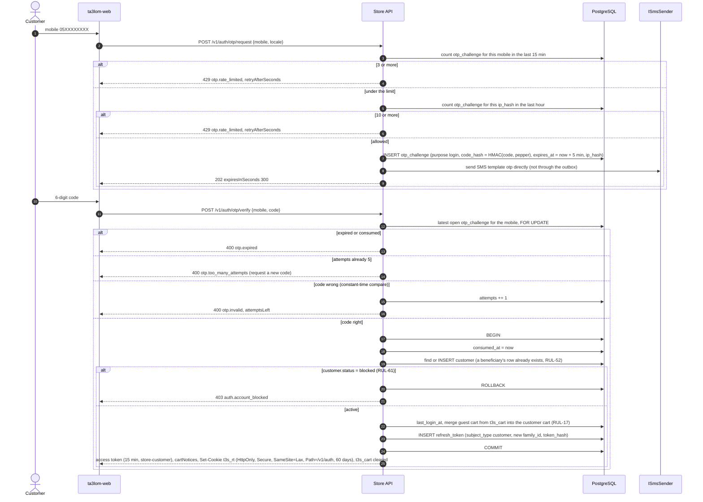

**Merge on sign-in (RUL-17).**

- Guest lines move into the customer's active cart, and the guest `cart` becomes `merged`.
- Identical undedicated `units` lines merge (RUL-14).
- A `buy` course line for a course the customer already owns is dropped and reported as a
  `cartNotices` entry.

**Later sessions.** `POST /v1/auth/refresh` rotates the refresh token (`replaced_by`). Presenting a
revoked token again revokes the whole family (`auth.refresh_reused`). Staff use the same pattern
under `/v1/admin/auth/*`, with the cookie `t3s_srt` (`Path=/v1/admin/auth`, 8 h) and a mandatory TOTP
step.

---

## m. Digital download (signed URL + watermark)

A buyer downloads their digital book from "My books" (RUL-41, FR-S41).

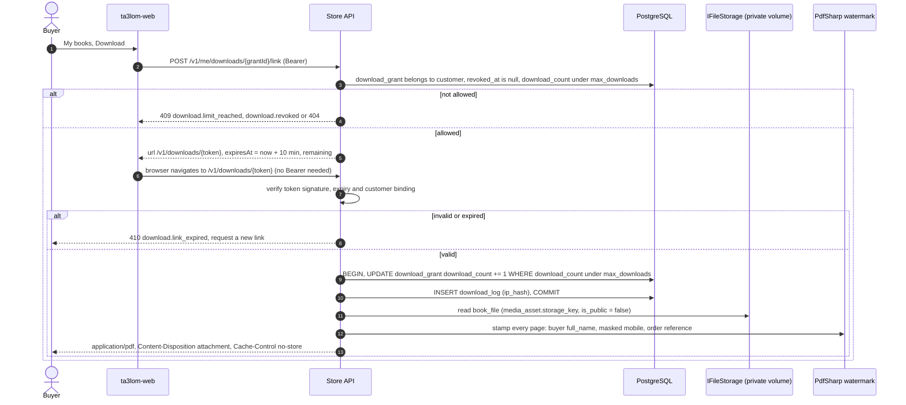

- **Staff reset.** Staff can reset the counter with `POST /v1/admin/download-grants/{id}/reset`
  (FR-S41). The reset is audited.
- **Refunds.** A refunded grant (`revoked_at`) cannot issue new links. A digital book is refundable
  only while `download_count = 0` (RUL-57).
- **Private files.** Book files are never served from the public volume (`ck_media_private_book`).

---

## n. Print shipment lifecycle

These are the exact `shipment.status` values. The print `order_line.fulfilment_status` follows the
shipment. The order is `fulfilled` only once every print line is `delivered` (RUL-40).

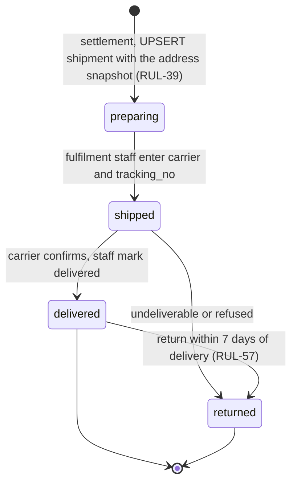

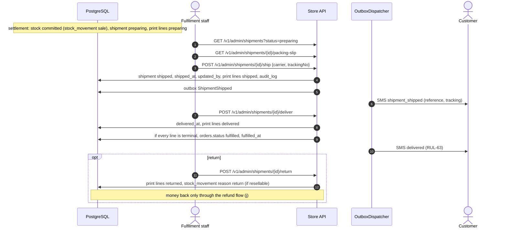

- **One shipment per order.** `shipment.order_id` is unique, so all print lines of an order travel
  together.
- **Refund before shipping.** A refund while the shipment is still `preparing` is a full refund. The
  shipping fee is refunded too when every print line is cancelled (RUL-57). The reserved or committed
  stock is returned with a `stock_movement`.
- **Shipping fee.** It is a flat fee per order (RUL-26). After delivery it is refunded only if the
  goods were faulty (RUL-57).
- **Low stock.** `LowStockAlert` (daily, 08:00) warns staff when a print format's available stock
  falls to or below `book_format.low_stock_threshold`, or to the default setting when that is null.
- **Carrier and handling.** These depend on Q-06.

---

## Open points

1. **Dedication sender fallback.** Still open. When no sender name is typed and the order is not
   anonymous, the card could show the order's contact name or the prototype's "محبّ". RUL-22/23 do
   not say which.
2. **Capture after expiry.** Resolved — RUL-35, RUL-29. The order goes to `payment_review`, and
   finance accepts or refunds it.
3. **Refunds from `fulfilled`.** Resolved — RUL-29. `fulfilled → partially_refunded → refunded` is
   now allowed.
4. **Lapse effects.**
   - Enrolment: Resolved — RUL-50. The enrolment is revoked, an SMS is sent, and the person may be
     allocated again.
   - Still open: whether a re-queued unit keeps its original `funded_at` for FIFO (proposal: yes).
5. **Allocation pairing and batch outcome.**
   - Zakat pairing: Resolved for S1 — RUL-20/46. No sponsored unit carries zakat in S1. The pairing
     rule is needed in S2.
   - Still open: whether a batch with some invalid beneficiaries fails as a whole (as drawn) or
     partially succeeds.
6. **Enrolment before the beneficiary has an account.** Resolved — RUL-47, RUL-52. The customer is
   found or created at allocation, and the first login simply signs in.
7. **Pool sweep accounting and zakat.** Resolved — RUL-46, RUL-20. The sweep is recorded as a
   `goal_adjustment` pair, integrity check 6 includes adjustments, and there is no zakat in pools in
   S1.
8. **Missing templates and mobiles.**
   - Mobiles: Resolved — RUL-47e. A course seat requires a mobile (own or guardian's). Book copies need
     no invitation.
   - Still open: RUL-63 lists a "delivered" SMS, but only `shipment_shipped` is seeded, and the lapse
     SMS (RUL-50) has no seeded template either.
9. **Download counting.** Still open. The flow counts a download each time the signed link streams the
   file, so two streams from one 10-minute link count twice. Confirm, or count only when the link is
   issued.
10. **Order status during a retry.** Still open. RUL-29 does not say whether an order in
    `payment_failed` returns to `pending_payment` while a retry payment is `initiated`. The diagram
    keeps `payment_failed` until a capture or expiry.
11. **Enrolment status with an external LMS.** Still open (depends on Q-05). The enrolment could be
    created `active` in the settlement transaction and set to `pending_sync` only if the LMS call
    fails (as drawn), or it could stay `pending_sync` until the LMS confirms.
12. **Restored lines when `payment_review` is later accepted.** New. The expired order's lines are
    already back in the cart when finance accepts the late capture and the order becomes `paid`. The
    customer could then pay twice for the same items (for a course, RUL-13 blocks this at checkout).
    Proposal: removing the restored lines at acceptance, or at least warning the customer, has to be
    decided.
