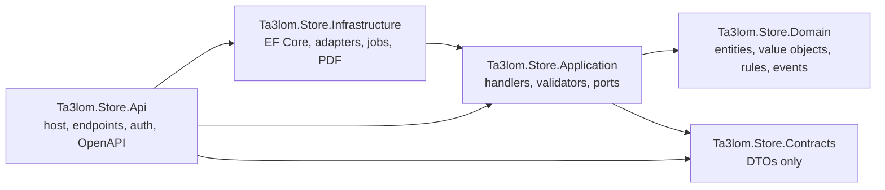
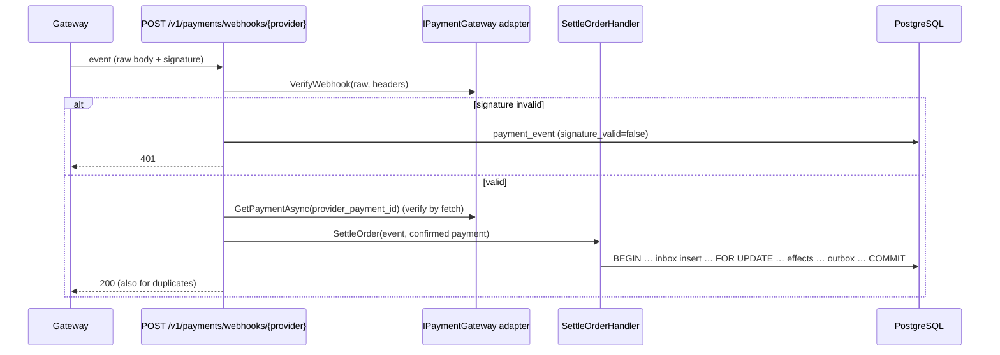
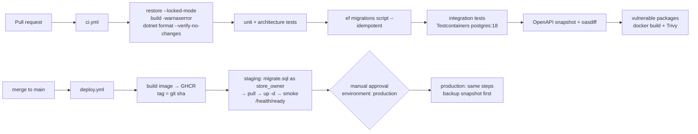

# 09 — Backend Implementation Guide (.NET)

**Revision:** S1 draft r1 · 29 September 2026 (reconciled with the canonical changes after round 1)

Implementation guide for the new repository `repos/ta3lom-store-api`: an ASP.NET Core **.NET 10 LTS**
(C# 14) modular monolith exposing Minimal APIs at `https://store-api.ta3lom.sa/v1`, backed by
PostgreSQL 18 (schema `store`). It turns the rules in [03-business-rules.md](03-business-rules.md)
(RUL-01…RUL-63) and the requirements in [04-functional-requirements.md](04-functional-requirements.md)
(FR-S01…FR-S83) into code, on top of the schema in
[`database/store/001_store_schema.sql`](../../database/store/001_store_schema.sql) and the
transactions in [database/01 §4](database/01-database-design.md#4-how-the-model-implements-the-rules).
The HTTP surface is specified in [11-api-contract.md](11-api-contract.md).

When this document and 03 disagree, 03 wins. When this document and the DDL disagree on a name,
the DDL wins.

---

## Contents

1. [Repository layout](#1-repository-layout)
2. [Layers and dependency rules](#2-layers-and-dependency-rules)
3. [Application patterns](#3-application-patterns)
4. [Modules](#4-modules)
5. [Code sketches](#5-code-sketches)
6. [Background jobs](#6-background-jobs-quartznet)
7. [Configuration and secrets](#7-configuration-and-secrets)
8. [Logging, telemetry, health](#8-logging-telemetry-health)
9. [PDF documents](#9-pdf-documents)
10. [Testing strategy](#10-testing-strategy)
11. [Local development, container, CI/CD](#11-local-development-container-cicd)
12. [Repository CLAUDE.md — non-negotiables](#12-repository-claudemd--non-negotiables)
13. [Open points](#13-open-points)

---

## 1. Repository layout

```
ta3lom-store-api/
├── CLAUDE.md                          # §12 — rules for humans and agents working in the repo
├── README.md                          # how to run, test, deploy (short; links here)
├── global.json                        # pins the .NET 10 SDK
├── Directory.Build.props              # shared MSBuild settings for every project
├── Directory.Packages.props           # central package management (versions live only here)
├── .editorconfig                      # style + analyzer severities
├── .gitattributes / .gitignore
├── Ta3lom.Store.slnx                  # XML solution format (.NET 10 default)
├── openapi/
│   └── v1.json                        # committed OpenAPI document, diffed in CI (§10.3)
├── src/
│   ├── Ta3lom.Store.Domain/
│   │   ├── Common/                    # Money, Entity, AggregateRoot, IDomainEvent, DomainException, Guard
│   │   ├── Catalog/                   # Product, CourseDetail, BookFormat, CauseDetail, SponsorshipOffer, GoalProgress …
│   │   ├── Cart/                      # Cart, CartLine, DedicationDraft, CartLimits
│   │   ├── Ordering/                  # Order, OrderLine, Dedication, OrderReference, VatCalculator, OrderStatus
│   │   ├── Payments/                  # Payment, PaymentEvent, Refund, RefundLine, RefundPolicy
│   │   ├── Fulfilment/                # Enrolment, DownloadGrant, Shipment, StockMovement
│   │   ├── Giving/                    # SponsoredUnit, SponsorshipPool, PoolContribution, UnitFunding,
│   │   │                              # Beneficiary, AllocationBatch, Distribution, ZakatLedgerEntry, CauseUpdate
│   │   ├── Identity/                  # Customer, CustomerAddress, OtpChallenge, StaffUser, RefreshToken, StaffRole
│   │   ├── Documents/                 # Invoice, DonationReceipt, DocumentSeries, DocumentNumber
│   │   ├── Notifications/             # OutboxMessage, MessageTemplate, Notification
│   │   └── Settings/                  # StoreSettings (typed view of `setting`)
│   ├── Ta3lom.Store.Application/
│   │   ├── Abstractions/              # ICommandHandler, IQueryHandler, Result, Error, IUnitOfWork, IClock,
│   │   │                              # IPaymentGateway, ISmsSender, IEmailSender, ILmsGateway, IFileStorage,
│   │   │                              # IPdfRenderer, IEInvoicingGateway, ICurrentActor, ISettingsProvider
│   │   ├── Catalog/  Cart/  Checkout/  Payments/  Fulfilment/  Giving/
│   │   ├── Identity/  Documents/  Notifications/  Admin/  Reporting/  Settings/
│   │   │   └── <UseCase>/             # one folder per use case: Command, Handler, Validator
│   │   └── DependencyInjection.cs     # Scrutor scan of handlers and validators
│   ├── Ta3lom.Store.Infrastructure/
│   │   ├── Persistence/
│   │   │   ├── StoreDbContext.cs
│   │   │   ├── Configurations/        # one IEntityTypeConfiguration<T> per table
│   │   │   ├── Converters/            # SnakeCaseEnumConverter, ProtectedStringConverter
│   │   │   ├── Interceptors/          # AuditSaveChangesInterceptor, OutboxSaveChangesInterceptor
│   │   │   ├── Locks/                 # RowLocks (FOR UPDATE helpers), DocumentNumberAllocator
│   │   │   ├── Migrations/
│   │   │   └── Seed/                  # SeedRunner (settings, templates, counters)
│   │   ├── Payments/                  # MoyasarGateway, FakePaymentGateway (dev/test), WebhookVerifier
│   │   ├── Messaging/                 # OutboxDispatcher, outbox handlers, UnifonicSmsSender, SmtpEmailSender, ScribanRenderer
│   │   ├── Lms/                       # InternalAccessLmsGateway (default until Q-05)
│   │   ├── Documents/                 # QuestPDF documents, ZatcaQr, PdfSharpWatermarker
│   │   ├── Storage/                   # LocalFileStorage (/srv/store/files/{public,private})
│   │   ├── Jobs/                      # Quartz jobs (§6)
│   │   ├── Security/                  # JwtIssuer, RefreshTokenService, OtpHasher, PiiProtector
│   │   └── DependencyInjection.cs
│   ├── Ta3lom.Store.Contracts/        # request/response records only; no logic; source for OpenAPI → TS
│   │   ├── Catalog/  Cart/  Checkout/  Me/  Admin/ …
│   │   └── Common/                    # PagedResponse<T>, MoneyString converter, ErrorCodes (constants)
│   └── Ta3lom.Store.Api/
│       ├── Program.cs
│       ├── Endpoints/                 # one static class per module: MapCatalogEndpoints(), MapAdminOrderEndpoints() …
│       ├── Auth/                      # schemes, policies (StorePolicies), cookie helpers
│       ├── Http/                      # ProblemDetails mapping, IdempotencyFilter, OriginCheckFilter, rate limiter policies
│       ├── OpenApi/                   # document transformers (money as string, error codes, security schemes)
│       ├── Cli/                       # `create-admin` command (database/03 §3)
│       └── appsettings*.json
├── tests/
│   ├── Ta3lom.Store.Domain.Tests/             # xUnit v3, pure, one test class per aggregate; [Rule("RUL-nn")]
│   ├── Ta3lom.Store.Application.Tests/        # xUnit v3, handlers with fakes
│   ├── Ta3lom.Store.Api.IntegrationTests/     # WebApplicationFactory + Testcontainers postgres:18
│   │   └── Fixtures/webhooks/                 # captured sandbox payloads for replay tests
│   └── Ta3lom.Store.ArchitectureTests/        # NetArchTest + RUL coverage test
├── tools/
│   ├── fake-data/                     # console app: fake customers/orders for local and load tests
│   ├── k6/                            # load scripts (§10.6)
│   └── scripts/                       # migrate.sh, backup-restore-drill.sh, regenerate-schema-sql.sh
├── deploy/
│   ├── Dockerfile
│   ├── compose.yml                    # prod/staging: caddy, store-api, postgres, backup
│   ├── compose.dev.yml                # local: postgres, mailpit, fake SMS sink
│   ├── Caddyfile
│   └── env/                           # *.env.example only; real values live on the VPS
└── .github/workflows/
    ├── ci.yml                         # PR: build, test, OpenAPI diff, image build (no push)
    └── deploy.yml                     # main/tag: image → GHCR → migrate → swap (staging, then prod)
```

### 1.1 Root files

`global.json`

```json
{
  "sdk": { "version": "10.0.100", "rollForward": "latestPatch", "allowPrerelease": false }
}
```

`Directory.Build.props`

```xml
<Project>
  <PropertyGroup>
    <TargetFramework>net10.0</TargetFramework>
    <LangVersion>14</LangVersion>
    <Nullable>enable</Nullable>
    <ImplicitUsings>enable</ImplicitUsings>
    <TreatWarningsAsErrors>true</TreatWarningsAsErrors>
    <AnalysisLevel>latest-recommended</AnalysisLevel>
    <EnforceCodeStyleInBuild>true</EnforceCodeStyleInBuild>
    <InvariantGlobalization>false</InvariantGlobalization>   <!-- Arabic culture formatting in PDFs -->
    <ManagePackageVersionsCentrally>true</ManagePackageVersionsCentrally>
    <Deterministic>true</Deterministic>
  </PropertyGroup>
</Project>
```

`Directory.Packages.props` (versions indicative; Renovate/Dependabot keeps them current)

```xml
<Project>
  <ItemGroup>
    <!-- Persistence -->
    <PackageVersion Include="Microsoft.EntityFrameworkCore" Version="10.0.0" />
    <PackageVersion Include="Microsoft.EntityFrameworkCore.Design" Version="10.0.0" />
    <PackageVersion Include="Npgsql.EntityFrameworkCore.PostgreSQL" Version="10.0.0" />
    <PackageVersion Include="EFCore.NamingConventions" Version="10.0.0" />
    <!-- Application -->
    <PackageVersion Include="FluentValidation" Version="12.0.0" />
    <PackageVersion Include="FluentValidation.DependencyInjectionExtensions" Version="12.0.0" />
    <PackageVersion Include="Scrutor" Version="6.1.0" />
    <!-- Api -->
    <PackageVersion Include="Microsoft.AspNetCore.OpenApi" Version="10.0.0" />
    <PackageVersion Include="Microsoft.Extensions.ApiDescription.Server" Version="10.0.0" />
    <PackageVersion Include="Scalar.AspNetCore" Version="2.8.0" />
    <PackageVersion Include="Microsoft.AspNetCore.Authentication.JwtBearer" Version="10.0.0" />
    <!-- Infrastructure -->
    <PackageVersion Include="Quartz.Extensions.Hosting" Version="3.15.0" />
    <PackageVersion Include="QuestPDF" Version="2025.7.0" />
    <PackageVersion Include="PdfSharp" Version="6.2.0" />
    <PackageVersion Include="QRCoder" Version="1.6.0" />
    <PackageVersion Include="Scriban" Version="6.2.0" />
    <PackageVersion Include="Otp.NET" Version="1.4.0" />
    <PackageVersion Include="Microsoft.Extensions.Http.Resilience" Version="10.0.0" />
    <PackageVersion Include="Serilog.AspNetCore" Version="9.0.0" />
    <PackageVersion Include="OpenTelemetry.Extensions.Hosting" Version="1.12.0" />
    <PackageVersion Include="OpenTelemetry.Instrumentation.AspNetCore" Version="1.12.0" />
    <PackageVersion Include="OpenTelemetry.Instrumentation.Http" Version="1.12.0" />
    <PackageVersion Include="Npgsql.OpenTelemetry" Version="10.0.0" />
    <PackageVersion Include="OpenTelemetry.Exporter.OpenTelemetryProtocol" Version="1.12.0" />
    <PackageVersion Include="AspNetCore.HealthChecks.NpgSql" Version="9.0.0" />
    <!-- Tests -->
    <PackageVersion Include="xunit.v3" Version="3.0.0" />
    <PackageVersion Include="Microsoft.AspNetCore.Mvc.Testing" Version="10.0.0" />
    <PackageVersion Include="Testcontainers.PostgreSql" Version="4.6.0" />
    <PackageVersion Include="Respawn" Version="6.2.1" />
    <PackageVersion Include="NetArchTest.Rules" Version="1.3.2" />
    <PackageVersion Include="Shouldly" Version="4.3.0" />
    <PackageVersion Include="NSubstitute" Version="5.3.0" />
  </ItemGroup>
</Project>
```

No MediatR, no AutoMapper, no FluentAssertions (commercial licences since 2025). `QRCoder` is the
only package not in the fixed library list; it draws the ZATCA QR (§9.3) and must be approved
before it is added (ta3lom convention: ask before adding a dependency).

`.editorconfig` (excerpt)

```ini
root = true
[*.cs]
indent_style = space
indent_size = 4
csharp_style_namespace_declarations = file_scoped:error
csharp_style_var_elsewhere = true:suggestion
dotnet_style_require_accessibility_modifiers = always:error
dotnet_diagnostic.CA2007.severity = none          # no ConfigureAwait in ASP.NET Core
dotnet_diagnostic.CA1848.severity = warning       # LoggerMessage source generators
dotnet_diagnostic.CA2016.severity = error         # forward CancellationToken
dotnet_diagnostic.CA1305.severity = error         # explicit culture (money and dates)
# Banned APIs (Microsoft.CodeAnalysis.BannedApiAnalyzers, BannedSymbols.txt):
#   T:System.Double / T:System.Single in Domain and Contracts money members
#   M:Microsoft.EntityFrameworkCore.RelationalDatabaseFacadeExtensions.Migrate(...)
#   M:System.DateTime.get_Now, M:System.DateTimeOffset.get_UtcNow  (use IClock)
```

`BannedSymbols.txt` sits next to each `src` project; `Database.Migrate`, `DateTime.Now` and
`DateTimeOffset.UtcNow` fail the build outside tests.

---

## 2. Layers and dependency rules



| Project | May reference | Must not reference |
|---|---|---|
| `Domain` | BCL only | anything else, including EF Core attributes, `Microsoft.Extensions.*`, `Contracts` |
| `Contracts` | BCL only | `Domain` (DTOs are not entities) |
| `Application` | `Domain`, `Contracts`, FluentValidation, `Microsoft.Extensions.Logging.Abstractions` | EF Core, Npgsql, ASP.NET Core, any adapter SDK |
| `Infrastructure` | `Application`, `Domain`, EF Core, Npgsql, Quartz, QuestPDF, PdfSharp, Scriban, HTTP resilience | `Api` |
| `Api` | all of the above | — (composition root) |

Module isolation inside a layer: a module reaches another module only through an application
interface (for example `Checkout` calls `ICatalogPricing`, not `Catalog` internals) or through a
domain event handled in the same transaction (settlement), never by reading another module's
`DbSet` in a handler. Shared kernel = `Domain/Common` and `Application/Abstractions`.

**Enforced by `Ta3lom.Store.ArchitectureTests`** (NetArchTest):

```csharp
public sealed class LayerTests
{
    private static readonly Assembly Domain = typeof(Money).Assembly;
    private static readonly Assembly Application = typeof(ICommandHandler<,>).Assembly;
    private static readonly Assembly Contracts = typeof(Ta3lom.Store.Contracts.Common.PagedResponse<>).Assembly;

    [Fact]
    public void Domain_has_no_outward_dependencies() =>
        Types.InAssembly(Domain).ShouldNot()
            .HaveDependencyOnAny("Microsoft.EntityFrameworkCore", "Microsoft.AspNetCore", "Microsoft.Extensions",
                                 "Npgsql", "Ta3lom.Store.Application", "Ta3lom.Store.Infrastructure",
                                 "Ta3lom.Store.Contracts", "Ta3lom.Store.Api")
            .GetResult().IsSuccessful.ShouldBeTrue();

    [Fact]
    public void Application_does_not_know_EF_or_AspNet() =>
        Types.InAssembly(Application).ShouldNot()
            .HaveDependencyOnAny("Microsoft.EntityFrameworkCore", "Npgsql", "Microsoft.AspNetCore",
                                 "Ta3lom.Store.Infrastructure", "Ta3lom.Store.Api")
            .GetResult().IsSuccessful.ShouldBeTrue();

    [Fact]
    public void Contracts_are_pure_records() =>
        Types.InAssembly(Contracts).Should().BeSealed().And()
            .NotHaveDependencyOn("Ta3lom.Store.Domain")
            .GetResult().IsSuccessful.ShouldBeTrue();

    [Fact]
    public void Endpoints_do_not_touch_DbContext() =>
        Types.InNamespace("Ta3lom.Store.Api.Endpoints").ShouldNot()
            .HaveDependencyOn("Ta3lom.Store.Infrastructure.Persistence")
            .GetResult().IsSuccessful.ShouldBeTrue();

    [Fact]
    public void No_money_as_floating_point() =>   // every decimal-like member named *Price/*Amount/*Total is decimal or Money
        MoneyMemberScanner.FindFloatingPointMoney(Domain, Application, Contracts).ShouldBeEmpty();
}
```

A second architecture test, `RuleCoverageTests`, reads `Docs/store/03-business-rules.md` (copied
into the test output at build) and fails if any `RUL-nn` has no test carrying `[Rule("RUL-nn")]`
(§10.1).

---

## 3. Application patterns

### 3.1 Handlers (no MediatR)

```csharp
namespace Ta3lom.Store.Application.Abstractions;

public interface ICommand<TResult>;
public interface IQuery<TResult>;

public interface ICommandHandler<in TCommand, TResult> where TCommand : ICommand<TResult>
{
    Task<Result<TResult>> HandleAsync(TCommand command, CancellationToken ct);
}

public interface IQueryHandler<in TQuery, TResult> where TQuery : IQuery<TResult>
{
    Task<Result<TResult>> HandleAsync(TQuery query, CancellationToken ct);
}
```

Registration by Scrutor, plus a validation decorator and a logging decorator:

```csharp
services.Scan(s => s.FromAssemblyOf<ApplicationAssemblyMarker>()
    .AddClasses(c => c.AssignableTo(typeof(ICommandHandler<,>)), publicOnly: false)
        .AsImplementedInterfaces().WithScopedLifetime()
    .AddClasses(c => c.AssignableTo(typeof(IQueryHandler<,>)), publicOnly: false)
        .AsImplementedInterfaces().WithScopedLifetime());

services.Decorate(typeof(ICommandHandler<,>), typeof(ValidatingCommandHandler<,>));
services.Decorate(typeof(ICommandHandler<,>), typeof(LoggingCommandHandler<,>));
services.AddValidatorsFromAssemblyContaining<ApplicationAssemblyMarker>(includeInternalTypes: true);
```

Endpoints inject the concrete handler interface (`ICommandHandler<AddCartLine, CartDto>`) and do
three things only: bind, call, map the `Result` to HTTP (§5.14). No business logic in endpoints.

### 3.2 Result and errors

```csharp
public sealed record Error(string Code, string Message, ErrorKind Kind,
                           IReadOnlyDictionary<string, object?>? Extensions = null);

public enum ErrorKind { Validation, NotFound, Conflict, Forbidden, Unauthorized, RateLimited, Unprocessable, Gone }

public readonly record struct Result<T>
{
    public T? Value { get; }
    public Error? Error { get; }
    public bool IsSuccess => Error is null;
    private Result(T? value, Error? error) { Value = value; Error = error; }
    public static Result<T> Ok(T value) => new(value, null);
    public static Result<T> Fail(Error error) => new(default, error);
    public static implicit operator Result<T>(T value) => Ok(value);
    public static implicit operator Result<T>(Error error) => Fail(error);
}
```

Domain methods throw `DomainException(code)` only for invariant violations that indicate a bug or a
race (for example a unit already allocated). Expected business outcomes — "campaign ended",
"duplicate course" — are returned as `Error` values with a stable `code` from
`Contracts/Common/ErrorCodes.cs`. The code list is in [11 §1.6](11-api-contract.md#16-errors--problemdetails-rfc-9457).

### 3.3 Validation

Two levels, never mixed:

| Level | Where | Examples |
|---|---|---|
| Shape | FluentValidation validator per command (runs in the decorator) | mobile matches `^05[0-9]{8}$`, `quantity` 1–999, `toName` 2–60 chars, `customText` ≤ 140 |
| Rule | Domain method or domain service, with data loaded by the handler | RUL-12 mode allowed for kind, RUL-13 course already owned, RUL-18 cart ≤ 50 lines / 100,000 SAR, RUL-24 re-validation |

### 3.4 Unit of work, domain events, outbox

- `StoreDbContext` is the unit of work; one `SaveChangesAsync` per command.
- Aggregates raise `IDomainEvent`s (`OrderPaid`, `UnitAllocated` …). `OutboxSaveChangesInterceptor`
  converts every pending event into an `outbox_message` row **in the same transaction**
  (`type` = event name, `payload` = JSON). Nothing is published in-process after commit.
- Side effects that must be atomic with the business change (RUL-39) run inside the handler's
  transaction as explicit steps, not as event handlers — the settlement handler (§5.3) is the
  model.
- `AuditSaveChangesInterceptor` writes `audit_log` for changes made by a staff actor
  (`ICurrentActor.Kind == Staff`), with `diff` = changed properties (PII properties written as
  `"***"`), `actor` = staff email, `ip_hash` = HMAC of the client IP.

### 3.5 Time

`IClock` (`UtcNow`, `RiyadhToday`, `ToRiyadh(DateTimeOffset)`) everywhere; campaign dates are
entered in Asia/Riyadh and stored as UTC `timestamptz` (RUL-09). The order reference year
`YY` (RUL-28) and document year `YYYY` (RUL-59) use the Riyadh calendar year.

---

## 4. Modules

Each module lists: aggregates → tables, key domain methods → rules, handlers, validators and the
outbox messages it emits. Handler names are the class names in `Application/<Module>/<UseCase>/`.

### 4.1 Catalog

| Aggregate / entity | Table(s) | Notes |
|---|---|---|
| `Product` (root) | `product` | `Type` immutable after first order (RUL-01); `Status` draft/published/archived (RUL-02) |
| `CourseDetail` (1:1 dependent) | `course_detail` | `AccessDays` null = lifetime (RUL-42) |
| `CourseModule` | `course_module` | ordered by `sort` |
| `BookDetail` (1:1) | `book_detail` | |
| `BookFormat` | `book_format` | `xmin` concurrency; `Reserve/Release/Commit/Restock/Adjust` (RUL-30, FR-S43) |
| `CauseDetail` (1:1) | `cause_detail` | RUL-07; `IsGeneralFund` (one only, `ux_one_general_fund`) |
| `SponsorshipOffer` | `sponsorship_offer` | RUL-06; one active per product (`ux_offer_one_active`) |
| `GoalProgress` | `goal_progress` | `xmin`; counters only, updated by settlement, refund and adjustments |
| `GoalAdjustment` | `goal_adjustment` | signed `amount`/`units`; `kind` `pool_sweep_out` / `pool_sweep_in` / `correction`; sweep rows share `pair_id` (RUL-46) |
| `CauseUpdate` | `cause_update` | RUL-54 |
| `Category`, `MediaAsset` | `category`, `media_asset` | image requires `alt_ar` (`ck_media_alt`) |
| Read models | `v_goal` (keyless) | live figures (FR-S07) |

| Domain method | Rule |
|---|---|
| `Product.Publish(now)` — requires `title_ar`, `summary_ar`, detail row, cover with alt; sets `published_at` | RUL-02, RUL-03 |
| `Product.ChangeType(type, hasOrders)` — refused when `hasOrders` | RUL-01 |
| `Product.IsPurchasable` → `Status == Published` | RUL-02 |
| `CourseDetail.DisplayCompareAt` → `compare_at_price > price ? compare_at_price : null` | RUL-04 |
| `BookFormat.Reserve(q)` / `Release(q)` / `CommitSale(q)` — stock never negative, `stock_reserved ≤ stock_on_hand` | RUL-05, RUL-30 |
| `SponsorshipOffer.IsOpen(now, goal)` → active, `starts_at ≤ now < ends_at`, not (`close_on_target` and units ≥ target) | RUL-09, RUL-10, RUL-44 |
| `CauseDetail.IsOpen(now, goal)` → `ends_at` null or future, not (`close_on_target` and raised ≥ target) | RUL-09, RUL-10, RUL-55 |
| `GoalProgress.Percent(target)` → `floor(raised × 100 / target)`; bar value `min(percent, 100)` | RUL-08 |
| `GoalProgress.ApplyGift(amount, units, isNewDonorForOrder, zakat)` / `ReverseGift(...)` | RUL-39, RUL-58 |
| `GoalAdjustment.PoolSweepOut/PoolSweepIn(...)` (one `pair_id`); `GoalAdjustment.Correction(productId, amount, units, note, actor)` | RUL-46, FR-S58 |
| `BookFormat.IsLowStock(defaultThreshold)` → `stock_on_hand − stock_reserved ≤ (low_stock_threshold ?? low_stock_default_threshold)` | FR-S43 |

Handlers: `GetHome`, `ListProducts` (type, category, sort, `q` with Arabic normalisation FR-S03),
`GetProduct`, `GetLiveFigures` (batch), `GetCauseUpdates`, `GetGiftFeed`, `ListCategories`,
`GetPublicSettings` (the prerender slug list is `ListProducts` with `fields=slug`, read by the main site's existing `scripts/routes.mjs`; the build fails if the API is unreachable); admin: `CreateProduct`, `UpdateProduct`,
`UpsertCourseDetail`, `ReplaceCourseModules`, `UpsertBookDetail`, `CreateBookFormat`,
`UpdateBookFormat`, `UpsertCauseDetail`, `PublishProduct`, `ArchiveProduct`, `CreateOffer`,
`UpdateOffer`, `CloseOffer`, `SetGoalSeed`, `CreateCategory`, `UpdateCategory`, `UploadMedia`,
`UpdateMediaAlt`, `PostCauseUpdate`, `UpdateCauseUpdate`, `DeleteCauseUpdate`, `RecordStockMovement`,
`ListGoalAdjustments`, `CorrectGoal` (finance; `goal_adjustment` kind `correction`, audited).

Validators: slug `^[a-z0-9-]{2,80}$`, `title_ar` 2–160 chars, `ends_at > starts_at`, seat price > 0,
cause `unit_amount` or `allow_custom_amount` (mirrors `ck_cause_mode`), image alt required.

Outbox: `CauseUpdatePublished` (when `notify_donors`), `CatalogChanged` (optional main-site rebuild
dispatch, database/01 §8).

Arabic search normalisation (FR-S03): the DDL function `ar_normalize(text)` (unifies alef forms,
taa marbuta and alef maqsura; strips tashkeel and tatweel; lower-cases Latin) feeds the generated
`product.search_vector` and the trigram index `ix_product_trgm ON (ar_normalize(title_ar))`. The query
normalises the input **with the same SQL function**, never with a C# copy, so both sides always match:

```sql
SELECT p.* FROM store.product p
WHERE p.status = 'published' AND p.type = @type
  AND (p.search_vector @@ plainto_tsquery('simple', store.ar_normalize(@q))
       OR store.ar_normalize(p.title_ar) % store.ar_normalize(@q))
ORDER BY similarity(store.ar_normalize(p.title_ar), store.ar_normalize(@q)) DESC, p.sort
```

In EF Core the function is mapped with `modelBuilder.HasDbFunction(typeof(StoreDbFunctions).GetMethod(nameof(StoreDbFunctions.ArNormalize))!)
.HasName("ar_normalize").HasSchema("store")`, so LINQ can call `StoreDbFunctions.ArNormalize(q)`.

### 4.2 Cart

| Aggregate | Tables | Notes |
|---|---|---|
| `Cart` (root) | `cart`, `cart_line` | guest: `customer_id` null, `expires_at` = last change + 30 days (RUL-16) |
| `DedicationDraft` (value, jsonb) | `cart_line.dedication` | `{toName,toMobile,fromName,templateKey,text}` |

| Domain method | Rule |
|---|---|
| `Cart.AddLine(CartLineSpec spec, CatalogSnapshot product, CustomerOwnership owned, CartLimits limits, now)` | RUL-12 (kind/mode/qty matrix), RUL-13 (course owned, in an unpaid order, or already `buy` in cart), RUL-14 (merge identical units lines), RUL-18 (≤ 50 lines, ≤ `cart_max_total`), RUL-19 (intent), RUL-21 (dedication only on gifts) |
| `Cart.ChangeQuantity(lineId, q)` | RUL-12 limits, RUL-18 |
| `Cart.RemoveLine(lineId)` | — |
| `Cart.MergeFrom(Cart guest, CustomerOwnership owned)` → `MergeNotice[]` | RUL-17 (duplicates per RUL-14, owned course lines dropped with notice); guest cart → `merged` |
| `Cart.Touch(now)` | RUL-16 |
| `Cart.RestoreFrom(Order expiredOrFailed, now)` → re-adds the order's lines, skipping products already in the cart | RUL-29 |

Handlers: `GetCart`, `GetCartSummary` (badge: line count + total; FR-S19), `AddCartLine`,
`UpdateCartLine`, `RemoveCartLine`, `ClearCart`, `MergeGuestCart` (called by `VerifyOtp`).

Validators: `AddCartLineValidator` (shape: kind/mode enums, quantity 1–999, amount ≥ 0.01 with two
decimals, dedication fields per RUL-21, `toMobile` Saudi format normalised to E.164).

Outbox: none.

### 4.3 Checkout / Ordering

| Aggregate | Tables | Notes |
|---|---|---|
| `Order` (root) | `orders`, `order_line`, `dedication` | `xmin`; snapshots of titles, prices, VAT, address (database/01 §1.2) |
| `OrderReference` (value) | `orders.reference` | `T3-YY-NNNNNN` from `order_ref_seq` (RUL-28) |
| `ShippingAddress` (owned, jsonb) | `orders.shipping_address`, `shipment.address` | copied from `customer_address` |

| Domain method | Rule |
|---|---|
| `CheckoutService.Validate(cart, catalog, ownership, settings, now)` → `CheckoutValidation { Lines[], PriceChanged, Errors[] }`; `ownership` includes courses in the customer's `pending_payment`/`payment_failed` orders | RUL-13, RUL-15, RUL-24 |
| `Order.Place(customer, lines, shipping, termsAcceptedAt, settings, now)` — refuses a `blocked` customer (RUL-61); sets `terms_accepted_at` from the request (`acceptTerms: true` required, FR-S30); computes `purchases_total`, `shipping_total`, `gifts_total`, `vat_total`, `grand_total`, `payment_due_at = placed_at + order_payment_timeout_min` | RUL-25, RUL-26, RUL-27, RUL-29, RUL-31 |
| `VatCalculator.Split(amount, rate)` | RUL-27 (§5.2) |
| `Order.MarkPaid(Money captured, now)` → `Paid` or `PaymentReview` | RUL-29, RUL-33, RUL-35 |
| `Order.MarkPaymentFailed(now)` / `Expire(now)` / `Cancel(actor, now)` (only from `pending_payment`/`payment_failed`); `Expire` and a final failure restore the lines to the customer's active cart in the same transaction (`Cart.RestoreFrom`) | RUL-29, RUL-30 |
| `Order.CanRetryPayment(now)` → status `payment_failed` or `pending_payment` and `now < payment_due_at` | RUL-37 |
| `Order.ResolveReview(decision)` → `accept`: `paid` + full settlement (§5.3 effects); `refund`: full refund of the capture | RUL-35 |
| `Order.RecomputeFulfilment()` → `fulfilled` when every line terminal | RUL-40 |
| `Order.ApplyRefund(lines)` → `partially_refunded` / `refunded` (also from `fulfilled`) | RUL-29, RUL-58 |
| `OrderLine.IsPurchase` / `IsGift`; `OrderLine.SetFulfilment(status)` | RUL-40 |

Handlers: `QuoteCheckout` (validate + reprice, no writes; FR-S31), `PlaceOrder` (database/01 §4.3,
then gateway call; FR-S32/S33), `GetOrderStatus` (FR-S35), `RetryPayment` (FR-S36), admin:
`SearchOrders`, `GetOrderDetail`, `CancelOrder`, `ResendOrderDocuments`, `ResolvePaymentReview`.

Validators: `PlaceOrderValidator` (name 2–100, email, `acceptTerms == true` (else `checkout.terms_not_accepted`), address required iff
a print line exists — rechecked in the domain, payment method in `mada|applepay|card|stcpay`;
`bnpl` rejected in S1, RUL-36).

Outbox: `OrderPlaced` (none sent to the customer; used for metrics), `OrderExpired`,
`OrderCancelled`.

### 4.4 Payments

| Aggregate | Tables | Notes |
|---|---|---|
| `Payment` | `payment` | one per attempt (RUL-37); `UNIQUE (provider, provider_payment_id)` |
| `PaymentEvent` | `payment_event` | webhook inbox, append-only; `UNIQUE (provider, provider_event_id)` (RUL-34) |
| `Refund`, `RefundLine` | `refund`, `refund_line` | `requested → succeeded | failed` |
| `RefundPolicy` (domain service) | — | RUL-57 |

| Domain method | Rule |
|---|---|
| `Payment.Capture(amount)` / `Fail(code, message)` / `Void()` | RUL-33 |
| `RefundPolicy.Evaluate(OrderLine line, RefundContext ctx)` → `RefundEligibility { IsRefundable, MaxAmount, MaxUnits, ReasonCode }` | RUL-57 (§5.4) |
| `Refund.Request(order, payment, lines, reason, actor)` — sum of lines ≤ captured − refunded | RUL-56, RUL-57 |
| `Refund.Succeed(providerRefundId, now)` → applies RUL-58 effects via `RefundEffects` | RUL-58 |

Handlers: `HandlePaymentWebhook` → `SettleOrder` (§5.3), `ReconcilePayments` (job every 5 min, RUL-38),
`EvaluateRefund` (FR-S64 screen), `RequestRefund`, `CompleteRefund` (gateway response or refund
webhook).

Outbox: `OrderPaid`, `FinanceAlert` (payment review, duplicate course, reconciliation anomaly),
`RefundProcessed`, `RenderDocuments` (credit note / cancellation receipt).

### 4.5 Fulfilment

| Aggregate | Tables | Notes |
|---|---|---|
| `Enrolment` | `enrolment` | `ux_enrolment_live` (RUL-13, RUL-47c); `source` purchase/sponsored/manual |
| `DownloadGrant` | `download_grant`, `download_log` | 5 downloads (`download_limit`), no expiry (RUL-39, RUL-41) |
| `Shipment` | `shipment` | one per order (`UNIQUE order_id`); `preparing → shipped → delivered | returned` |
| `StockMovement` | `stock_movement` | append-only ledger |
| (on `BookFormat`) | `book_format.low_stock_threshold` | NULL = setting `low_stock_default_threshold` (20) |

| Domain method | Rule |
|---|---|
| `Enrolment.ForPurchase(line, customer, course, lmsRequiresSync, now)` → `active` or `pending_sync`, `expires_at` from `access_days` | RUL-39, RUL-42 |
| `Enrolment.MarkSynced(ref)` / `UpdateProgress(pct)` / `Complete(certNo)` / `Revoke()` | RUL-42, RUL-50, RUL-58 |
| `DownloadGrant.Issue(line, limit)` / `CanDownload` / `RecordDownload(ipHash)` / `Reset()` / `Revoke()` | RUL-41 |
| `Shipment.AddLines(order)` / `Ship(carrier, trackingNo)` / `Deliver()` / `Return()` | RUL-40, FR-S42 |

Handlers: `IssueDownloadLink` (10-minute signed URL; RUL-41), `DownloadFile` (watermark + stream),
`ResetDownloadGrant` (admin), `ListShipments`, `ShipShipment`, `DeliverShipment`, `ReturnShipment`,
`RenderPackingSlip`, `ListStock`, `LmsProgressSync` (job), `LowStockAlert` (job), `LaunchCourse` (LMS start link, FR-S23).

Outbox: `ShipmentShipped`, `ShipmentDelivered`, `LmsEnrol`, `LmsRevoke`.

### 4.6 Giving (Sponsorship, Pool, Beneficiaries, Allocation, Causes, Zakat)

| Aggregate | Tables | Notes |
|---|---|---|
| `SponsoredUnit` | `sponsored_unit`, `sponsored_unit_event` | `xmin`; `ck_unit_source`, `ck_unit_alloc` |
| `SponsorshipPool` | `sponsorship_pool`, `pool_contribution`, `unit_funding` | `xmin`; invariant balance = Σ remaining |
| `Beneficiary` | `beneficiary` | PII in `full_name_enc`, `mobile_enc`, `guardian_name_enc` (Data Protection); `mobile_hash` lookup |
| `AllocationBatch` | `allocation_batch` | groups one console action |
| `Distribution` | `distribution` | book copy handed over |
| `ZakatLedgerEntry` | `zakat_ledger` | append-only; `v_zakat_balance` |

| Domain method | Rule |
|---|---|
| `SponsoredUnit.CreateFull(line, offer, now)` × N | RUL-39, RUL-43 |
| `SponsorshipPool.Add(PoolContribution c, IReadOnlyList<PoolContribution> openFifo, SponsorshipOffer offer, now)` → new pooled units + `unit_funding` | RUL-45 (§5.5) |
| `SponsorshipPool.Sweep(open, offer, generalFundId, actor, now)` → balance 0, contributions `remaining = 0` + `swept_to_fund_at`, `goal_adjustment` pair (`pool_sweep_out` on the product, `pool_sweep_in` on the general fund); never sweeps zakat (none in S1 pools) | RUL-46 |
| `AllocationPolicy.Check(unit, beneficiary, offer, hasLiveEnrolment)` | RUL-47 a–e |
| `SponsoredUnit.Allocate(Beneficiary b, AllocationBatch batch, actor, now)` | RUL-47, RUL-50 |
| `SponsoredUnit.Complete(now)` / `Lapse(now)` (→ `lapsed`, then back to `awaiting_allocation`; the beneficiary's enrolment → `revoked`, outbox `UnitLapsed` SMS) / `Cancel()` (only `awaiting_allocation`) | RUL-50, RUL-57 |
| `Beneficiary.Register(...)`, `Approve(actor)`, `Reject(actor, notes)`, `Deactivate(actor)`, `LinkCustomer(customerId)` (at allocation) | RUL-47e, RUL-51, RUL-52 |
| `ZakatLedgerEntry.In(line)`, `.Out(unit, share)` (sponsorship, at allocation), `.Voucher(productId, amount, voucherNo, purpose, date)` (cause disbursement by finance; balance never below 0), `.Refund(line)` | RUL-20 |

Handlers: `ListBeneficiaries` (masked), `GetBeneficiary`, `CreateBeneficiary`, `UpdateBeneficiary`,
`ImportBeneficiaries` (CSV, dry-run + commit), `SetBeneficiaryEligibility`, `RevealBeneficiaryPii`
(audited, `allocation_officer` only), `ResendBeneficiaryInvite`, `GetAllocationBacklog`
(`v_allocation_backlog`), `ListAwaitingUnits`, `ListAllocationCandidates`, `AllocateUnits`
(§5.6), `CompleteUnit` (book distribution proof), `SweepPools` (in `CloseCampaigns` and offer close), `LapseUnits` (job),
`RaiseAllocationAlerts` (job), `SponsorDigest` (job), `GetZakatBalance`, `RecordZakatDisbursement` (voucher),
`ResendDedicationCard`.

Validators: CSV row validator (kind in the five kinds, region non-empty, group key exists on an
offer, mobile Saudi format), `AllocateUnitsValidator` (1–200 beneficiaries, distinct).

Outbox: `DedicationCard`, `BeneficiaryInvite`, `UnitLapsed`, `SponsorUnitAllocated`, `SponsorUnitCompleted`,
`PoolSwept`, `AllocationAlert`, `AllocationEscalation`.

### 4.7 Identity (Customers, Staff)

| Aggregate | Tables | Notes |
|---|---|---|
| `Customer` | `customer`, `customer_address` | mobile E.164 unique; `status` active/blocked/anonymised |
| `OtpChallenge` | `otp_challenge` | `code_hash` HMAC-SHA256 hex |
| `StaffUser` | `staff_user` | `roles text[]`; `totp_secret_enc` Data Protection |
| `RefreshToken` | `refresh_token` | rotation + family revocation |

| Domain method | Rule |
|---|---|
| `OtpChallenge.Issue(mobile, purpose, codeHash, ipHash, now)` (5-minute expiry) | RUL-60 |
| `OtpChallenge.Verify(hash, now)` → attempts ≤ 5, not expired, not consumed | RUL-60 |
| `Customer.RegisterOnFirstLogin(mobile, now)`; `UpdateProfile(...)`; `Anonymise(now)` | RUL-61 |
| `CustomerAddress.SetDefault()` (one default, `ux_address_default`) | RUL-61 |
| `StaffUser.RecordFailedLogin(now)` → lock 1 h after 5 failures in 15 min (FR-53 rule) | RUL-62 |
| `RefreshToken.Rotate(now)` / `RevokeFamily(reason)` | RUL-60, FR-S28 |

Handlers: `RequestOtp`, `VerifyOtp` (creates the customer on first login, refuses `blocked` (RUL-61),
merges guest cart (RUL-17), issues tokens; a beneficiary's customer row already exists from allocation, RUL-52), `RefreshSession`, `Logout`, `LogoutAll`,
`GetProfile`, `UpdateProfile`, `List/Add/Update/Delete/SetDefaultAddress`, `ExportMyData`,
`DeleteMyAccount`; staff: `StaffLogin`, `VerifyStaffTotp`, `EnrolStaffTotp`, `StaffRefresh`,
`StaffLogout`, `ListStaff`, `CreateStaff`, `UpdateStaff`, `ResetStaffPassword`, `ResetStaffTotp`,
`UnlockStaff`, `SearchCustomers`, `GetCustomer360`, `BlockCustomer`, `UnblockCustomer`.

Outbox: `StaffSecurityEvent`. The OTP SMS is sent directly, not through the outbox, so that the
plain code is never stored (§5.7).

### 4.8 Documents

| Aggregate | Tables | Rule |
|---|---|---|
| `Invoice` | `invoice` (`invoice` / `credit_note`) | RUL-59; `gross_total = net_total + vat_total` |
| `DonationReceipt` | `donation_receipt` (`receipt` / `cancellation`) | RUL-59; `donor_name` real name even when anonymous (RUL-23) |
| `DocumentNumber` (value) | `document_counter` | gapless per series and year (§5.10) |

Domain: `Invoice.ForOrder(order, number, settings)` (buy lines + shipping; `is_tax_invoice =
vat_enabled`; `seller_vat_no` from setting), `Invoice.CreditNote(original, refund, number)`,
`DonationReceipt.ForOrder(order, number)` (sponsor + donate lines; `zakat_amount` = zakat lines),
`DonationReceipt.Cancellation(original, refund, number)`.

Handlers: `IssueDocuments` (inside settlement), `RenderDocumentPdf` (outbox handler for
`RenderDocuments`), `GetDocumentPdf` (customer/admin download).

### 4.9 Notifications

`OutboxMessage`, `MessageTemplate`, `Notification`. Outbox handlers map message type → template
key(s) → channel(s) (RUL-63):

| Outbox `type` | Template key(s) | Channel | Recipient |
|---|---|---|---|
| — (direct send, §5.7) | `otp` | sms | mobile |
| `OrderPaid` | `order_paid` | sms + email | `contact_mobile`, `contact_email` |
| `DedicationCard` | `dedication_card` | sms | `dedication.to_mobile`; sets `sms_status`, `sent_at` |
| `BeneficiaryInvite` | `beneficiary_invite` | sms | decrypted beneficiary mobile |
| `UnitLapsed` | `beneficiary_lapsed` | sms | decrypted beneficiary mobile (RUL-50) |
| `ShipmentShipped` / `ShipmentDelivered` | `shipment_shipped` / `shipment_delivered` | sms | `contact_mobile` |
| `RefundProcessed` | `refund_done` | sms + email | contact |
| `CauseUpdatePublished` | `cause_update` | sms or email | distinct donors of the product (paid orders) |
| `SponsorUnitAllocated` / `SponsorUnitCompleted` | — (feeds the `SponsorDigest` job) | email digest | sponsor |
| `LowStockAlert` | `staff_alert` | email | staff alert address |
| `AllocationAlert` / `AllocationEscalation` / `FinanceAlert` | `staff_alert` | email | staff alert address |
| `RenderDocuments` | — | PDF render + `pdf_asset_id` | — |
| `LmsEnrol` / `LmsRevoke` | — | `ILmsGateway` | — |
| `PoolSwept` | — | account-history note | contributors |

Template keys not in the seed (`shipment_delivered`, `staff_alert`, `beneficiary_lapsed`, `sponsor_digest`,
email bodies, English rows) are added by `SeedRunner`. Every send writes `notification` with
`outbox_message_id`; `ux_notification_once (outbox_message_id, channel, recipient)` makes a retried
message skip recipients already sent (§5.11).

### 4.10 Admin / Reporting and Settings

- Reporting reads the views `v_sales_daily`, `v_goal`, `v_allocation_backlog`,
  `v_zakat_balance` as keyless entities plus direct queries for refunds and shipments. CSV output
  uses UTF-8 with BOM (Excel + Arabic).
- `ISettingsProvider` loads `setting` into a typed `StoreSettings` record (keys in RUL §M plus
  `seller_vat_no`, `dedication_templates`) with a 60-second memory cache; `UpdateSetting`
  invalidates it and audits the change.
- Handlers: `GetDashboard`, `RunReport(name, from, to, format)`, `GetSettings`, `UpdateSetting`,
  `ListTemplates`, `UpdateTemplate`, `SendTestTemplate`, `SearchAuditLog`.

---

## 5. Code sketches

The sketches show structure and the rule each piece enforces. They are close to compilable, but
namespaces, `using`s and trivial members are omitted.

### 5.1 Money (RUL-31)

```csharp
namespace Ta3lom.Store.Domain.Common;

/// SAR amount, exactly two decimals, never floating point (RUL-31).
/// Rounding is half away from zero, which is what PostgreSQL round(numeric, 2) does —
/// .NET's default (banker's rounding) would disagree with the database on x.xx5 values.
public readonly record struct Money : IComparable<Money>
{
    public const string Currency = "SAR";
    private const decimal Max = 9_999_999_999.99m;              // numeric(12,2)

    public decimal Amount { get; }

    public Money(decimal amount)
    {
        if (decimal.Round(amount, 2) != amount)
            throw new DomainException("money.precision", $"{amount} has more than two decimals");
        if (Math.Abs(amount) > Max)
            throw new DomainException("money.overflow", $"{amount} exceeds numeric(12,2)");
        Amount = amount;
    }

    public static Money Zero { get; } = new(0m);
    public static Money Round(decimal value) => new(decimal.Round(value, 2, MidpointRounding.AwayFromZero));
    public static Money Parse(string wire) =>                    // "350.00" from JSON
        new(decimal.Parse(wire, NumberStyles.AllowDecimalPoint | NumberStyles.AllowLeadingSign, CultureInfo.InvariantCulture));

    public static Money operator +(Money a, Money b) => new(a.Amount + b.Amount);
    public static Money operator -(Money a, Money b) => new(a.Amount - b.Amount);
    public static Money operator *(Money a, int quantity) => new(a.Amount * quantity);
    public static bool operator >(Money a, Money b) => a.Amount > b.Amount;
    public static bool operator <(Money a, Money b) => a.Amount < b.Amount;
    public static bool operator >=(Money a, Money b) => a.Amount >= b.Amount;
    public static bool operator <=(Money a, Money b) => a.Amount <= b.Amount;

    public bool IsPositive => Amount > 0;
    public int CompareTo(Money other) => Amount.CompareTo(other.Amount);
    public long ToHalalas() => decimal.ToInt64(Amount * 100m);   // gateway minor units, exact
    public static Money FromHalalas(long halalas) => new(halalas / 100m);
    public string ToWire() => Amount.ToString("0.00", CultureInfo.InvariantCulture);
    public override string ToString() => $"{ToWire()} {Currency}";
}

public static class MoneyExtensions
{
    public static Money Sum(this IEnumerable<Money> source) => source.Aggregate(Money.Zero, (a, b) => a + b);
}
```

EF Core maps `Money` with a value converter to `decimal` + `HasPrecision(12, 2)`; `goal_progress`
and `cause_detail.target_amount` use `HasPrecision(14, 2)` on plain `decimal`. Contracts expose
money as `string` (`"350.00"`) through `MoneyJsonConverter`; the OpenAPI transformer publishes
those members as `type: string, pattern: ^-?\d{1,10}\.\d{2}$`.

### 5.2 VAT split (RUL-27)

```csharp
namespace Ta3lom.Store.Domain.Ordering;

public readonly record struct VatSplit(Money Gross, Money Net, Money Vat, decimal Rate);

public static class VatCalculator
{
    /// RUL-27: prices are VAT-inclusive. vat = round(amount × rate ÷ (100 + rate), 2); net = amount − vat.
    public static VatSplit Split(Money gross, decimal ratePercent)
    {
        if (ratePercent < 0 || ratePercent >= 100) throw new DomainException("vat.rate_invalid");
        if (ratePercent == 0) return new(gross, gross, Money.Zero, 0m);
        var vat = Money.Round(gross.Amount * ratePercent / (100m + ratePercent));
        return new(gross, gross - vat, vat, ratePercent);
    }

    /// Applies RUL-27 per line: purchases carry VAT when vat_enabled; gifts never do (ck_line_buy_vat).
    public static VatSplit ForLine(LineKind kind, Money amount, StoreSettings s) =>
        kind == LineKind.Buy && s.VatEnabled ? Split(amount, s.VatRate) : new(amount, amount, Money.Zero, 0m);
}
```

Worked values (test data in `VatCalculatorTests`, `[Rule("RUL-27")]`):

| Gross | Rate | VAT | Net |
|---|---|---|---|
| 350.00 | 15 | 45.65 | 304.35 |
| 65.00 | 15 | 8.48 | 56.52 |
| 25.00 (shipping) | 15 | 3.26 | 21.74 |
| 1,750.00 (sponsor) | 15 | 0.00 | 1,750.00 |

`orders.vat_total` = Σ `order_line.vat_amount` + VAT of `shipping_total` (shipping is VAT-inclusive,
RUL-26). The invoice's `net_total`/`vat_total`/`gross_total` cover buy lines plus shipping.

### 5.3 Settlement handler (RUL-33, RUL-34, RUL-35, RUL-39; database/01 §4.4)

The domain decision:

```csharp
public sealed partial class Order
{
    /// RUL-33/35: called only from settlement (verified webhook or reconciliation).
    public PaidOutcome MarkPaid(Money captured, DateTimeOffset now)
    {
        switch (Status)
        {
            case OrderStatus.Paid or OrderStatus.Fulfilled or OrderStatus.PartiallyRefunded or OrderStatus.Refunded:
                return PaidOutcome.AlreadyPaid;                                   // replay, different event id
            case OrderStatus.Expired or OrderStatus.Cancelled:
                Status = OrderStatus.PaymentReview;                               // RUL-35: late capture — finance accepts or refunds
                Raise(new FinanceAlert(Id, Reference, "late_capture", captured));
                return PaidOutcome.Review;
            case OrderStatus.PaymentReview:
                return PaidOutcome.Review;
        }
        if (captured != GrandTotal)                                               // RUL-35
        {
            Status = OrderStatus.PaymentReview;
            Raise(new FinanceAlert(Id, Reference, "amount_mismatch", captured));
            return PaidOutcome.Review;
        }
        Status = OrderStatus.Paid;
        PaidAt = now;
        return PaidOutcome.Paid;
    }
}
```

The application handler (ports only; no EF Core in `Application`):

```csharp
public sealed record SettleOrder(
    string Provider, string ProviderEventId, string EventType, bool SignatureValid, JsonElement Payload,
    Guid PaymentId, GatewayPayment Confirmed)                   // Confirmed = re-fetched from the gateway API
    : ICommand<SettlementOutcome>;

internal sealed class SettleOrderHandler(
    IUnitOfWork uow, IPaymentEventInbox inbox, IOrderRepository orders, IPaymentRepository payments,
    IFulfilmentWriter fulfilment, IGivingWriter giving, IDocumentIssuer documents,
    ISettingsProvider settings, IClock clock) : ICommandHandler<SettleOrder, SettlementOutcome>
{
    public Task<Result<SettlementOutcome>> HandleAsync(SettleOrder cmd, CancellationToken ct) =>
        uow.InTransactionAsync(IsolationLevel.ReadCommitted, async ct =>
        {
            // 1. Inbox — RUL-34. INSERT … ON CONFLICT (provider, provider_event_id) DO NOTHING RETURNING id
            var eventRowId = await inbox.TryInsertAsync(cmd.Provider, cmd.ProviderEventId, cmd.EventType,
                                                        cmd.SignatureValid, cmd.Payload, ct);
            if (eventRowId is null) return SettlementOutcome.Duplicate;

            var payment = await payments.GetAsync(cmd.PaymentId, ct);
            // 2. Serialise per order — SELECT 1 FROM orders WHERE id = @id FOR UPDATE, then load the graph
            var order = await orders.LoadForUpdateAsync(payment.OrderId, ct);
            var now = clock.UtcNow;

            if (cmd.Confirmed.Status is GatewayPaymentStatus.Failed)
            {
                payment.Fail(cmd.Confirmed.FailureCode, cmd.Confirmed.FailureMessage, cmd.Confirmed.Method);
                order.MarkPaymentFailed(now);                                    // only from pending_payment
                await inbox.MarkProcessedAsync(eventRowId.Value, now, ct);
                return SettlementOutcome.Failed;
            }
            if (cmd.Confirmed.Status is not GatewayPaymentStatus.Captured)
            {
                await inbox.MarkProcessedAsync(eventRowId.Value, now, ct);       // authorized/initiated: nothing to do
                return SettlementOutcome.Ignored;
            }

            payment.Capture(cmd.Confirmed.Amount, cmd.Confirmed.Method);
            var outcome = order.MarkPaid(cmd.Confirmed.Amount, now);
            if (outcome is not PaidOutcome.Paid)
            {
                await inbox.MarkProcessedAsync(eventRowId.Value, now, ct);
                return outcome == PaidOutcome.AlreadyPaid ? SettlementOutcome.AlreadyPaid : SettlementOutcome.PaymentReview;
            }

            // 3. Effects — RUL-39, all in this transaction
            var s = await settings.GetAsync(ct);
            foreach (var line in order.Lines)
            {
                switch (line)
                {
                    case { Kind: LineKind.Buy, ProductType: ProductType.Course }:
                        await fulfilment.EnrolForPurchaseAsync(order, line, now, ct);   // RUL-13 race: live enrolment exists →
                        break;                                                          // no enrolment, line stays 'pending' (refund due), FinanceAlert 'duplicate_course'
                    case { Kind: LineKind.Buy, ProductType: ProductType.Book, FormatKind: FormatKind.Digital }:
                        fulfilment.GrantDownload(order, line, s.DownloadLimit);
                        break;
                    case { Kind: LineKind.Buy, ProductType: ProductType.Book, FormatKind: FormatKind.Print }:
                        await fulfilment.CommitPrintSaleAsync(order, line, now, ct);    // stock_on_hand −= q, stock_reserved −= q,
                        break;                                                          // stock_movement 'sale', upsert shipment
                    case { Kind: LineKind.Sponsor, Mode: LineMode.Units }:
                        giving.CreateFullUnits(order, line, now);                       // RUL-43: exactly quantity units
                        break;
                    case { Kind: LineKind.Sponsor, Mode: LineMode.Amount }:
                        await giving.ContributeAndPoolAsync(order, line, now, ct);      // RUL-45, §5.5
                        break;
                    case { Kind: LineKind.Donate }:
                        line.SetFulfilment(FulfilmentStatus.Received);                  // RUL-53: no per-unit rows
                        break;
                }
            }
            await giving.ApplyGoalProgressAsync(order, now, ct);     // raised, funded_units, donor_count (+1 per order per product), zakat_amount
            giving.RecordZakatIn(order, now);                        // zakat_ledger 'in' per zakat line (RUL-20)
            giving.QueueDedicationCards(order);                      // outbox DedicationCard (RUL-22)
            await documents.IssueForOrderAsync(order, s, now, ct);   // INV and/or DR numbers (§5.10), RUL-59
            order.RecomputeFulfilment(now);                          // e.g. digital-only order → fulfilled
            order.Raise(new OrderPaid(order.Id, order.Reference));   // SMS + email (RUL-63)
            await inbox.MarkProcessedAsync(eventRowId.Value, now, ct);
            return SettlementOutcome.Paid;
        }, ct);
}
```

> Implementation note (plan 14 §13.4): the `switch` above is delivered as one `ILineSettlementEffect` per case, resolved by line kind and executed in the same transaction. Behaviour and order are identical; the split lets each effect ship in its own session.

`IUnitOfWork.InTransactionAsync` wraps the whole unit of work in the Npgsql execution strategy, so
a serialization failure (`40001`) or deadlock (`40P01`) replays the delegate from the start —
including the inbox insert, which is why the inbox row is part of the same transaction:

```csharp
internal sealed class EfUnitOfWork(StoreDbContext db) : IUnitOfWork
{
    public Task<Result<T>> InTransactionAsync<T>(IsolationLevel isolation,
        Func<CancellationToken, Task<Result<T>>> work, CancellationToken ct, bool commitOnFailure = false)
    {
        var strategy = db.Database.CreateExecutionStrategy();          // NpgsqlRetryingExecutionStrategy
        return strategy.ExecuteAsync(async () =>
        {
            db.ChangeTracker.Clear();                                  // each attempt starts clean
            await using var tx = await db.Database.BeginTransactionAsync(isolation, ct);
            var result = await work(ct);
            if (!result.IsSuccess && !commitOnFailure) { await tx.RollbackAsync(ct); return result; }
            await db.SaveChangesAsync(ct);                             // outbox interceptor adds messages here
            await tx.CommitAsync(ct);
            return result;
        });
    }
}

// Registration
services.AddDbContext<StoreDbContext>((sp, o) => o
    .UseNpgsql(cs, npg => npg
        .MigrationsHistoryTable("__ef_migrations_history", "store")
        .EnableRetryOnFailure(maxRetryCount: 5, maxRetryDelay: TimeSpan.FromSeconds(2),
                              errorCodesToAdd: ["40001", "40P01"]))
    .UseSnakeCaseNamingConvention()
    .AddInterceptors(sp.GetRequiredService<AuditSaveChangesInterceptor>(),
                     sp.GetRequiredService<OutboxSaveChangesInterceptor>()));
```

Row-lock helpers in `Infrastructure/Persistence/Locks`. **Never compose LINQ over locking SQL**:
`FromSql(...).FirstAsync()` wraps it in a sub-select; use `ToListAsync()` or `ExecuteSqlAsync`.

```csharp
internal sealed class OrderRepository(StoreDbContext db) : IOrderRepository
{
    public async Task<Order> LoadForUpdateAsync(Guid orderId, CancellationToken ct)
    {
        await db.Database.ExecuteSqlAsync($"SELECT 1 FROM store.orders WHERE id = {orderId} FOR UPDATE", ct);
        return await db.Orders
            .Include(o => o.Lines).ThenInclude(l => l.Dedication)
            .AsSplitQuery()
            .SingleAsync(o => o.Id == orderId, ct);
    }
}

internal sealed class PaymentEventInbox(StoreDbContext db) : IPaymentEventInbox
{
    public async Task<long?> TryInsertAsync(string provider, string eventId, string type, bool valid,
                                            JsonElement payload, CancellationToken ct)
    {
        var ids = await db.Database.SqlQuery<long>($"""
            INSERT INTO store.payment_event (provider, provider_event_id, event_type, signature_valid, payload)
            VALUES ({provider}, {eventId}, {type}, {valid}, {payload.GetRawText()}::jsonb)
            ON CONFLICT (provider, provider_event_id) DO NOTHING
            RETURNING id AS "Value"
            """).ToListAsync(ct);
        return ids.Count == 0 ? null : ids[0];
    }
}
```

Goal counters are incremented atomically rather than read-modify-write, so two settlements on the
same cause never lose an update:

```csharp
await db.GoalProgress.Where(g => g.ProductId == productId).ExecuteUpdateAsync(u => u
    .SetProperty(g => g.RaisedAmount, g => g.RaisedAmount + amount)
    .SetProperty(g => g.FundedUnits,  g => g.FundedUnits + units)
    .SetProperty(g => g.DonorCount,   g => g.DonorCount + 1)          // once per order per product
    .SetProperty(g => g.ZakatAmount,  g => g.ZakatAmount + zakat)
    .SetProperty(g => g.LastGiftAt,   now)
    .SetProperty(g => g.UpdatedAt,    now), ct);
```

Webhook flow end to end:



### 5.4 Refund policy (RUL-57)

```csharp
public sealed record RefundContext(
    DateTimeOffset Now, DateTimeOffset PaidAt, StoreSettings Settings,
    Enrolment? Enrolment, DownloadGrant? Grant, Shipment? Shipment,
    IReadOnlyList<SponsoredUnit> Units, PoolContribution? Contribution, bool AllPrintLinesCancelled = false);

public sealed record RefundEligibility(bool IsRefundable, Money MaxAmount, int? MaxUnits,
                                       string? ReasonCode, bool RequiresReturn = false, bool FinanceDiscretion = false,
                                       bool IncludesShipping = false)
{
    public static RefundEligibility No(string code) => new(false, Money.Zero, null, code);
}

public static class RefundPolicy
{
    public static RefundEligibility Evaluate(OrderLine line, RefundContext c)
    {
        var open = line.Amount - line.RefundedAmount;
        if (!open.IsPositive) return RefundEligibility.No("refund.already_refunded");
        var giftWindow = TimeSpan.FromHours(c.Settings.GiftRefundWindowHours);           // 48 h

        return line switch
        {
            { Kind: LineKind.Buy, ProductType: ProductType.Course } =>
                c.Now > c.PaidAt.AddDays(c.Settings.RefundWindowDays)                       ? RefundEligibility.No("refund.window_passed")
                : c.Enrolment is null                                                        ? RefundEligibility.No("refund.no_enrolment")
                : c.Enrolment.ProgressPct >= c.Settings.RefundProgressMaxPct                 ? RefundEligibility.No("refund.progress_exceeded")
                : new(true, open, null, null),                                               // full refund; access revoked (RUL-58)

            { Kind: LineKind.Buy, FormatKind: FormatKind.Digital } =>
                c.Grant is { DownloadCount: > 0 } ? RefundEligibility.No("refund.already_downloaded")
                : new(true, open, null, null),

            { Kind: LineKind.Buy, FormatKind: FormatKind.Print } => c.Shipment switch
            {
                null or { Status: ShipmentStatus.Preparing } =>                              // RUL-57: before shipment
                    new(true, open, null, null, IncludesShipping: c.AllPrintLinesCancelled), // shipping too if every print line goes
                { Status: ShipmentStatus.Shipped } => RefundEligibility.No("refund.in_transit"),
                { DeliveredAt: { } at } when c.Now > at.AddDays(c.Settings.RefundWindowDays)
                    => RefundEligibility.No("refund.window_passed"),                        // after delivery: 7 days, unused
                _ => new(true, open, null, null, RequiresReturn: c.Shipment.Status != ShipmentStatus.Returned)
            },                                                                               // shipping only if faulty (OP-7)

            { Kind: LineKind.Sponsor, Mode: LineMode.Units } =>
                c.Now > c.PaidAt + giftWindow ? RefundEligibility.No("refund.window_passed")
                : c.Units.Count(u => u.Status == UnitStatus.AwaitingAllocation) is var n and > 0
                    ? new(true, line.UnitPrice * n, n, null, FinanceDiscretion: true)
                    : RefundEligibility.No("refund.units_allocated"),

            { Kind: LineKind.Sponsor, Mode: LineMode.Amount } =>
                c.Now > c.PaidAt + giftWindow ? RefundEligibility.No("refund.window_passed")
                : c.Contribution is { Remaining: > 0m } pc && pc.SweptToFundAt is null
                    ? new(true, new Money(pc.Remaining), null, null, FinanceDiscretion: true)
                    : RefundEligibility.No("refund.pool_converted"),

            { Kind: LineKind.Donate } =>
                c.Now > c.PaidAt + giftWindow ? RefundEligibility.No("refund.window_passed")
                : new(true, open, null, null, FinanceDiscretion: true),

            _ => RefundEligibility.No("refund.not_refundable")
        };
    }
}
```

`RequestRefundHandler` evaluates every requested line, rejects the request with per-line reasons
if any line is not refundable, calls `IPaymentGateway.RefundAsync` with the `Idempotency-Key`
header value, stores `refund` (`requested`) and applies the RUL-58 effects when the gateway
confirms (`succeeded`): `goal_progress` decrement, units `cancelled`, `pool_contribution.remaining`
and `sponsorship_pool.balance` reduced, `zakat_ledger` `refund`, enrolment `revoked` (+ `LmsRevoke`),
`download_grant.revoked_at`, `order_line.refunded_amount`, `orders.refunded_total`, credit note
(`CN`) or cancellation receipt (`DRC`), order `partially_refunded` / `refunded`, outbox
`RefundProcessed`.

### 5.5 Pooling (RUL-45)

```csharp
public sealed class SponsorshipPool
{
    public Guid SponsorshipOfferId { get; private set; }
    public decimal Balance { get; private set; }
    public DateTimeOffset UpdatedAt { get; private set; }
    public uint RowVersion { get; private set; }                    // xmin

    /// RUL-45. openFifo = every contribution of this offer with remaining > 0 (locked, oldest first),
    /// including the new one. Converts whole seats while the balance allows; the remainder stays.
    public PoolingResult Add(PoolContribution added, IReadOnlyList<PoolContribution> openFifo,
                             SponsorshipOffer offer, DateTimeOffset now)
    {
        if (added.SponsorshipOfferId != SponsorshipOfferId) throw new DomainException("pool.offer_mismatch");
        Balance += added.Amount;

        var seat = offer.SeatPrice.Amount;
        var queue = new Queue<PoolContribution>(openFifo.Where(c => c.Remaining > 0)
                                                        .OrderBy(c => c.CreatedAt).ThenBy(c => c.Id));
        var units = new List<SponsoredUnit>();
        var fundings = new List<UnitFunding>();

        while (Balance >= seat)
        {
            var unit = SponsoredUnit.CreatePooled(offer, now);      // source 'pooled', unit_price = seat_price
            var need = seat;
            while (need > 0)
            {
                var c = queue.Peek();                               // FIFO
                var take = Math.Min(c.Remaining, need);
                c.Consume(take);
                fundings.Add(new UnitFunding(unit.Id, c.Id, take));
                if (c.IsZakat) unit.MarkZakatFunded();              // RUL-47d
                need -= take;
                if (c.Remaining == 0) queue.Dequeue();
            }
            Balance -= seat;
            units.Add(unit);
        }

        if (Balance != queue.Sum(c => c.Remaining))                 // database/01 §4.5 invariant
            throw new DomainException("pool.invariant", "balance ≠ Σ remaining");
        UpdatedAt = now;
        return new PoolingResult(units, fundings);
    }
}
```

Infrastructure side (`GivingWriter.ContributeAndPoolAsync`):

```csharp
var pools = await db.SponsorshipPools.FromSql($"""
    SELECT * FROM store.sponsorship_pool WHERE sponsorship_offer_id = {offerId} FOR UPDATE
    """).ToListAsync(ct);
var pool = pools.Single();

var contribution = PoolContribution.From(line, isZakat: line.Intent == GiftIntent.Zakat, now);
db.PoolContributions.Add(contribution);

var open = await db.PoolContributions.FromSql($"""
    SELECT * FROM store.pool_contribution
    WHERE sponsorship_offer_id = {offerId} AND remaining > 0 AND swept_to_fund_at IS NULL
    ORDER BY created_at, id
    FOR UPDATE
    """).ToListAsync(ct);

var result = pool.Add(contribution, [.. open, contribution], offer, now);
db.SponsoredUnits.AddRange(result.Units);                           // + sponsored_unit_event rows
db.UnitFundings.AddRange(result.Fundings);
line.SetFulfilment(FulfilmentStatus.Funded);
```

With a 350.00 seat (`digital-teacher`): contributions 100, 200, 100 → after the third, one pooled
unit funded 100 + 200 + 50, pool balance 50.00, the third contribution `remaining = 50.00`.

**Sweep at campaign end (RUL-46)**, run by `CloseCampaigns` and by `POST /v1/admin/offers/{id}/close`:

```csharp
public SweepResult Sweep(IReadOnlyList<PoolContribution> open, SponsorshipOffer offer, Guid generalFundId,
                         string actor, DateTimeOffset now)
{
    if (Balance == 0) return SweepResult.Nothing;
    if (open.Any(c => c.IsZakat)) throw new DomainException("pool.zakat_sweep");        // never swept; none in S1 pools
    var amount = new Money(Balance);
    foreach (var c in open) c.Sweep(now);                                              // remaining = 0, swept_to_fund_at = now
    Balance = 0; UpdatedAt = now;
    var pair = Guid.CreateVersion7();
    return new SweepResult(amount, [
        GoalAdjustment.PoolSweepOut(offer.ProductId, -amount, offer.Id, pair, actor, now),   // product raised_amount − amount
        GoalAdjustment.PoolSweepIn(generalFundId,     amount, offer.Id, pair, actor, now) ]);// general fund + amount
}
```

The handler locks `sponsorship_pool` and the open contributions `FOR UPDATE`, inserts both
`goal_adjustment` rows, applies them to `goal_progress.raised_amount` of both products with
`ExecuteUpdateAsync` and queues `PoolSwept` (account-history note to the contributors), all in one
transaction. Integrity check 6 (database/03 §6) adds `Σ goal_adjustment.amount`, so the counters
reconcile. Goal corrections by finance use the same table with `kind = 'correction'` (§4.1).

### 5.6 Allocation (RUL-47, RUL-48)

```csharp
public sealed partial class SponsoredUnit
{
    /// RUL-47 a–d are checked by AllocationPolicy before this call; this method guards state.
    public void Allocate(Beneficiary b, AllocationBatch batch, string actor, DateTimeOffset now)
    {
        if (Status != UnitStatus.AwaitingAllocation) throw new DomainException("unit.not_awaiting");
        BeneficiaryId = b.Id; AllocationBatchId = batch.Id;
        AllocatedAt = now; AllocatedBy = actor;
        Transition(UnitStatus.Allocated, actor, now);             // + sponsored_unit_event (RUL-50)
        Raise(new SponsorUnitAllocated(Id, ProductId, OrderLineId));
    }
}

public static class AllocationPolicy
{
    public static Error? Check(SponsoredUnit u, Beneficiary b, SponsorshipOffer offer, bool hasLiveEnrolment, ProductType type) =>
        b.EligibilityStatus != EligibilityStatus.Approved           ? Errors.Allocation.NotApproved(b.Code)       // (a)
      : b.BeneficiaryGroup  != offer.BeneficiaryGroup               ? Errors.Allocation.GroupMismatch(b.Code)     // (b)
      : type == ProductType.Course && hasLiveEnrolment              ? Errors.Allocation.AlreadyEnrolled(b.Code)   // (c)
      : u.HasZakat && !b.ZakatEligible                              ? Errors.Allocation.ZakatMismatch(b.Code)     // (d)
      : type == ProductType.Course && b.MobileHash is null          ? Errors.Allocation.MobileRequired(b.Code)    // (e) own or guardian's mobile
      : null;
}
```

Handler (Infrastructure implements `IAllocationStore`; shown inline for brevity):

```csharp
internal sealed class AllocateUnitsHandler(StoreDbContext db, IUnitOfWork uow, ICurrentActor actor,
    ICustomerProvisioner customers, IPiiProtector pii, IClock clock) : ICommandHandler<AllocateUnits, AllocationResult>
{
    public Task<Result<AllocationResult>> HandleAsync(AllocateUnits cmd, CancellationToken ct) =>
        uow.InTransactionAsync(IsolationLevel.ReadCommitted, async ct =>
        {
            // RUL-48: oldest first. SKIP LOCKED: a second officer gets the next oldest, never the same units.
            var units = await db.SponsoredUnits.FromSql($"""
                SELECT * FROM store.sponsored_unit
                WHERE product_id = {cmd.ProductId} AND status = 'awaiting_allocation'
                ORDER BY funded_at, id
                LIMIT {cmd.BeneficiaryIds.Count}
                FOR UPDATE SKIP LOCKED
                """).ToListAsync(ct);
            if (units.Count == 0) return Errors.Allocation.NoUnits;

            var ids = cmd.BeneficiaryIds.ToArray();
            var beneficiaries = await db.Beneficiaries.FromSql($"""
                SELECT * FROM store.beneficiary WHERE id = ANY({ids}) FOR UPDATE
                """).ToListAsync(ct);
            var offers = await db.SponsorshipOffers.Where(o => units.Select(u => u.SponsorshipOfferId).Contains(o.Id))
                                                   .ToDictionaryAsync(o => o.Id, ct);
            var product = await db.Products.SingleAsync(p => p.Id == cmd.ProductId, ct);
            var enrolled = product.Type == ProductType.Course
                ? await db.Enrolments.Where(e => e.ProductId == cmd.ProductId && e.IsLive &&
                                                 beneficiaries.Select(b => b.CustomerId).Contains(e.CustomerId))
                                     .Select(e => e.CustomerId).ToHashSetAsync(ct)
                : [];

            var now = clock.UtcNow;
            var batch = AllocationBatch.Create(cmd.ProductId, cmd.Note, actor.Email, now);
            var errors = new List<Error>();
            var pairs = new List<(SponsoredUnit U, Beneficiary B)>();
            var pending = new List<Beneficiary>(cmd.BeneficiaryIds.Select(id => beneficiaries.Single(b => b.Id == id)));

            // Zakat-funded units first, so zakat-eligible beneficiaries in the selection are used for them (RUL-20).
            foreach (var u in units.OrderByDescending(u => u.HasZakat).ThenBy(u => u.FundedAt))
            {
                var b = pending.FirstOrDefault(b => AllocationPolicy.Check(u, b, offers[u.SponsorshipOfferId],
                                                    b.CustomerId is { } c && enrolled.Contains(c), product.Type) is null);
                if (b is null) continue;
                pairs.Add((u, b)); pending.Remove(b);
            }
            errors.AddRange(pending.Select(b => AllocationPolicy.Check(units[0], b, offers[units[0].SponsorshipOfferId], false, product.Type)
                                                ?? Errors.Allocation.NoMatchingUnit(b.Code)));
            if (errors.Count > 0) return Errors.Allocation.Rejected(errors);   // all-or-nothing per request

            db.AllocationBatches.Add(batch);
            foreach (var (u, b) in pairs)
            {
                u.Allocate(b, batch, actor.Email, now);
                if (product.Type == ProductType.Course)
                {
                    var customerId = await customers.FindOrCreateByMobileAsync(pii.Unprotect(b.MobileEnc!), ct); // RUL-47e/52
                    b.LinkCustomer(customerId);                                          // beneficiary.customer_id set now
                    db.Enrolments.Add(Enrolment.ForSponsoredUnit(u, customerId, now));
                    b.Raise(new BeneficiaryInvite(b.Id, u.Id));
                }
                else db.Distributions.Add(Distribution.ForUnit(u, await PrintFormatIdAsync(product.Id, ct)));

                var zakatShare = await ZakatShareAsync(u, ct);           // Σ unit_funding from is_zakat contributions
                if (zakatShare.IsPositive)
                    db.ZakatLedger.Add(ZakatLedgerEntry.Out(u.ProductId, zakatShare, u.Id, actor.Email, now));
            }
            return new AllocationResult(batch.Id, pairs.Count, units.Count < cmd.BeneficiaryIds.Count);
            // FindOrCreateByMobileAsync: INSERT customer … ON CONFLICT (mobile) DO NOTHING, then SELECT id.
        }, ct);
}
```

Two officers allocating the same product at the same moment each lock a disjoint FIFO slice; the
unique index `ux_enrolment_live` is the last defence against a double seat for the same person
(the transaction fails with `allocation.conflict` and the officer retries).

### 5.7 OTP service (RUL-60)

```csharp
public sealed class OtpHasher(IOptions<OtpOptions> options)
{
    private readonly byte[] _pepper = Convert.FromBase64String(options.Value.PepperBase64);   // 32+ bytes, secret file

    /// char(64) lowercase hex — otp_challenge.code_hash. Challenge id in the MAC so equal codes never collide.
    public string Hash(Guid challengeId, string mobileE164, string code) =>
        Convert.ToHexStringLower(HMACSHA256.HashData(_pepper, Encoding.UTF8.GetBytes($"{challengeId:N}:{mobileE164}:{code}")));

    public bool Matches(OtpChallenge c, string code) =>
        CryptographicOperations.FixedTimeEquals(Encoding.ASCII.GetBytes(c.CodeHash),
                                                Encoding.ASCII.GetBytes(Hash(c.Id, c.Mobile, code)));
}

internal sealed class RequestOtpHandler(IOtpStore store, OtpHasher hasher, ISmsSender sms, ITemplateRenderer templates,
    INotificationLog log, IClock clock, IOptions<OtpOptions> o) : ICommandHandler<RequestOtp, OtpRequested>
{
    public async Task<Result<OtpRequested>> HandleAsync(RequestOtp cmd, CancellationToken ct)
    {
        var now = clock.UtcNow;
        var mobile = SaudiMobile.ToE164(cmd.Mobile);                                   // 05XXXXXXXX → +9665XXXXXXXX
        if (await store.CountForMobileSinceAsync(mobile, now.AddMinutes(-15), ct) >= 3)  // RUL-60: 3 / mobile / 15 min
            return Errors.Otp.RateLimited(await store.RetryAfterForMobileAsync(mobile, now, ct));
        if (await store.CountForIpSinceAsync(cmd.IpHash, now.AddHours(-1), ct) >= 10)    // RUL-60: 10 / IP / hour
            return Errors.Otp.RateLimited(TimeSpan.FromHours(1));

        var code = RandomNumberGenerator.GetInt32(0, 1_000_000).ToString("D6", CultureInfo.InvariantCulture);
        var id = Guid.CreateVersion7();
        var challenge = OtpChallenge.Issue(id, mobile, cmd.Purpose, hasher.Hash(id, mobile, code),
                                           cmd.IpHash, expiresAt: now.AddMinutes(5), now);
        await store.AddAsync(challenge, ct);                                           // committed before the SMS

        // Sent directly (not via outbox) so the plain code is never persisted. The notification row
        // records the send without the code.
        var body = await templates.RenderAsync("otp", "sms", cmd.Locale, new { code }, ct);
        var sent = await sms.SendAsync(mobile, body, ct);
        await log.RecordAsync("sms", mobile, "otp", cmd.Locale, sent, relatedOrderId: null, ct);

        return new OtpRequested(ExpiresInSeconds: 300);        // same response whether or not the mobile exists
    }
}

internal sealed class VerifyOtpHandler(IOtpStore store, OtpHasher hasher, ICustomerRepository customers,
    ICartMerger carts, ISessionIssuer sessions, IUnitOfWork uow, IClock clock)
    : ICommandHandler<VerifyOtp, SessionIssued>
{
    public Task<Result<SessionIssued>> HandleAsync(VerifyOtp cmd, CancellationToken ct) =>
        uow.InTransactionAsync(IsolationLevel.ReadCommitted, async ct =>
        {
            var now = clock.UtcNow;
            var mobile = SaudiMobile.ToE164(cmd.Mobile);
            var c = await store.LatestOpenForUpdateAsync(mobile, cmd.Purpose, ct);      // consumed_at IS NULL, newest, FOR UPDATE
            if (c is null || c.ExpiresAt <= now) return Errors.Otp.Expired;
            if (c.Attempts >= 5) return Errors.Otp.TooManyAttempts;                     // RUL-60: 5 wrong per code
            if (!hasher.Matches(c, cmd.Code))
            {
                c.RecordFailure();                                                      // attempts + 1 (committed, see note)
                return c.Attempts >= 5 ? Errors.Otp.TooManyAttempts : Errors.Otp.Invalid(attemptsLeft: 5 - c.Attempts);
            }
            c.Consume(now);

            var customer = await customers.FindByMobileAsync(mobile, ct) ?? customers.Add(Customer.RegisterOnFirstLogin(mobile, now));
            if (customer.Status == CustomerStatus.Blocked) return Errors.Auth.AccountBlocked;   // RUL-61
            customer.RecordLogin(now);
            // RUL-52: a beneficiary's customer row was created at allocation; nothing to link here.
            var notices = await carts.MergeGuestCartAsync(cmd.GuestCartId, customer.Id, ct);   // RUL-17
            return await sessions.IssueCustomerAsync(customer, cmd.UserAgent, notices, ct);
        }, ct, commitOnFailure: true);
}
```

Note: a wrong code must still persist `attempts + 1`, so the unit of work commits on the
`otp.invalid` path: this handler calls `InTransactionAsync(..., commitOnFailure: true)`. Every other
handler rolls back on failure.

### 5.8 JWT and refresh rotation with reuse detection (RUL-60, FR-S28, RUL-62)

| | Customer | Staff |
|---|---|---|
| Access token | JWT, 15 min, audience `store-customer` | JWT, 10 min, audience `store-staff`, `role` claims from `staff_user.roles` |
| Refresh token | 60 days, cookie `t3s_rt`, `Path=/v1/auth` | 8 h, cookie `t3s_srt`, `Path=/v1/admin/auth` |
| Storage | raw token only in the cookie; `refresh_token.token_hash` = SHA-256 hex | same |
| Client | access token in an Angular signal, never `localStorage` | same |

```csharp
internal sealed class RefreshTokenService(StoreDbContext db, IClock clock, IAuditWriter audit) : IRefreshTokenService
{
    private static readonly TimeSpan Grace = TimeSpan.FromSeconds(20);   // two tabs refreshing together

    public async Task<(RefreshToken Entity, string Raw)> IssueAsync(SubjectType type, Guid subjectId, Guid? familyId,
                                                                     string? userAgent, CancellationToken ct)
    {
        var raw = Base64Url.EncodeToString(RandomNumberGenerator.GetBytes(32));
        var lifetime = type == SubjectType.Customer ? TimeSpan.FromDays(60) : TimeSpan.FromHours(8);
        var token = RefreshToken.Create(type, subjectId, Sha256Hex(raw), familyId ?? Guid.CreateVersion7(),
                                        clock.UtcNow + lifetime, userAgent);
        db.RefreshTokens.Add(token);
        return (token, raw);
    }

    public async Task<Result<(RefreshToken, string)>> RotateAsync(string raw, SubjectType type, string? ua, CancellationToken ct)
    {
        var hash = Sha256Hex(raw);
        var rows = await db.RefreshTokens.FromSql($"""
            SELECT * FROM store.refresh_token WHERE token_hash = {hash} FOR UPDATE
            """).ToListAsync(ct);
        var current = rows.SingleOrDefault();
        var now = clock.UtcNow;

        if (current is null || current.SubjectType != type) return Errors.Auth.RefreshInvalid;
        if (current.RevokedAt is { } revokedAt)
        {
            if (current.ReplacedBy is not null && now - revokedAt < Grace)
                return Errors.Auth.RefreshRace;                         // 409: client retries with the cookie it already received
            // Reuse of a rotated token = theft signal: revoke the whole family, audit it.
            await db.RefreshTokens.Where(t => t.FamilyId == current.FamilyId && t.RevokedAt == null)
                    .ExecuteUpdateAsync(u => u.SetProperty(t => t.RevokedAt, now), ct);
            await audit.SecurityEventAsync("auth.refresh_reuse", current.SubjectType, current.SubjectId, ct);
            return Errors.Auth.RefreshReused;
        }
        if (current.ExpiresAt <= now) return Errors.Auth.RefreshExpired;

        var (next, nextRaw) = await IssueAsync(type, current.SubjectId, current.FamilyId, ua, ct);
        current.Revoke(now, replacedBy: next.Id);
        return (next, nextRaw);
    }

    private static string Sha256Hex(string raw) => Convert.ToHexStringLower(SHA256.HashData(Encoding.UTF8.GetBytes(raw)));
}
```

Authentication setup: two JWT bearer schemes (`Customer`, `Staff`) with the same issuer
(`https://store-api.ta3lom.sa`), different audiences and keys; `ClockSkew = 30 s`; `MapInboundClaims
= false`. Signing: HMAC-SHA256 with 256-bit keys from secret files, `kid` header, two active keys
during rotation. Logout revokes the current token; "sign out everywhere" revokes every family of the
subject (FR-S28). Refresh and logout endpoints also pass the Origin check (§5.9).

Staff login: email + password (`PasswordHasher<StaffUser>` v3) → short-lived `mfa_token` (5 min,
audience `store-staff-mfa`) → TOTP (Otp.NET, 30-second step, window ±1) → tokens. Five failures in
15 minutes lock the account for one hour (main-site FR-53 rule, RUL-62). Uniform error for wrong
email or password.

### 5.9 Cart — `AddLine` and the cart cookie (RUL-11 … RUL-18)

```csharp
public sealed class Cart : AggregateRoot
{
    public const int MaxLines = 50;                                    // RUL-18
    private readonly List<CartLine> _lines = [];
    public IReadOnlyList<CartLine> Lines => _lines;
    public Guid? CustomerId { get; private set; }
    public CartStatus Status { get; private set; }
    public DateTimeOffset? ExpiresAt { get; private set; }

    public Result<CartLine> AddLine(CartLineSpec s, CatalogSnapshot p, CustomerOwnership owned, CartLimits limits, DateTimeOffset now)
    {
        if (!p.IsPublished) return Errors.Cart.ProductUnavailable;                                 // RUL-02
        var modeCheck = CartLineRules.CheckKindAndMode(s, p, limits);                               // RUL-12 matrix, RUL-19 intent, RUL-21
        if (modeCheck is not null) return modeCheck;

        if (s.Kind == LineKind.Buy && p.Type == ProductType.Course)
        {
            if (owned.HasLiveEnrolment(p.ProductId)) return Errors.Cart.CourseOwned;               // RUL-13
            if (owned.InUnpaidOrder(p.ProductId)) return Errors.Cart.CourseInUnpaidOrder;          // RUL-13 (pending_payment / payment_failed)
            if (_lines.Any(l => l.Kind == LineKind.Buy && l.ProductId == p.ProductId)) return Errors.Cart.DuplicateCourse;
        }
        if (s.Kind != LineKind.Buy && !p.IsGivingOpen) return Errors.Cart.CampaignEnded;           // RUL-09

        var unitPrice = CartLineRules.IndicativeUnitPrice(s, p);                                   // RUL-15 (display only)
        var amount = s.Mode == LineMode.Units ? unitPrice * s.Quantity : s.Amount!.Value;

        // RUL-14: identical units line without dedication merges
        var twin = s.Mode == LineMode.Units && s.Dedication is null
            ? _lines.FirstOrDefault(l => l.IsMergeableWith(s))
            : null;

        var newTotal = Total - (twin?.Amount ?? Money.Zero) + (twin is null ? amount : unitPrice * (twin.Quantity + s.Quantity));
        if (newTotal > limits.CartMaxTotal) return Errors.Cart.TotalExceeded(limits.CartMaxTotal);  // RUL-18
        if (twin is null && _lines.Count >= MaxLines) return Errors.Cart.TooManyLines;              // RUL-18

        if (twin is not null)
        {
            var q = twin.Quantity + s.Quantity;
            var max = CartLineRules.MaxQuantity(s.Kind, p);                                         // print 20, course/digital 1, gifts 999
            if (q > max) return Errors.Cart.QuantityLimit(max);
            twin.SetQuantity(q, unitPrice);
            Touch(now);
            return twin;
        }
        var line = CartLine.Create(Id, s, p, unitPrice, amount, now);
        _lines.Add(line);
        Touch(now);
        return line;
    }

    public Money Total => _lines.Select(l => l.Amount).Sum();
    private void Touch(DateTimeOffset now) => ExpiresAt = CustomerId is null ? now.AddDays(30) : null;   // RUL-16
}
```

`CartLineRules.CheckKindAndMode` implements the RUL-12 table literally: `buy` → `units` only (course
qty 1, print 1–20, digital 1); `sponsor` → open offer, `units` 1–999 or `amount` if
`allow_partial` and ≥ `min_gift_amount`; `donate` → `units` if `unit_amount` set, `amount` if
`allow_custom_amount` and ≥ `min_amount`; `zakat` only if `zakat_eligible` (RUL-19); dedication only
on gift lines and, for free text, only if `dedication_free_text_enabled` (RUL-21).

Cart cookie (`Api/Auth/CartCookie.cs`):

```csharp
public sealed class CartCookie(IDataProtectionProvider dp, IClock clock)
{
    public const string Name = "t3s_cart";
    private readonly IDataProtector _p = dp.CreateProtector("Store.Cart.v1");

    public Guid? Read(HttpRequest req)
    {
        if (!req.Cookies.TryGetValue(Name, out var v)) return null;
        try { return Guid.Parse(_p.Unprotect(v)); }                       // tampered or foreign value → treated as no cart
        catch (CryptographicException) { return null; }
    }

    public void Write(HttpResponse res, Guid cartId) =>
        res.Cookies.Append(Name, _p.Protect(cartId.ToString("N")), new CookieOptions
        {
            HttpOnly = true, Secure = true, SameSite = SameSiteMode.Lax,  // same site as ta3lom.sa
            Path = "/v1", IsEssential = true,                             // host-only: store-api.ta3lom.sa
            MaxAge = TimeSpan.FromDays(30)                                // RUL-16
        });

    public void Delete(HttpResponse res) => res.Cookies.Delete(Name, new CookieOptions { Path = "/v1", Secure = true, SameSite = SameSiteMode.Lax });
}
```

Resolution order in `CurrentCartResolver`: signed-in customer → active customer cart
(`ux_cart_customer_active`); otherwise the guest cart from the cookie if `status = 'active'` and
not expired. `GET /v1/cart` without a cart returns an empty cart and does **not** create a row; the
first `POST /v1/cart/lines` creates the cart and sets the cookie. After OTP verification the guest
cart is merged (RUL-17) and the cookie deleted.

CSRF: the cookies are `SameSite=Lax`, so cross-site POSTs carry none. `OriginCheckFilter` also
rejects unsafe methods on cookie-bearing routes (`/v1/cart/**`, `/v1/checkout`, `/v1/auth/**`,
`/v1/admin/auth/**`) when `Origin` is not one of `https://ta3lom.sa`, `https://www.ta3lom.sa`
(403 `http.origin_forbidden`), which also covers a compromised sibling subdomain.

### 5.10 Document numbering (RUL-59)

```csharp
internal sealed class DocumentNumberAllocator(StoreDbContext db) : IDocumentNumberAllocator
{
    /// Gapless per series and year: the counter row is locked until the settlement/refund transaction
    /// commits; a rollback returns the number. Must be called inside that transaction.
    public async Task<string> NextAsync(DocumentSeries series, int riyadhYear, CancellationToken ct)
    {
        var code = series.ToCode();                                            // INV | CN | DR | DRC
        await db.Database.ExecuteSqlAsync($"""
            INSERT INTO store.document_counter (series, year) VALUES ({code}, {riyadhYear})
            ON CONFLICT (series, year) DO NOTHING
            """, ct);                                                          // new year rows created lazily (database/03 §3)

        var last = (await db.Database.SqlQuery<int>($"""
            SELECT last_value AS "Value" FROM store.document_counter
            WHERE series = {code} AND year = {riyadhYear}
            FOR UPDATE
            """).ToListAsync(ct)).Single();

        var next = last + 1;
        await db.Database.ExecuteSqlAsync($"""
            UPDATE store.document_counter SET last_value = {next} WHERE series = {code} AND year = {riyadhYear}
            """, ct);
        return $"{code}-{riyadhYear}-{next:D6}";                               // INV-2026-000001
    }
}
```

The order reference is not gapless (RUL-28) and uses the sequence:
`'T3-' || to_char(now() AT TIME ZONE 'Asia/Riyadh','YY') || '-' || lpad(nextval('store.order_ref_seq')::text, 6, '0')`
→ `T3-26-004187`.

### 5.11 Outbox dispatcher (RUL-63, FR-S80)

Hosted `BackgroundService` (one instance per container; several instances are safe). It claims a
batch with a lease so that no transaction is held open during SMS/SMTP/LMS calls.

```csharp
internal sealed class OutboxDispatcher(IServiceScopeFactory scopes, OutboxSignal signal, IClock clock,
    ILogger<OutboxDispatcher> log) : BackgroundService
{
    private const int BatchSize = 20;
    private static readonly TimeSpan Lease = TimeSpan.FromMinutes(5);
    private static readonly TimeSpan GiveUpAfter = TimeSpan.FromHours(24);   // database/03 §5

    protected override async Task ExecuteAsync(CancellationToken stop)
    {
        using var timer = new PeriodicTimer(TimeSpan.FromSeconds(1));
        while (!stop.IsCancellationRequested)
        {
            int claimed;
            do { claimed = await RunOnceAsync(stop); } while (claimed == BatchSize);
            await Task.WhenAny(timer.WaitForNextTickAsync(stop).AsTask(), signal.WaitAsync(stop));  // nudged after commits
        }
    }

    private async Task<int> RunOnceAsync(CancellationToken ct)
    {
        await using var scope = scopes.CreateAsyncScope();
        var db = scope.ServiceProvider.GetRequiredService<StoreDbContext>();

        var batch = await db.Database.SqlQuery<OutboxRow>($"""
            UPDATE store.outbox_message m
               SET attempts = m.attempts + 1,
                   next_attempt_at = now() + {Lease}
             WHERE m.id IN (SELECT id FROM store.outbox_message
                             WHERE processed_at IS NULL AND next_attempt_at <= now()
                             ORDER BY next_attempt_at
                             LIMIT {BatchSize}
                             FOR UPDATE SKIP LOCKED)
            RETURNING m.id, m.type, m.payload, m.occurred_at, m.attempts
            """).ToListAsync(ct);

        foreach (var msg in batch)
        {
            var handler = scope.ServiceProvider.GetRequiredKeyedService<IOutboxHandler>(msg.Type);
            try
            {
                await handler.HandleAsync(msg, ct);                     // handlers are idempotent / at-most-once (below)
                await db.Database.ExecuteSqlAsync($"""
                    UPDATE store.outbox_message SET processed_at = now(), last_error = NULL WHERE id = {msg.Id}
                    """, ct);
            }
            catch (Exception ex) when (ex is not OperationCanceledException)
            {
                var backoffSeconds = Backoff(msg.Attempts).TotalSeconds;
                await db.Database.ExecuteSqlAsync($"""
                    UPDATE store.outbox_message
                       SET next_attempt_at = CASE WHEN now() - occurred_at > interval '24 hours'
                                                  THEN 'infinity'::timestamptz                 -- dead letter
                                                  ELSE now() + make_interval(secs => {backoffSeconds}) END,
                           last_error = left({ex.Message}, 2000)
                     WHERE id = {msg.Id}
                    """, ct);
                log.OutboxFailed(msg.Id, msg.Type, msg.Attempts, clock.UtcNow - msg.OccurredAt > GiveUpAfter, ex);
            }
        }
        return batch.Count;
    }

    /// 10 s, 20 s, 40 s … capped at 6 h, ±20 % jitter; retries stop 24 h after occurred_at.
    private static TimeSpan Backoff(int attempts)
    {
        var seconds = Math.Min(10 * Math.Pow(2, attempts - 1), 6 * 3600);
        return TimeSpan.FromSeconds(seconds * (0.8 + Random.Shared.NextDouble() * 0.4));
    }
}
```

Dead-lettered rows (`next_attempt_at = 'infinity'`, `processed_at IS NULL`) raise a staff alert,
are excluded from the lag metric and can be re-queued from the admin order screen ("resend").

Handler delivery guarantees:

| Handler | Guarantee | How |
|---|---|---|
| `DedicationCard` | at most once per line (RUL-22) | `UPDATE dedication SET sms_status='sent', sent_at=now() WHERE id=@id AND sms_status='pending'`; send only if 1 row; on provider error set `failed` and rethrow; staff resend (FR-S60) resets to `pending` |
| `OrderPaid`, `RefundProcessed`, `Shipment*`, `CauseUpdatePublished`, `BeneficiaryInvite`, `UnitLapsed`, `LowStockAlert` | once per recipient | before sending, `INSERT notification (outbox_message_id, channel, recipient, …) ON CONFLICT (outbox_message_id, channel, recipient) WHERE outbox_message_id IS NOT NULL DO NOTHING RETURNING id` (`ux_notification_once`); no row → already handled, skip. The row becomes `sent`/`failed` after the provider call; a crash in between leaves it `queued` (not re-sent) and visible on the admin order screen |
| `RenderDocuments` | idempotent | skips when `pdf_asset_id` is already set |
| `LmsEnrol` / `LmsRevoke` | idempotent | adapter keyed by `enrolment.id` |

`OutboxSignal` is a `SemaphoreSlim`-backed nudge released by `OutboxSaveChangesInterceptor`
after a commit that added messages, so a paid order's SMS goes out within about a second.

### 5.12 Payment gateway port and Moyasar-style adapter (RUL-32 … RUL-38, ADR-S05)

```csharp
namespace Ta3lom.Store.Application.Abstractions.Payments;

public interface IPaymentGateway
{
    string Provider { get; }                                                   // "moyasar"

    /// Hosted payment page / SDK session. Card data never reaches us (RUL-32).
    Task<HostedPaymentSession> CreateSessionAsync(CreateSession request, CancellationToken ct);

    /// Source of truth for status and captured amount (webhook verify-by-fetch, reconciliation RUL-38).
    Task<GatewayPayment> GetPaymentAsync(string providerPaymentId, CancellationToken ct);

    Task<GatewayRefund> RefundAsync(string providerPaymentId, Money amount, string idempotencyKey, CancellationToken ct);

    /// Verifies authenticity of a webhook from the raw body; never trusts parsed JSON before this.
    WebhookVerification VerifyWebhook(ReadOnlySpan<byte> rawBody, IReadOnlyDictionary<string, string> headers);
}

public sealed record CreateSession(Guid PaymentId, string OrderReference, Money Amount, string DescriptionAr,
                                   PaymentMethod Method, Uri SuccessUrl, Uri BackUrl, string Locale);
public sealed record HostedPaymentSession(string ProviderPaymentId, Uri RedirectUrl, DateTimeOffset ExpiresAt);
public enum GatewayPaymentStatus { Initiated, Authorized, Captured, Failed, Voided, Refunded, PartiallyRefunded }
public sealed record GatewayPayment(string ProviderPaymentId, GatewayPaymentStatus Status, Money Amount,
                                    PaymentMethod? Method, Guid? OurPaymentId, string? FailureCode, string? FailureMessage);
public sealed record WebhookVerification(bool IsValid, string? EventId, string? EventType, string? ProviderPaymentId, Guid? OurPaymentId);
```

Adapter sketch (field names follow Moyasar's public API as understood at the time of writing and
**must be checked against the provider's documentation when Q-01 closes**; the port does not change
if another provider is chosen):

```csharp
internal sealed class MoyasarGateway(HttpClient http, IOptions<MoyasarOptions> o, IClock clock) : IPaymentGateway
{
    public string Provider => "moyasar";

    public async Task<HostedPaymentSession> CreateSessionAsync(CreateSession r, CancellationToken ct)
    {
        using var res = await http.PostAsJsonAsync("v1/invoices", new
        {
            amount = r.Amount.ToHalalas(),                        // minor units, exact
            currency = "SAR",
            description = $"{r.OrderReference} — {r.DescriptionAr}",
            success_url = r.SuccessUrl, back_url = r.BackUrl,     // browser return — never proof (RUL-33)
            callback_url = o.Value.WebhookUrl,
            metadata = new { payment_id = r.PaymentId, order_ref = r.OrderReference }
        }, ct);
        res.EnsureSuccessStatusCode();
        var inv = (await res.Content.ReadFromJsonAsync<MoyasarInvoice>(ct))!;
        return new(inv.Id, new Uri(inv.Url), clock.UtcNow.AddMinutes(60));
    }

    public WebhookVerification VerifyWebhook(ReadOnlySpan<byte> raw, IReadOnlyDictionary<string, string> headers)
    {
        var evt = JsonSerializer.Deserialize<MoyasarWebhook>(raw);
        if (evt?.SecretToken is null) return new(false, null, null, null, null);
        var ok = CryptographicOperations.FixedTimeEquals(
            Encoding.UTF8.GetBytes(evt.SecretToken), Encoding.UTF8.GetBytes(o.Value.WebhookSecret));
        return new(ok, evt.Id, evt.Type, evt.Data?.Id, evt.Data?.Metadata?.PaymentId);
    }

    public async Task<GatewayPayment> GetPaymentAsync(string id, CancellationToken ct)
    {
        var p = (await http.GetFromJsonAsync<MoyasarPayment>($"v1/payments/{Uri.EscapeDataString(id)}", ct))!;
        return new(p.Id, Map(p.Status), Money.FromHalalas(p.Captured > 0 ? p.Captured : p.Amount),
                   MapMethod(p.Source?.Type, p.Source?.Company), p.Metadata?.PaymentId, FailureCode: null, FailureMessage: p.Source?.Message);
    }

    private static GatewayPaymentStatus Map(string s) => s switch
    {
        "paid" or "captured" => GatewayPaymentStatus.Captured,
        "authorized" => GatewayPaymentStatus.Authorized,
        "failed" => GatewayPaymentStatus.Failed,
        "voided" => GatewayPaymentStatus.Voided,
        "refunded" => GatewayPaymentStatus.Refunded,
        _ => GatewayPaymentStatus.Initiated
    };
    // RefundAsync: POST v1/payments/{id}/refund { amount } with the Idempotency-Key passed through.
}

// Registration with resilience (timeouts, retries only on idempotent calls)
services.AddHttpClient<IPaymentGateway, MoyasarGateway>((sp, c) =>
{
    var o = sp.GetRequiredService<IOptions<MoyasarOptions>>().Value;
    c.BaseAddress = new Uri("https://api.moyasar.com/");
    c.DefaultRequestHeaders.Authorization = new("Basic", Convert.ToBase64String(Encoding.ASCII.GetBytes($"{o.SecretKey}:")));
}).AddStandardResilienceHandler(r => r.Retry.DisableForUnsafeHttpMethods());
```

Where a provider signs webhooks with an HMAC header instead of a body token (HyperPay, Tap), the
adapter computes `HMACSHA256(secret, rawBody)` and compares in constant time. In every case the
endpoint re-fetches the payment (`GetPaymentAsync`) before settling, so a forged but "valid" body
still cannot mark an order paid with a wrong amount.

Webhook endpoint:

```csharp
group.MapPost("/payments/webhooks/{provider}", async (string provider, HttpRequest req,
    IPaymentGatewayRegistry gateways, ICommandHandler<SettleOrder, SettlementOutcome> settle,
    IPaymentEventInbox inbox, CancellationToken ct) =>
{
    var gw = gateways.Get(provider);
    if (gw is null) return Results.NotFound();
    var raw = await req.ReadRawBodyAsync(maxBytes: 256 * 1024, ct);
    var v = gw.VerifyWebhook(raw.Span, req.Headers.ToDictionary());
    if (!v.IsValid)
    {
        await inbox.RecordInvalidAsync(provider, v.EventId ?? Sha256Hex(raw), raw, ct);   // signature_valid = false
        return Results.Problem(statusCode: 401, extensions: new Dictionary<string, object?> { ["code"] = "webhook.signature_invalid" });
    }
    var confirmed = await gw.GetPaymentAsync(v.ProviderPaymentId!, ct);
    var result = await settle.HandleAsync(new SettleOrder(provider, v.EventId!, v.EventType!, true,
                                          JsonDocument.Parse(raw).RootElement, confirmed.OurPaymentId!.Value, confirmed), ct);
    return result.IsSuccess ? Results.Ok() : result.ToProblem();         // 5xx → gateway retries
})
.AllowAnonymous()
.RequireRateLimiting(RatePolicies.Webhook)
.ExcludeFromDescription();                                              // documented by hand in 11 §7
```

### 5.13 EF Core configuration and PII encryption

```csharp
public sealed class StoreDbContext(DbContextOptions<StoreDbContext> options, IPiiProtector pii) : DbContext(options)
{
    protected override void OnModelCreating(ModelBuilder b)
    {
        b.HasDefaultSchema("store");
        b.HasPostgresExtension("citext").HasPostgresExtension("pg_trgm");
        b.HasSequence<long>("order_ref_seq").StartsAt(1000);
        b.HasSequence<long>("beneficiary_code_seq").StartsAt(1);
        b.ApplyConfigurationsFromAssembly(typeof(StoreDbContext).Assembly);
        b.ApplyConfiguration(new BeneficiaryConfiguration(pii));               // needs the protector
        b.Entity<GoalView>().HasNoKey().ToView("v_goal");
        b.Entity<AllocationBacklogView>().HasNoKey().ToView("v_allocation_backlog");
        b.Entity<ZakatBalanceView>().HasNoKey().ToView("v_zakat_balance");
        b.Entity<SalesDailyView>().HasNoKey().ToView("v_sales_daily");
    }

    protected override void ConfigureConventions(ModelConfigurationBuilder c)
    {
        c.Properties<Money>().HaveConversion<MoneyConverter>().HavePrecision(12, 2);
        c.Properties<decimal>().HavePrecision(12, 2);
        c.Properties<Enum>().HaveConversion(typeof(SnakeCaseEnumConverter<>));  // "pending_payment" ↔ OrderStatus.PendingPayment
    }
}
```

`orders` configuration (snake_case names come from `UseSnakeCaseNamingConvention()`):

```csharp
internal sealed class OrderConfiguration : IEntityTypeConfiguration<Order>
{
    public void Configure(EntityTypeBuilder<Order> e)
    {
        e.ToTable("orders", t =>                                            // "order" is reserved
        {
            t.HasCheckConstraint("ck_order_total", "grand_total = purchases_total + shipping_total + gifts_total");
            t.HasCheckConstraint("ck_orders_currency", "currency = 'SAR'");
            t.HasCheckConstraint("ck_orders_status", "status IN ('pending_payment','paid','payment_failed','payment_review'," +
                                 "'expired','cancelled','fulfilled','partially_refunded','refunded')");
        });
        e.HasKey(o => o.Id);
        e.Property(o => o.Id).ValueGeneratedNever();                        // Guid.CreateVersion7() in the domain
        e.Property(o => o.Reference).HasMaxLength(20).IsRequired();
        e.HasIndex(o => o.Reference).IsUnique();
        e.Property(o => o.Currency).HasColumnType("char(3)").HasDefaultValue("SAR");
        e.Property(o => o.Locale).HasColumnType("char(2)");
        e.Property(o => o.ContactEmail).HasColumnType("citext");
        e.Property(o => o.GrandTotal).HasPrecision(12, 2);
        e.Property(o => o.RowVersion).IsRowVersion();                       // Npgsql maps uint + IsRowVersion to xmin
        e.Property(o => o.TermsAcceptedAt).IsRequired();                    // terms_accepted_at NOT NULL (FR-S30)

        e.OwnsOne(o => o.ShippingAddress, a => a.ToJson("shipping_address"));   // jsonb snapshot

        e.HasMany(o => o.Lines).WithOne().HasForeignKey(l => l.OrderId).OnDelete(DeleteBehavior.Cascade);
        e.Navigation(o => o.Lines).UsePropertyAccessMode(PropertyAccessMode.Field);

        e.HasIndex(o => new { o.CustomerId, o.PlacedAt }).IsDescending(false, true).HasDatabaseName("ix_order_customer");
        e.HasIndex(o => new { o.Status, o.PlacedAt }).HasDatabaseName("ix_order_status");
        e.HasIndex(o => o.PaymentDueAt).HasDatabaseName("ix_order_due")
         .HasFilter("status IN ('pending_payment','payment_failed')");
    }
}

internal sealed class EnrolmentConfiguration : IEntityTypeConfiguration<Enrolment>
{
    public void Configure(EntityTypeBuilder<Enrolment> e)
    {
        e.ToTable("enrolment", t => t.HasCheckConstraint("ck_enrol_source",
            "(source = 'purchase' AND order_line_id IS NOT NULL) OR (source = 'sponsored' AND sponsored_unit_id IS NOT NULL) OR (source = 'manual')"));
        e.HasIndex(x => new { x.CustomerId, x.ProductId })                   // RUL-13 / RUL-47c
         .IsUnique()
         .HasFilter("status IN ('pending_sync','active','completed')")
         .HasDatabaseName("ux_enrolment_live");
        e.Property(x => x.ProgressPct).HasColumnType("smallint");
        e.HasIndex(x => x.CertificateNo).IsUnique();
    }
}
```

PII column encryption with ASP.NET Core Data Protection (database/01 §6, purpose
`Store.Beneficiary.Pii.v1`):

```csharp
public interface IPiiProtector { byte[] Protect(string plain); string Unprotect(byte[] cipher); string MobileHash(string e164); }

internal sealed class PiiProtector(IDataProtectionProvider dp, IOptions<PiiOptions> o) : IPiiProtector
{
    private readonly IDataProtector _p = dp.CreateProtector("Store.Beneficiary.Pii.v1");
    private readonly byte[] _hashKey = Convert.FromBase64String(o.Value.MobileHashKeyBase64);
    public byte[] Protect(string plain) => _p.Protect(Encoding.UTF8.GetBytes(plain));
    public string Unprotect(byte[] cipher) => Encoding.UTF8.GetString(_p.Unprotect(cipher));
    public string MobileHash(string e164) => Convert.ToHexStringLower(HMACSHA256.HashData(_hashKey, Encoding.UTF8.GetBytes(e164)));
}

internal sealed class ProtectedStringConverter(IPiiProtector pii)
    : ValueConverter<string, byte[]>(plain => pii.Protect(plain), cipher => pii.Unprotect(cipher));

internal sealed class BeneficiaryConfiguration(IPiiProtector pii) : IEntityTypeConfiguration<Beneficiary>
{
    public void Configure(EntityTypeBuilder<Beneficiary> e)
    {
        e.ToTable("beneficiary");
        var conv = new ProtectedStringConverter(pii);
        e.Property(b => b.FullName).HasColumnName("full_name_enc").HasColumnType("bytea").HasConversion(conv).IsRequired();
        e.Property(b => b.Mobile).HasColumnName("mobile_enc").HasColumnType("bytea").HasConversion(conv!);
        e.Property(b => b.GuardianName).HasColumnName("guardian_name_enc").HasColumnType("bytea").HasConversion(conv!);
        e.Property(b => b.MobileHash).HasColumnType("char(64)");
        e.HasIndex(b => b.MobileHash).IsUnique().HasFilter("mobile_hash IS NOT NULL").HasDatabaseName("ux_beneficiary_mobile");
        e.HasIndex(b => new { b.BeneficiaryGroup, b.EligibilityStatus, b.ZakatEligible }).HasDatabaseName("ix_beneficiary_pick");
    }
}
```

Rules for PII: encrypted values are non-deterministic, so they are never used in `WHERE` (lookups go
through `mobile_hash`); lists project masked fields only (`code`, `kind`, `region`, `beneficiary_group`,
`organisation_name`), so decryption happens only in `RevealBeneficiaryPii` (audited) and the invite
sender. The same protector (purpose `Store.Staff.Totp.v1`) encrypts `staff_user.totp_secret_enc`.
Data Protection keys: `PersistKeysToFileSystem("/srv/store/keys")` +
`ProtectKeysWithCertificate(...)` (certificate from a secret file) + `SetApplicationName("ta3lom-store")`.
Keys are never deleted; losing them makes PII unreadable (database/03 §4).

### 5.14 Minimal API endpoint group, policies and ProblemDetails

Authorisation policies (FR-S71, RUL-47, RUL-56, RUL-62):

| Policy | Roles | Used for |
|---|---|---|
| `customer` | scheme `Customer`, `customer.status = active` | `/v1/me/**`, checkout, retry |
| `staff:read` | any staff role (incl. `viewer`) | admin GETs not listed below |
| `staff:catalogue` | `admin`, `store_manager` | products, offers, causes, categories, media, updates, goal seed |
| `staff:stock` | `admin`, `store_manager`, `fulfilment` | stock movements |
| `staff:fulfilment` | `admin`, `fulfilment` | shipments, packing slips |
| `staff:finance` | `admin`, `finance` | orders (write), payment review, reports, zakat |
| `staff:refund` | `finance` only | refunds (RUL-56) |
| `staff:beneficiaries` | `admin`, `allocation_officer` | beneficiary register |
| `staff:allocate` | `allocation_officer` only | allocation, unit completion (RUL-47) |
| `staff:reveal-pii` | `allocation_officer` only | reveal beneficiary PII (FR-S52) |
| `staff:admin` | `admin` | settings, templates, staff users, audit log |
| `staff:resend` | `admin`, `finance`, `store_manager` | resend order documents and dedication cards, reset download grants (11 §9) |

Segregation of duties (RUL-62) — confirmed unchanged: `staff:refund`, `staff:allocate` and
`staff:reveal-pii` test the named role only; `admin` does not satisfy them. One person may hold several
roles (`staff_user.roles` is an array). `staff:finance` (payment review, goal corrections, zakat
vouchers) accepts `admin`, because RUL-62 restricts only refund, allocate and reveal.

```csharp
public static class AdminAllocationEndpoints
{
    public static RouteGroupBuilder MapAdminAllocationEndpoints(this RouteGroupBuilder v1)
    {
        var g = v1.MapGroup("/admin/allocation")
                  .WithTags("Admin · Allocation")
                  .RequireAuthorization(StorePolicies.StaffRead);

        g.MapGet("/backlog", async (IQueryHandler<GetAllocationBacklog, IReadOnlyList<BacklogRowDto>> h, CancellationToken ct) =>
                (await h.HandleAsync(new(), ct)).ToHttp())
         .WithName("GetAllocationBacklog");

        g.MapPost("/products/{productId:guid}/allocate", async (
                Guid productId, AllocateUnitsRequest body,
                ICommandHandler<AllocateUnits, AllocationResult> h, CancellationToken ct) =>
                (await h.HandleAsync(new AllocateUnits(productId, body.BeneficiaryIds, body.Note), ct))
                    .ToHttp(r => TypedResults.Ok(r.ToDto())))
         .RequireAuthorization(StorePolicies.Allocate)                 // RUL-47: allocation_officer only
         .WithName("AllocateUnits")
         .Produces<AllocationResultDto>()
         .ProducesProblem(409).ProducesProblem(422);

        return g;
    }
}

// Program.cs
var v1 = app.MapGroup("/v1").AddEndpointFilter<OriginCheckFilter>();
v1.MapCatalogEndpoints();  v1.MapCartEndpoints();  v1.MapAuthEndpoints();  v1.MapMeEndpoints();
v1.MapCheckoutEndpoints(); v1.MapPaymentEndpoints(); v1.MapCardEndpoints();
v1.MapAdminEndpoints();    // calls every MapAdmin*Endpoints()
app.MapHealthEndpoints();
```

`Result` → HTTP mapping (RFC 9457 ProblemDetails with a stable `code`):

```csharp
public static class ResultHttpExtensions
{
    public static IResult ToHttp<T>(this Result<T> r, Func<T, IResult>? ok = null) =>
        r.IsSuccess ? (ok?.Invoke(r.Value!) ?? TypedResults.Ok(r.Value)) : r.Error!.ToProblem();

    public static IResult ToProblem(this Error e)
    {
        var status = e.Kind switch
        {
            ErrorKind.Validation => 400, ErrorKind.Unauthorized => 401, ErrorKind.Forbidden => 403,
            ErrorKind.NotFound => 404, ErrorKind.Conflict => 409, ErrorKind.Gone => 410,
            ErrorKind.Unprocessable => 422, ErrorKind.RateLimited => 429, _ => 500
        };
        var ext = new Dictionary<string, object?> { ["code"] = e.Code };
        if (e.Extensions is not null) foreach (var (k, v) in e.Extensions) ext[k] = v;
        return TypedResults.Problem(title: e.Message, statusCode: status,
                                    type: $"https://store-api.ta3lom.sa/problems/{e.Code}", extensions: ext);
    }
}

builder.Services.AddProblemDetails(o => o.CustomizeProblemDetails = ctx =>
{
    ctx.ProblemDetails.Extensions["traceId"] = Activity.Current?.TraceId.ToString() ?? ctx.HttpContext.TraceIdentifier;
    ctx.ProblemDetails.Extensions.TryAdd("code", ctx.ProblemDetails.Status switch
    {
        401 => "auth.unauthenticated", 403 => "auth.forbidden", 404 => "http.not_found",
        429 => "http.rate_limited", _ => "http.error"
    });
});
builder.Services.AddExceptionHandler<StoreExceptionHandler>();   // DomainException → 409 "{code}", DbUpdateConcurrencyException → 409
                                                                 // "concurrency.conflict", unique violation 23505 → 409 by constraint name,
                                                                 // anything else → 500 "server.error" (no stack traces)
```

Validation failures (FluentValidation) return 400 `validation.failed` with `errors: { "field": ["message"] }`
in camelCase. Messages are in the request locale (`Accept-Language: ar|en`, default `ar`).

### 5.15 Rate limiter policies

Behind Caddy: `ForwardedHeaders` with `KnownNetworks` = the Docker network only, so the client IP is
trusted only from the proxy. Partition keys use the HMAC'd IP.

| Policy | Limiter | Limit | Partition | Applied to |
|---|---|---|---|---|
| `public` | token bucket | 120 / min, burst 40 | IP | catalogue, cards, status poll |
| `cart` | sliding window | 60 / min | cart id or IP | `/v1/cart/**` |
| `otp-request` | fixed window | 10 / hour | IP | `POST /v1/auth/otp/request` (per-mobile limit is in the handler, RUL-60) |
| `otp-verify` | fixed window | 30 / 15 min | IP | `POST /v1/auth/otp/verify` |
| `auth-refresh` | sliding window | 30 / min | IP | refresh, logout |
| `checkout` | fixed window | 10 / min | customer id | `POST /v1/checkout`, retry payment |
| `me` | sliding window | 120 / min | customer id | `/v1/me/**` |
| `download` | fixed window | 10 / min | customer id | download link issue |
| `staff-login` | fixed window | 10 / 15 min | IP | staff login and TOTP |
| `admin` | sliding window | 300 / min | staff id | `/v1/admin/**` |
| `webhook` | concurrency | 20 concurrent, queue 100 | provider | payment webhooks |

```csharp
builder.Services.AddRateLimiter(o =>
{
    o.RejectionStatusCode = 429;
    o.OnRejected = async (ctx, ct) =>
    {
        if (ctx.Lease.TryGetMetadata(MetadataName.RetryAfter, out var ra))
            ctx.HttpContext.Response.Headers.RetryAfter = ((int)ra.TotalSeconds).ToString(CultureInfo.InvariantCulture);
        await Results.Problem(statusCode: 429, title: "Too many requests",
            extensions: new Dictionary<string, object?> { ["code"] = "http.rate_limited" }).ExecuteAsync(ctx.HttpContext);
    };
    o.AddPolicy(RatePolicies.OtpRequest, http => RateLimitPartition.GetFixedWindowLimiter(
        http.ClientIpHash(), _ => new FixedWindowRateLimiterOptions { PermitLimit = 10, Window = TimeSpan.FromHours(1) }));
    o.AddPolicy(RatePolicies.Checkout, http => RateLimitPartition.GetFixedWindowLimiter(
        http.User.FindFirstValue("sub") ?? http.ClientIpHash(),
        _ => new FixedWindowRateLimiterOptions { PermitLimit = 10, Window = TimeSpan.FromMinutes(1) }));
    // … remaining policies as in the table
});
```

The in-memory limiter is per container; the database-backed OTP limits (RUL-60) are the
authoritative ones, so a restart or a second instance cannot bypass them.

### 5.16 Idempotency-Key filter (`idempotency_key` table)

Applied as an endpoint filter to `POST /v1/checkout`, `POST /v1/orders/{ref}/retry-payment`
(optional header) and `POST /v1/admin/orders/{ref}/refunds` (11 §1.5). Scope = `checkout:{customerId}`,
`retry:{customerId}`, `refund:{staffId}`.

```csharp
internal sealed class IdempotencyFilter(StoreDbContext db, bool required) : IEndpointFilter
{
    public async ValueTask<object?> InvokeAsync(EndpointFilterInvocationContext ctx, EndpointFilterDelegate next)
    {
        var http = ctx.HttpContext;
        var key = http.Request.Headers["Idempotency-Key"].ToString();
        if (string.IsNullOrEmpty(key)) return required ? Errors.Idempotency.KeyRequired.ToProblem() : await next(ctx);
        if (key.Length is < 8 or > 64) return Errors.Validation("Idempotency-Key", "8–64 characters").ToProblem();

        var scope = IdempotencyScope.For(http);                                  // checkout:{sub} …
        var hash = Convert.ToHexStringLower(SHA256.HashData(await http.Request.ReadCanonicalJsonAsync()));

        // Claim: first writer wins on PK (scope, key); status_code NULL = in progress.
        var claimed = await db.Database.ExecuteSqlAsync($"""
            INSERT INTO store.idempotency_key (scope, key, request_hash) VALUES ({scope}, {key}, {hash})
            ON CONFLICT (scope, key) DO NOTHING
            """);
        if (claimed == 0)
        {
            var row = (await db.IdempotencyKeys.FromSql($"""
                SELECT * FROM store.idempotency_key WHERE scope = {scope} AND key = {key}
                """).AsNoTracking().ToListAsync()).Single();
            if (row.RequestHash != hash) return Errors.Idempotency.KeyReused.ToProblem();   // 422
            if (row.StatusCode is null)  return Errors.Idempotency.InProgress.ToProblem();  // 409
            http.Response.Headers["Idempotent-Replayed"] = "true";
            return Results.Json(row.Response, statusCode: row.StatusCode.Value);
        }

        var result = await next(ctx);
        var (status, body) = await ResultCapture.SerializeAsync(result, http);   // status + JSON body
        if (status >= 500)                                                        // transient: the client may retry with the same key
            await db.Database.ExecuteSqlAsync($"DELETE FROM store.idempotency_key WHERE scope = {scope} AND key = {key}");
        else
            await db.Database.ExecuteSqlAsync($"""
                UPDATE store.idempotency_key SET status_code = {status}, response = {body}::jsonb
                WHERE scope = {scope} AND key = {key}
                """);
        return result;
    }
}
```

`PruneIdempotencyKeys` (hourly) deletes rows older than 24 h. Checkout keeps its natural guard as
well: a cart already `converted` returns the order it produced.

---

## 6. Background jobs (Quartz.NET)

Quartz runs in-process with the RAM job store and `DisallowConcurrentExecution` on every job. Times
are Asia/Riyadh (`TimeZoneInfo.FindSystemTimeZoneById("Asia/Riyadh")`; the container image must
carry tzdata, §11.2). Every job is idempotent and safe to run twice, because a redeploy can overlap
two containers for a few seconds.

Jobs from [database/03 §5](database/03-database-operations.md#5-scheduled-jobs-that-touch-the-database-quartznet):

| Job | Schedule (cron, Riyadh) | Handler | Effect | Rule |
|---|---|---|---|---|
| `ExpireUnpaidOrders` | every 5 min (`0 0/5 * * * ?`) | `ExpireUnpaidOrdersHandler` | `pending_payment`/`payment_failed` past `payment_due_at` → `expired`; release `stock_reserved`; payment `initiated` → `voided`; restore the order's lines to the customer's active cart, skipping products already there | RUL-29, RUL-30 |
| `ReconcilePayments` | every 5 min (`0 0/5 * * * ?`) | `ReconcilePaymentsHandler` | `payment.status = 'initiated'`, `created_at < now() − 5 min` and `now() < orders.payment_due_at + 24 h` → `IPaymentGateway.GetPaymentAsync` → `SettleOrder` with a synthetic event id `recon:{provider_payment_id}:{status}` | RUL-38 |
| `OutboxDispatcher` | continuous (1 s poll + nudge) | hosted service, §5.11 | notifications, PDFs, LMS, with backoff up to 24 h | RUL-63 |
| `CloseCampaigns` | 00:05 daily (`0 5 0 * * ?`) | `CloseCampaignsHandler` | offers past `ends_at` → `is_active = false`; sweep each pool remainder to the general fund as a `goal_adjustment` pair (§5.5) | RUL-09, RUL-46 |
| `AllocationAlerts` | 07:00 daily (`0 0 7 * * ?`) | `RaiseAllocationAlertsHandler` | units `awaiting_allocation` older than `allocation_alert_days` → `AllocationAlert`; older than `allocation_escalate_days` → `AllocationEscalation` | RUL-49 |
| `LapseUnits` | 02:00 daily (`0 0 2 * * ?`) | `LapseUnitsHandler` | allocated course units whose enrolment has no `started_at` after `lapse_days` → `lapsed` → `awaiting_allocation`; enrolment `revoked`; outbox `UnitLapsed` (short SMS) | RUL-50 |
| `ExpireGuestCarts` | 03:00 daily (`0 0 3 * * ?`) | `ExpireGuestCartsHandler` | delete guest carts past `expires_at` | RUL-16 |
| `LmsProgressSync` | hourly (`0 15 * * * ?`) | `LmsProgressSyncHandler` | pull progress/completion from `ILmsGateway` → `enrolment.progress_pct`, `completed_at`; sponsored unit → `completed` | RUL-42, RUL-50 |
| `SponsorDigest` | 1st of month 09:00 (`0 0 9 1 * ?`) | `SponsorDigestHandler` | email each sponsor their units' status changes since the last digest | RUL-63 |
| `LowStockAlert` | 08:00 daily (`0 0 8 * * ?`) | `LowStockAlertHandler` | print formats with `stock_on_hand − stock_reserved ≤ coalesce(low_stock_threshold, low_stock_default_threshold)` → outbox `LowStockAlert` | FR-S43 |
| `PruneIdempotencyKeys` | hourly (`0 30 * * * ?`) | `PruneIdempotencyKeysHandler` | delete `idempotency_key` older than 24 h | 11 §1.5 |
| `PruneOtp` | hourly (`0 0 * * * ?`) | `PruneOtpHandler` | delete `otp_challenge` older than 24 h | PDPL |
| `IntegrityChecks` | 04:00 daily (`0 0 4 * * ?`) | `IntegrityChecksHandler` | runs the nine queries of database/03 §6; any row → staff alert | — |
| `Retention` | weekly, Friday 04:30 (`0 30 4 ? * FRI`) | `RetentionHandler` | database/03 §7 (payload scrub, notification/outbox/download_log deletes, beneficiary PII nulling) | PDPL |

All jobs above are the set in database/03 §5. LMS enrolment retries (RUL-42, `pending_sync`) are not a
separate job: the `LmsEnrol` outbox message retries with the dispatcher's backoff (§5.11).

---

## 7. Configuration and secrets

### 7.1 Where values live

| Kind | Source | Examples |
|---|---|---|
| Technical config | `appsettings.json` + `appsettings.{Environment}.json` | URLs, timeouts, cookie names, log levels |
| Secrets | files under `/run/secrets` (Docker secrets / bind-mounted `0400` files) read with `AddKeyPerFile`; env vars as fallback | DB passwords, JWT keys, OTP pepper, gateway keys, SMS/SMTP credentials, Data Protection certificate |
| Business settings | table `setting` (RUL §M), edited in the admin (FR-S76) | `vat_enabled`, `shipping_flat_fee`, `lapse_days` |

Nothing secret is committed. `deploy/env/*.env.example` lists every key with a placeholder.

### 7.2 appsettings structure

```json
{
  "ConnectionStrings": {
    "Store": "Host=postgres;Database=ta3lom_store;Username=store_app;Maximum Pool Size=40;Search Path=store"
  },
  "Store": {
    "PublicBaseUrl": "https://store-api.ta3lom.sa",
    "WebBaseUrl": "https://ta3lom.sa",
    "Cors": { "Origins": [ "https://ta3lom.sa", "https://www.ta3lom.sa" ] },
    "Jwt": {
      "Issuer": "https://store-api.ta3lom.sa",
      "CustomerAudience": "store-customer", "StaffAudience": "store-staff",
      "CustomerAccessMinutes": 15, "StaffAccessMinutes": 10,
      "CustomerRefreshDays": 60, "StaffRefreshHours": 8
    },
    "Cookies": { "Refresh": "t3s_rt", "StaffRefresh": "t3s_srt", "Cart": "t3s_cart" },
    "Otp": { "CodeLifetimeSeconds": 300, "MaxAttempts": 5, "PerMobilePer15Min": 3, "PerIpPerHour": 10 },
    "Files": { "Root": "/srv/store/files", "PublicBaseUrl": "https://store-api.ta3lom.sa/files" },
    "DataProtection": { "KeysPath": "/srv/store/keys", "ApplicationName": "ta3lom-store" },
    "Payments": {
      "Provider": "moyasar",
      "Moyasar": { "BaseUrl": "https://api.moyasar.com/", "WebhookUrl": "https://store-api.ta3lom.sa/v1/payments/webhooks/moyasar" }
    },
    "Sms": { "Provider": "unifonic", "SenderId": "ta3lom" },
    "Email": { "Host": "smtp.hostinger.com", "Port": 465, "From": "store@ta3lom.sa", "StaffAlerts": "store-alerts@ta3lom.sa" },
    "Lms": { "Adapter": "internal" },
    "Seller": {
      "NameAr": "جمعية التعلم الإلكتروني", "NameEn": "E-Learning Association",
      "LicenceNo": "", "AddressAr": "الرياض", "CrOrUnifiedNo": ""
    },
    "Telemetry": { "OtlpEndpoint": "" }
  },
  "Serilog": { "MinimumLevel": { "Default": "Information", "Override": { "Microsoft.AspNetCore": "Warning" } } }
}
```

Secret keys (file name under `/run/secrets` = configuration key with `__` separators):

| Key | Content |
|---|---|
| `ConnectionStrings__Store` | full connection string with the `store_app` password |
| `Store__Jwt__CustomerSigningKey`, `Store__Jwt__StaffSigningKey` | 256-bit base64 |
| `Store__Otp__PepperBase64` | 32 bytes base64 |
| `Store__Pii__MobileHashKeyBase64` | 32 bytes base64 (beneficiary `mobile_hash`) |
| `Store__Security__IpHashKeyBase64` | 32 bytes base64 (`ip_hash` columns) |
| `Store__Payments__Moyasar__SecretKey`, `__PublishableKey`, `__WebhookSecret` | gateway credentials |
| `Store__Sms__ApiKey`, `Store__Email__Password` | provider credentials |
| `Store__DataProtection__CertificatePath`, `__CertificatePassword` | PFX that encrypts the key ring |

### 7.3 Options validation

```csharp
builder.Services.AddOptions<JwtOptions>().BindConfiguration("Store:Jwt")
    .ValidateDataAnnotations()
    .Validate(o => Convert.FromBase64String(o.CustomerSigningKey).Length >= 32, "Customer signing key < 256 bits")
    .Validate(o => o.CustomerAudience != o.StaffAudience, "Audiences must differ")
    .ValidateOnStart();

builder.Services.AddOptions<MoyasarOptions>().BindConfiguration("Store:Payments:Moyasar")
    .ValidateDataAnnotations()                      // [Required] SecretKey, WebhookSecret; [Url] BaseUrl
    .ValidateOnStart();

builder.Services.AddSingleton<IValidateOptions<SellerOptions>, SellerOptionsValidator>();   // LicenceNo required in Production
```

The app refuses to start with missing or weak secrets. In Production it also refuses the
`FakePaymentGateway` and the console SMS sender.

---

## 8. Logging, telemetry, health

### 8.1 Logging (Serilog)

- JSON to stdout (`CompactJsonFormatter`); Docker's `local` log driver with rotation. No log files in
  the container.
- Enrichers: `TraceId`, `SpanId`, `OrderRef` (scope), `ActorKind`, environment, version.
- **Redaction** (`RedactingEnricher` + destructuring policies): `authorization`, `cookie`,
  `set-cookie`, any property matching `*password*`, `*secret*`, `*token*`, `code` on OTP routes;
  mobiles logged masked (`+9665•••••123`); beneficiary PII never logged (types marked
  `[PersonalData]` are destructured as `"***"`); webhook payloads not logged (they are in
  `payment_event`).
- `LoggerMessage` source-generated methods for hot paths (CA1848).
- Request logging: `UseSerilogRequestLogging` with path template, status, elapsed; health checks at
  `Verbose`.

### 8.2 Telemetry (OpenTelemetry)

```csharp
builder.Services.AddOpenTelemetry()
    .ConfigureResource(r => r.AddService("ta3lom-store-api", serviceVersion: AppVersion.Current))
    .WithTracing(t => t.AddAspNetCoreInstrumentation().AddHttpClientInstrumentation().AddNpgsql()
                       .AddSource("Ta3lom.Store"))
    .WithMetrics(m => m.AddAspNetCoreInstrumentation().AddHttpClientInstrumentation().AddRuntimeInstrumentation()
                       .AddMeter("Ta3lom.Store"));
if (!string.IsNullOrEmpty(otlp)) builder.Services.ConfigureOpenTelemetryTracerProvider(t => t.AddOtlpExporter());
```

Custom meter `Ta3lom.Store`:

| Instrument | Type | Tags |
|---|---|---|
| `store.orders.placed` / `store.orders.paid` | counter | `has_gifts`, `has_purchases` |
| `store.settlement.duration` | histogram (ms) | `outcome` |
| `store.webhook.received` | counter | `provider`, `valid`, `duplicate` |
| `store.outbox.lag_seconds` | observable gauge | — (oldest pending, excluding dead letters) |
| `store.outbox.dead` | observable gauge | `type` |
| `store.otp.requested` / `store.otp.rate_limited` | counter | — |
| `store.allocation.backlog` | observable gauge | `overdue_30` |

Where the OTLP data goes (self-hosted Grafana stack on the VPS, a hosted service, or nothing in S1)
is an operations choice; without an endpoint the app emits logs only.

### 8.3 Health checks (FR-S83)

| Endpoint | Checks | Used by |
|---|---|---|
| `GET /health/live` | process up (no dependencies) | Docker/Caddy liveness |
| `GET /health/ready` | PostgreSQL `SELECT 1` (2 s timeout); outbox lag < 30 min and pending < 500 (database/03 §8) → otherwise `Degraded`; Data Protection key ring readable; files volume writable; Quartz scheduler started | Caddy upstream health, uptime monitor, deploy smoke test |

Responses are JSON (`status`, per-check `status` and `durationMs`, no exception text). `Degraded`
returns 200 so that a slow SMS provider does not take the API out of rotation; `Unhealthy` returns 503.

---

## 9. PDF documents

### 9.1 Library and fonts

- **QuestPDF** (Community licence: free for non-profit organisations and for organisations under
  USD 1M annual gross revenue under the licence terms at the time of writing — **confirm the
  association's eligibility**, OP-1). `QuestPDF.Settings.License = LicenseType.Community;`
- **IBM Plex Sans Arabic** (SIL Open Font Licence) Regular/Medium/SemiBold embedded as resources
  in `Infrastructure/Documents/Fonts` and registered at startup with
  `FontManager.RegisterFont(stream)`. It covers Arabic and Latin, so one family serves both
  languages; no system fonts are used (the chiselled image has none).
- Layout: `page.ContentFromRightToLeft()` for Arabic documents; bilingual labels stacked
  (Arabic first, English beneath in a smaller size), as on the prototype receipt. Numbers use
  Western digits and two decimals with "ر.س" / "SAR".
- Rendering happens in the `RenderDocuments` outbox handler, never in the payment transaction. The
  PDF is written to `private/documents/{yyyy}/{number}.pdf` through `IFileStorage`, a
  `media_asset` row (`kind = 'pdf'`, `is_public = false`) is created and `pdf_asset_id` set.
  Documents are immutable: re-rendering an issued number is refused unless the stored file is
  missing (RUL-59).

### 9.2 Documents

| Document | Table | Content | Rule |
|---|---|---|---|
| Sales invoice / simplified tax invoice | `invoice` (`kind='invoice'`) | seller name, address, VAT number (`seller_vat_no`) if `is_tax_invoice`; title "فاتورة ضريبية مبسطة / Simplified tax invoice" or "فاتورة / Invoice"; number `INV-YYYY-NNNNNN`; issue date and time; order reference; buyer name; buy lines (title snapshot, qty, unit price, VAT rate, VAT, gross); shipping; `net_total`, `vat_total`, `gross_total`; QR (§9.3) when tax invoice | RUL-27, RUL-59, FR-S62 |
| Credit note | `invoice` (`kind='credit_note'`) | as above, negative presentation, `references_invoice_id` number | RUL-58 |
| Donation receipt | `donation_receipt` (`kind='receipt'`) | association name and licence number, `DR-YYYY-NNNNNN`, `donor_name` (real name even if anonymous, RUL-23), gift lines (title, units or amount, intent), `total_amount`, `zakat_amount` shown separately, statement that gifts are outside VAT scope (pending Q-02), dedication recipient names | RUL-20, RUL-59, FR-S63 |
| Cancellation receipt | `donation_receipt` (`kind='cancellation'`) | `DRC-…`, `references_receipt_id` | RUL-58 |
| Packing slip | — (rendered on demand, not stored) | order reference, recipient, address snapshot, print lines and quantities, no prices | FR-S42 |

```csharp
internal sealed class DonationReceiptDocument(DonationReceiptModel m) : IDocument
{
    public void Compose(IDocumentContainer c) => c.Page(page =>
    {
        page.Size(PageSizes.A4);
        page.Margin(36);
        page.DefaultTextStyle(t => t.FontFamily("IBM Plex Sans Arabic").FontSize(10));
        page.ContentFromRightToLeft();
        page.Header().Row(r =>
        {
            r.RelativeItem().Column(col =>
            {
                col.Item().Text("إيصال تبرع").FontSize(18).SemiBold();
                col.Item().Text("Donation receipt").FontSize(10).FontColor(Colors.Grey.Darken1);
            });
            r.ConstantItem(140).AlignLeft().Text(m.Number).SemiBold();       // DR-2026-000187
        });
        page.Content().Column(col =>
        {
            col.Item().Text($"المتبرع / Donor: {m.DonorName}");
            col.Item().Table(t =>
            {
                t.ColumnsDefinition(d => { d.RelativeColumn(4); d.RelativeColumn(1); d.RelativeColumn(2); });
                foreach (var l in m.Lines)
                {
                    t.Cell().Text(l.TitleAr);
                    t.Cell().Text(l.QuantityLabel);
                    t.Cell().AlignLeft().Text($"{l.Amount.ToWire()} ر.س");
                }
            });
            if (m.ZakatAmount.IsPositive)
                col.Item().PaddingTop(8).Text($"منها زكاة / of which zakat: {m.ZakatAmount.ToWire()} ر.س").SemiBold();
            col.Item().PaddingTop(8).Text($"الإجمالي / Total: {m.Total.ToWire()} ر.س").FontSize(12).SemiBold();
        });
        page.Footer().Text($"{m.SellerNameAr} — ترخيص رقم {m.LicenceNo}").FontSize(8);
    });
}
```

### 9.3 ZATCA QR (simplified tax invoice, Phase 1 TLV)

When `vat_enabled` is true at issue time, the invoice carries a QR with the five Phase 1 TLV tags,
base64-encoded, stored in `invoice.zatca_qr`; `zatca_status` = `pending` (Phase 2 reporting is S2,
FR-S65) or `not_required` when the invoice is not a tax invoice.

```csharp
public static class ZatcaQr
{
    /// Tags: 1 seller name, 2 VAT number, 3 timestamp (ISO 8601 UTC), 4 invoice total incl. VAT, 5 VAT total.
    public static string BuildTlvBase64(string sellerName, string vatNumber, DateTimeOffset issuedAt, Money total, Money vat)
    {
        var buffer = new ArrayBufferWriter<byte>();
        Write(buffer, 1, sellerName);
        Write(buffer, 2, vatNumber);
        Write(buffer, 3, issuedAt.ToUniversalTime().ToString("yyyy-MM-dd'T'HH:mm:ss'Z'", CultureInfo.InvariantCulture));
        Write(buffer, 4, total.ToWire());
        Write(buffer, 5, vat.ToWire());
        return Convert.ToBase64String(buffer.WrittenSpan);
    }

    private static void Write(ArrayBufferWriter<byte> w, byte tag, string value)
    {
        var bytes = Encoding.UTF8.GetBytes(value);
        if (bytes.Length > 255) throw new ArgumentException($"TLV tag {tag} longer than 255 bytes");
        w.Write([tag, (byte)bytes.Length]);
        w.Write(bytes);
    }
}
```

The QR image is drawn with QRCoder (`PngByteQRCode`, ECC level M) and placed with
`.Image(bytes)` in the invoice header (OP-2). Phase 2 fields (`zatca_uuid`, `zatca_icv`,
`zatca_pih`, `zatca_hash`) stay null until `IEInvoicingGateway` exists.

### 9.4 Digital book watermark (RUL-41)

PdfSharp stamps each page of the private book file with the buyer's name, masked mobile and order
reference (`نورة العتيبي · 05•••••123 · T3-26-004187`). PdfSharp does not shape Arabic text, so
the stamp is first rendered as a transparent PNG with QuestPDF (`GenerateImages()`, which does
shape Arabic) and then drawn with `XGraphics.DrawImage` at 12 % opacity on every page. The result
is streamed and never stored; `download_log` records the download.

---

## 10. Testing strategy

| Level | Project | Runs | What |
|---|---|---|---|
| Unit — domain | `Ta3lom.Store.Domain.Tests` | every build, < 5 s | every RUL that the domain enforces |
| Unit — application | `Ta3lom.Store.Application.Tests` | every build | handlers with in-memory fakes of ports (not EF InMemory) |
| Integration | `Ta3lom.Store.Api.IntegrationTests` | every PR | HTTP → PostgreSQL 18 in Testcontainers |
| Contract | same project + CI step | every PR | OpenAPI document vs committed `openapi/v1.json` |
| Architecture | `Ta3lom.Store.ArchitectureTests` | every build | layers, banned APIs, RUL coverage |
| Load | `tools/k6` | before release, on staging | throughput and latency targets |

### 10.1 Unit tests — every RUL has a test

```csharp
[AttributeUsage(AttributeTargets.Method, AllowMultiple = true)]
public sealed class RuleAttribute(string id) : Attribute, ITraitAttribute   // xUnit v3 trait: Rule=RUL-45
{
    public IReadOnlyCollection<KeyValuePair<string, string>> GetTraits() => [new("Rule", id)];
}

public sealed class SponsorshipPoolTests
{
    [Fact, Rule("RUL-45")]
    public void Converts_whole_seats_fifo_and_keeps_remainder()
    {
        var offer = Offers.DigitalTeacher(seatPrice: 350m);
        var pool = Pools.Empty(offer);
        var c1 = Contribution(offer, 100m, at: T0); var c2 = Contribution(offer, 200m, at: T0.AddMinutes(1));
        var c3 = Contribution(offer, 100m, at: T0.AddMinutes(2));

        pool.Add(c1, [c1], offer, T0).Units.ShouldBeEmpty();
        pool.Add(c2, [c1, c2], offer, T0).Units.ShouldBeEmpty();
        var r = pool.Add(c3, [c1, c2, c3], offer, T0);

        r.Units.Count.ShouldBe(1);
        r.Fundings.Select(f => f.Amount).ShouldBe([100m, 200m, 50m]);
        pool.Balance.ShouldBe(50m);
        c3.Remaining.ShouldBe(50m);
    }
}
```

`RuleCoverageTests` enumerates `RUL-01`…`RUL-63` from `03-business-rules.md` and asserts each has at
least one test method with that trait in any test assembly. Rules that are process-only (RUL-56
"never outside the system") are covered by an authorisation integration test.

Coverage map (test class → rules):

| Rules | Tests |
|---|---|
| RUL-01…RUL-10 | `ProductTests`, `BookFormatTests`, `SponsorshipOfferTests`, `CauseDetailTests`, `GoalProgressTests` |
| RUL-11…RUL-18 | `CartAddLineTests` (matrix-driven `[Theory]` over the RUL-12 table), `CartMergeTests`, `CartLimitsTests`, `CartExpiryTests` |
| RUL-19…RUL-23 | `GiftIntentTests`, `DedicationTests`, `DedicationCardHandlerTests` (at most once), `GiftFeedTests` (anonymity) |
| RUL-24…RUL-31 | `CheckoutValidationTests`, `OrderPlaceTests`, `VatCalculatorTests`, `OrderReferenceTests`, `OrderStateMachineTests`, `StockReservationTests` |
| RUL-32…RUL-38 | `WebhookVerificationTests`, `SettlementTests` (integration), `PaymentReviewTests`, `RetryPaymentTests`, `ReconciliationTests` |
| RUL-39…RUL-42 | `SettlementEffectsTests` (one case per line type), `FulfilmentStateTests`, `DownloadGrantTests`, `EnrolmentTests` |
| RUL-43…RUL-52 | `SponsoredUnitTests`, `SponsorshipPoolTests`, `PoolSweepTests` (goal_adjustment pair), `CustomerProvisioningTests` (RUL-47e/52), `AllocationPolicyTests`, `AllocationFifoTests` (integration), `AllocationAlertTests`, `UnitLifecycleTests`, `BeneficiaryTests` |
| RUL-53…RUL-55 | `CauseUnitsTests`, `CauseUpdateTests`, `OverTargetTests` |
| RUL-56…RUL-58 | `RefundPolicyTests` (one `[Theory]` row per RUL-57 table row, both sides of every window), `RefundEffectsTests`, `RefundAuthorisationTests` |
| RUL-59 | `DocumentNumberingTests` (gapless under rollback), `DocumentSplitTests` |
| RUL-60…RUL-62 | `OtpTests`, `RefreshRotationTests`, `AccountDeletionTests`, `StaffLockoutTests` |
| RUL-63 | `OutboxMappingTests`, `OutboxDispatcherTests` (backoff, dead letter) |

### 10.2 Integration tests (Testcontainers)

```csharp
public sealed class StoreApiFactory : WebApplicationFactory<Program>, IAsyncLifetime
{
    private readonly PostgreSqlContainer _pg = new PostgreSqlBuilder()
        .WithImage("postgres:18").WithDatabase("ta3lom_store_test").Build();
    private Respawner _respawner = default!;

    public async ValueTask InitializeAsync()
    {
        await _pg.StartAsync();
        // Same path as production: the idempotent migration script, not Database.Migrate().
        await PsqlRunner.RunFileAsync(_pg.GetConnectionString(), "artifacts/migrate.sql");
        await PsqlRunner.RunFileAsync(_pg.GetConnectionString(), "Seed/002_store_seed.sql");
        _respawner = await Respawner.CreateAsync(_pg.GetConnectionString(), new RespawnerOptions
        {
            DbAdapter = DbAdapter.Postgres, SchemasToInclude = ["store"],
            TablesToIgnore = ["__ef_migrations_history"]
        });
    }

    protected override void ConfigureWebHost(IWebHostBuilder b) => b.UseEnvironment("Testing").ConfigureServices(s =>
    {
        s.Replace(ServiceDescriptor.Singleton<IPaymentGateway, FakePaymentGateway>());   // scriptable captures/failures
        s.Replace(ServiceDescriptor.Singleton<ISmsSender, RecordingSmsSender>());
        s.Replace(ServiceDescriptor.Singleton<IClock, TestClock>());
        s.PostConfigure<ConnectionStringsOptions>(o => o.Store = _pg.GetConnectionString());
    });
}
```

CI runs `dotnet ef migrations script --idempotent` before the tests, so the script under test is
the artifact that will be deployed. Each test class resets all `store` tables with Respawn and
re-applies the seed, so catalogue, counters and settings start from the same state. The integration suite runs `database/store/003_integrity_checks.sql` at the end of
every settlement, refund and allocation test and asserts zero rows.

### 10.3 Contract tests (OpenAPI)

- `OpenApiGenerateDocumentsOnBuild=true` writes `artifacts/openapi/v1.json` at build.
- `OpenApiSnapshotTests` compares it with the committed `openapi/v1.json`; a difference fails with
  a diff. Intentional changes are committed in the same PR.
- CI runs `oasdiff breaking openapi/v1.json artifacts/openapi/v1.json`; a breaking change needs the
  `api-breaking` label and a matching ta3lom-web PR.
- `ErrorCodeCatalogueTests` asserts every `ErrorCodes` constant appears in 11 §1.6 and vice versa.
- Response-shape tests: for each endpoint in 11, one integration test validates the live response
  against the OpenAPI schema (JSON Schema validation of the body).

### 10.4 Webhook replay tests

Fixtures in `Fixtures/webhooks/{provider}/` are captured sandbox payloads (secrets replaced).

| Test | Expectation |
|---|---|
| Valid capture | 200; order `paid`; one `payment_event`; effects once; OrderPaid in outbox |
| Same event replayed ×5 (sequential and parallel) | 200 each; still one `payment_event`, one set of units, counters unchanged (RUL-34, FR-S34) |
| Different event id, same capture (provider resend) | 200; `AlreadyPaid`; no second effects |
| Invalid signature | 401 `webhook.signature_invalid`; `payment_event.signature_valid = false`; order unchanged |
| Captured amount ≠ `grand_total` | order `payment_review`; nothing fulfilled; `FinanceAlert` (RUL-35) |
| Failed then success (retry, RUL-37) | two `payment` rows; order `paid` once |
| Webhook lost, reconciliation runs | order `paid` within one job run (FR-S34 acceptance) |
| Capture after `expired` or `cancelled` | `payment_review` (RUL-35); finance `accept` runs full settlement |
| Order expires / fails for good | lines back in the active cart, products already there skipped (RUL-29) |

### 10.5 Concurrency tests

Run against the Testcontainers database with real parallelism (`Task.WhenAll` over separate
`HttpClient`s, or handler instances with separate scopes):

| Test | Setup | Assertion |
|---|---|---|
| Two allocators | 10 awaiting units; officer A allocates 6, officer B allocates 6, simultaneously | 10 allocated in total, no unit allocated twice, FIFO respected per batch (RUL-48); the short request reports unavailable units |
| Two webhooks | two distinct valid events for the same payment, simultaneously | order paid once; N units once; `goal_progress` incremented once |
| Pool race | 20 concurrent 100 SAR contributions on a 350 SAR seat | 5 units; balance 250.00; balance = Σ remaining (RUL-45) |
| Last print copy | stock 1, two checkouts for 1 copy | one order created, the other `checkout.out_of_stock` (RUL-30) |
| Document numbers | 50 settlements in parallel, 5 forced rollbacks | `INV` numbers 1…45 without gaps (RUL-59) |
| Refresh reuse | same refresh token used twice > 20 s apart | family revoked, audit row (RUL-60) |
| Duplicate course race | two unpaid orders with the same course forced past checkout, both captured | one enrolment; the second line `pending`, `FinanceAlert duplicate_course` (RUL-13) |
| Idempotency key | same key and body, 5 parallel checkouts | one order; the others `409 idempotency.in_progress` or a replayed `201` |
| Sweep vs late contribution | pool sweep and a settlement on the same offer | pool row lock serialises; integrity checks 4 and 6 return zero rows (RUL-46) |

### 10.6 Load test (k6) outline

`tools/k6/store.js`, run against staging with `FakePaymentGateway` enabled by a staging-only flag:

```js
import http from 'k6/http';
import { check, sleep } from 'k6';

export const options = {
  scenarios: {
    browse:   { executor: 'constant-vus', vus: 50, duration: '5m', exec: 'browse' },
    cart:     { executor: 'ramping-vus', stages: [{ duration: '2m', target: 20 }, { duration: '3m', target: 20 }], exec: 'cart' },
    checkout: { executor: 'constant-arrival-rate', rate: 2, timeUnit: '1s', duration: '5m', preAllocatedVUs: 10, exec: 'checkout' },
    webhooks: { executor: 'constant-arrival-rate', rate: 10, timeUnit: '1s', duration: '2m', preAllocatedVUs: 10, exec: 'webhookStorm', startTime: '3m' },
  },
  thresholds: {
    'http_req_duration{group:::browse}': ['p(95)<200'],   // main-site public-read target (NFR); confirm as NFR-S
    'http_req_duration{group:::checkout}': ['p(95)<800'],
    http_req_failed: ['rate<0.01'],
  },
};
const API = __ENV.API ?? 'https://staging-store-api.ta3lom.sa/v1';
export function browse() { http.get(`${API}/catalog/products?type=course`); http.get(`${API}/catalog/live?slugs=water-for-schools,digital-teacher`); sleep(1); }
export function cart() { /* POST /cart/lines (sponsor digital-teacher amount 100.00), GET /cart, PATCH qty, DELETE */ }
export function checkout() { /* OTP via staging fixed code → POST /checkout with Idempotency-Key → fake capture webhook → poll /orders/{ref}/status */ }
export function webhookStorm() { /* replay the same signed event 10×/s: expect 200 and no duplicate effects */ }
```

Pass criteria: thresholds met, zero integrity-check rows after the run, outbox lag back under 60 s
within 2 minutes of the end.

---

## 11. Local development, container, CI/CD

### 11.1 Local development

```bash
docker compose -f deploy/compose.dev.yml up -d          # postgres:18 (5432), mailpit (8025)
dotnet tool restore                                      # dotnet-ef
dotnet ef database update -p src/Ta3lom.Store.Infrastructure -s src/Ta3lom.Store.Api   # CLI only, never at app start-up
dotnet run --project tools/fake-data                     # seed + fake customers/orders
dotnet run --project src/Ta3lom.Store.Api                # https://localhost:7180, Scalar UI at /docs
dotnet test                                              # needs Docker for Testcontainers
```

`compose.dev.yml`:

```yaml
services:
  postgres:
    image: postgres:18
    environment: { POSTGRES_DB: ta3lom_store_dev, POSTGRES_USER: store_owner, POSTGRES_PASSWORD: dev }
    ports: ["5432:5432"]
    volumes: [pgdata:/var/lib/postgresql]
  mailpit:
    image: axllent/mailpit
    ports: ["8025:8025", "1025:1025"]
volumes: { pgdata: {} }
```

Development defaults: `FakePaymentGateway` with a local "hosted page" at `/dev/pay/{paymentId}`
that posts a signed fake webhook; `ConsoleSmsSender` (OTP codes in the log); SMTP to Mailpit; CORS
also allows `http://localhost:4200`; cookies without `Secure` only when the environment is
`Development`.

### 11.2 Dockerfile

```dockerfile
# deploy/Dockerfile
FROM mcr.microsoft.com/dotnet/sdk:10.0 AS build
WORKDIR /src
COPY global.json Directory.Build.props Directory.Packages.props .editorconfig ./
COPY src/*/*.csproj ./
RUN for f in *.csproj; do mkdir -p src/${f%.*} && mv $f src/${f%.*}/; done
RUN dotnet restore src/Ta3lom.Store.Api/Ta3lom.Store.Api.csproj --locked-mode
COPY src/ src/
RUN dotnet publish src/Ta3lom.Store.Api -c Release -o /app --no-restore /p:UseAppHost=false

# chiseled-extra = chiselled Ubuntu + ICU + tzdata (Arabic culture, Asia/Riyadh); no shell, no package manager
FROM mcr.microsoft.com/dotnet/aspnet:10.0-noble-chiseled-extra AS runtime
WORKDIR /app
COPY --from=build /app .
ENV ASPNETCORE_HTTP_PORTS=8080 \
    DOTNET_gcServer=0 \
    TZ=UTC
EXPOSE 8080
USER $APP_UID                                          # non-root (uid 1654)
HEALTHCHECK NONE                                       # no curl in the image; compose uses `healthcheck` CLI verb
ENTRYPOINT ["dotnet", "Ta3lom.Store.Api.dll"]
```

The API exposes a `healthcheck` CLI verb (`dotnet Ta3lom.Store.Api.dll healthcheck` → calls
`/health/live` on localhost, exit 0/1) for the compose `healthcheck:`. Verify QuestPDF's native
library runs on the chiselled image in Phase 1; fall back to `aspnet:10.0-noble` with a non-root
user if not (OP-17).

Production compose (excerpt):

```yaml
services:
  store-api:
    image: ghcr.io/<owner>/ta3lom-store-api:${IMAGE_TAG}
    restart: unless-stopped
    read_only: true
    tmpfs: [/tmp]
    environment: { ASPNETCORE_ENVIRONMENT: Production }
    secrets: [store_db, jwt_customer, jwt_staff, otp_pepper, pii_hash, ip_hash, moyasar_secret, moyasar_webhook, sms_key, smtp_password, dp_cert]
    volumes: [files:/srv/store/files, keys:/srv/store/keys]
    healthcheck: { test: ["CMD", "dotnet", "Ta3lom.Store.Api.dll", "healthcheck"], interval: 15s, timeout: 3s, retries: 3 }
    depends_on: { postgres: { condition: service_healthy } }
  caddy:
    image: caddy:2
    ports: ["80:80", "443:443"]
    volumes: [./Caddyfile:/etc/caddy/Caddyfile:ro, caddy_data:/data]
```

`Caddyfile`: `store-api.ta3lom.sa { reverse_proxy store-api:8080 { health_uri /health/ready
lb_try_duration 15s } }` — `lb_try_duration` holds requests while the container is swapped.

### 11.3 CI/CD



`deploy.yml` production job, in order:

1. `pg_dump -Fc` snapshot through the backup sidecar (rollback point).
2. Copy `migrate.sql` over SSH; run `docker compose exec -T postgres psql -v ON_ERROR_STOP=1 -U store_owner -d ta3lom_store -f -`
   (database/03 §2). Stop on the first error; the old container keeps serving.
3. `IMAGE_TAG=<sha> docker compose up -d --no-deps store-api`; Caddy holds requests during the swap.
4. Smoke: `/health/ready` = Healthy, `GET /v1/catalog/products?pageSize=1` = 200, within 60 s; on
   failure redeploy the previous tag (migrations are expand/contract, so the previous image runs on
   the new schema).
5. Tag the release; post the OpenAPI document as a release asset for `ta3lom-web` (`npm run types:pull`).

SSH uses a deploy key restricted to the deploy user and the compose directory; GHCR pull uses a
read-only token on the VPS.

---

## 12. Repository CLAUDE.md — non-negotiables

The repository's `CLAUDE.md` follows the ta3lom-web format (stack, commands, specification table,
architecture rules, conventions, definition of done). Its non-negotiables section:

```markdown
## Non-negotiables

1. **03-business-rules.md is the source of truth.** Read the RUL before touching its code. If code and
   rule disagree, stop and ask; do not "fix" the rule in code.
2. **Never float money.** `decimal`/`Money` only, two decimals, rounding AwayFromZero. JSON money is a
   string ("350.00"). A `double` near money fails the build.
3. **The webhook is the truth.** Only a verified webhook (re-fetched from the gateway) or the
   reconciliation job marks an order paid. The browser return URL is never proof.
4. **Settlement, pooling, allocation and refunds are one transaction each**, wrapped in the execution
   strategy, with row locks as written in database/01 §4. External calls (gateway, SMS, LMS, PDF)
   happen outside the transaction, from the outbox.
5. **No business logic in endpoints.** Endpoints bind, call one handler, map the Result. Rules live in
   the domain; orchestration in handlers.
6. **Every RUL has a test** tagged `[Rule("RUL-nn")]`. RuleCoverageTests fails otherwise.
7. **No MediatR, no AutoMapper, no FluentAssertions.** Plain handler interfaces, Scrutor, Shouldly.
8. **No `Database.Migrate()` at start-up.** Migrations ship as the idempotent script run by the deploy
   job with `store_owner`. Schema changes are expand → migrate → contract.
9. **DDL names are fixed.** Tables and columns match database/store/001_store_schema.sql. After a
   migration, regenerate that file and the data dictionary.
10. **Personal data stays protected.** Beneficiary PII only through IPiiProtector, never logged, never
    in a donor-facing DTO. Revealing it is audited. Mobiles are masked in logs.
11. **Idempotency everywhere money moves.** Webhooks by provider event id; checkout and refunds by
    Idempotency-Key; outbox handlers idempotent or at-most-once.
12. **Use IClock.** No DateTime.Now / DateTimeOffset.UtcNow in src. Business dates are Asia/Riyadh.
13. **Contracts are the API.** Changing a DTO changes openapi/v1.json in the same PR; breaking changes
    need the ta3lom-web PR that consumes them.
14. **Ask before adding a dependency.** Central package management; versions only in
    Directory.Packages.props.
15. **Secrets never in the repo.** Only *.env.example files are committed.

## Definition of done
- [ ] `dotnet build` clean with warnings as errors; `dotnet format --verify-no-changes`
- [ ] Unit, architecture and integration tests green; new RUL code has `[Rule]` tests
- [ ] Migration added (if the model changed) and the idempotent script applies to a copy of staging
- [ ] openapi/v1.json updated; 11-api-contract.md updated for new endpoints or error codes
- [ ] Integrity checks return zero rows after the integration suite
- [ ] `git diff` read by a human
```

---

## 13. Open points

Decisions this guide needs that the rules, requirements or DDL do not settle. Proposed handling is
in brackets; none is final until accepted.

| # | Point | Proposed handling |
|---|---|---|
| OP-1 | QuestPDF Community licence eligibility for the association | Confirm in writing; otherwise buy the Professional licence |
| OP-2 | `QRCoder` is not in the fixed library list | Approve (MIT), or draw the QR with QuestPDF's SVG support from another encoder |
| OP-3 | Capture on an `expired`/`cancelled` order | **Resolved — RUL-29, RUL-35** (`payment_review`; accept → full settlement) |
| OP-4 | Duplicate course paid in two orders | **Resolved — RUL-13** (checkout blocks unpaid-order duplicates; a race leaves the line `pending`, refund due, `FinanceAlert`) |
| OP-5 | Arabic-variant search | **Resolved — schema** (`ar_normalize()` in `search_vector`, `ix_product_trgm` and the query, §4.1) |
| OP-6 | Print refund before delivery | **Resolved — RUL-57** (before shipment: full refund, shipping included if every print line is cancelled) |
| OP-7 | A faulty-goods shipping refund after delivery has no `refund_line` target (the window itself is RUL-57, reusing `refund_window_days`) | Represent as `refund.amount` > Σ `refund_line.amount`, or add a nullable shipping column to `refund` |
| OP-8 | Course seat for a beneficiary without a mobile | **Resolved — RUL-47(e), RUL-52** (`allocation.mobile_required`; customer find-or-create at allocation) |
| OP-9 | Book copy distribution: which `book_format` and when `stock_movement` `sponsor_distribution` is written | Print format; stock movement when `distribution.delivered_on` is set |
| OP-10 | Staff refresh cookie | **Resolved — canonical decision** (`t3s_srt`, `Path=/v1/admin/auth`) |
| OP-11 | Outbox → notification duplicates | **Resolved — schema** (`notification.outbox_message_id`, `ux_notification_once`, §5.11) |
| OP-12 | OTP SMS outside the outbox | **Resolved — RUL-63** (the one exception) |
| OP-13 | Role mapping for dedication resend, download reset and customer block (FR-S71 silent) | Partly resolved — RUL-62 gives `admin` staff, settings and catalogue; proposed `admin`+`finance`+`store_manager` for resends and download reset, `admin`+`finance` for customer block — confirm |
| OP-14 | Admin vs single-role actions | **Resolved — RUL-62** (segregation of duties; policies already matched, §5.14) |
| OP-15 | Monthly sponsor digest | **Resolved — RUL-63 / database/03 §5** (`SponsorDigest`) |
| OP-16 | LMS progress sync and retry | **Resolved — database/03 §5** (`LmsProgressSync`; retries through outbox backoff) |
| OP-17 | QuestPDF native dependencies on the chiselled image | Verify in Phase 1; fallback image documented in §11.2 |
| OP-18 | Gift-feed name format ("نورة ع.") is not defined; RUL-23 covers only anonymity | First name + initial of `contact_name`, dedications shown as "عن {to_name}"; confirm |
| OP-19 | Pool sweep vs integrity check 6 | **Resolved — RUL-46 / schema** (`goal_adjustment` pair; check 6 includes adjustments) |
| OP-20 | Zakat in swept pools | **Resolved — RUL-46** (never swept; no zakat in S1 pools; from S2 to a zakat-eligible cause chosen by finance) |
| OP-21 | Moyasar field names (`secret_token`, invoice/payment objects, statuses) | Verify against provider documentation when Q-01 closes |
