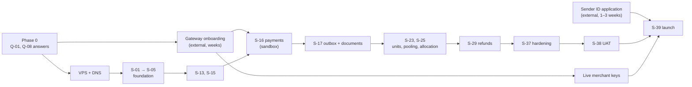

# 12 — Implementation Plan

**Revision:** S1 draft · 29 September 2026

How the store gets built: one full-stack developer working with Claude Code, two repositories
(`ta3lom-store-api`, new; `ta3lom-web`, existing), in eight phases and 45 sessions. The approach
follows the main site's plan: each session is one focused unit of work with a written prompt in the
repository's `SESSIONS.md`, a definition of done, and a human review of the diff. This document is
the order, the gates, the estimates and the parts a tool cannot do.

---

> **r2 (30 Sep 2026):** payment processing (gateway, webhooks, reconciliation, retry, payment-review resolution, refunds) is now a separate piece of work — see [14 §0](14-backend-implementation-plan.md#0-scope-change-r2--the-payment-service-is-a-separate-piece-of-work) and [15](15-payment-service-handoff.md). S-16 is reduced to the settlement core (2.0 d) and S-29 moves to the payment service; the figures below are the r1 full-scope estimate.

## Summary

| Phase | Goal | Dev-days |
|---|---|---|
| 0 | Decisions and spikes | 4.0 |
| 1 | Foundation | 12.5 |
| 2 | Catalogue | 11.0 |
| 3 | Cart, checkout, payments, documents | 15.0 |
| 4 | Fulfilment | 9.5 |
| 5 | Giving and refunds | 16.25 |
| 6 | Account, reports, notifications, hardening, UAT | 18.0 |
| 7 | Launch and hypercare | 4.0 |
| | **Build estimate** | **90.25** |
| | Contingency (15%) | 13.5 |
| | **Total** | **≈ 104 developer-days** |

By repository: `ta3lom-store-api` 47.75 d, `ta3lom-web` 28.5 d, both/ops 14.0 d (including Phase 0).

At about four productive developer-days per week (the rest goes to review, client feedback and
waiting on third parties), that is **roughly 26 weeks** of calendar time. External lead times —
gateway onboarding, SMS sender ID approval — run in parallel from week 1 and are on the critical
path if they start late.

Estimates are for a developer who knows .NET and Angular, using Claude Code for scaffolding, tests
and repetitive code, and reviewing every diff. They exclude content entry (products, beneficiaries)
by the association.

### Estimate changes in revision r1

Applied from the canonical changes (`_changes-r1.md`). Session IDs S-01 … S-39 are unchanged; new
sessions are numbered S-40 … S-45 and listed in their phase.

| Session | Change | Delta (d) |
|---|---|---|
| S-02 | 49 tables, `ar_normalize`, `idempotency_key` | +0.25 |
| S-05 | `/v1/admin/auth`, `t3s_srt`, segregation of duties (RUL-62) | +0.25 |
| S-15 | RUL-13 unpaid-order check, `terms_accepted_at`, idempotency store, status token | +0.25 |
| S-16 | Late capture → `payment_review`, duplicate paid course, 5-min reconciliation, lines restored to cart on expiry | +0.5 |
| S-17 | `ux_notification_once` | +0.25 |
| S-23 | Pool sweep moved to S-42 | −0.5 |
| S-25 | Customer created at allocation, lapse revokes enrolment + SMS | +0.25 |
| S-29 | Print refund before shipment incl. shipping (RUL-57) | +0.25 |
| S-35 | Sponsor digest moved to S-45 | −0.5 |
| S-40 | New: `LmsProgressSync` | +1.0 |
| S-41 | New: `LowStockAlert` | +0.5 |
| S-42 | New: `goal_adjustment` pool sweep and corrections (RUL-46) | +1.0 |
| S-43 | New: zakat disbursement vouchers (RUL-20) | +0.75 |
| S-44 | New: admin screens for vouchers and adjustments | +0.5 |
| S-45 | New: `SponsorDigest` | +1.0 |
| | **Net** | **+5.75** (84.5 → 90.25) |

---

## Phase 0 — Decisions and spikes (4.0 d)

**Goal:** remove the unknowns that would be expensive to discover in Phase 3.

| Item | Output | Est | Blocks |
|---|---|---|---|
| Open-questions workshop | Answers or owners and dates for Q-01 … Q-09 | 0.5 | everything |
| Payment sandbox spike | Sandbox account with the recommended provider (ADR-S05); a console app creates a hosted payment, receives a webhook on a temporary staging URL, verifies it, fetches status, issues a partial refund. Fill the ADR-S05 table with confirmed facts | 1.0 | S-16 |
| SMS provider and sender ID | Account opened, sender ID application filed with the required association documents (lead time 1–3 weeks), OTP and card template wording submitted if the provider requires it | 0.25 | S-04 go-live, launch |
| VPS provisioning | KVM 2 ordered in the location agreed under Q-08; Ubuntu 24.04, ufw, SSH hardening, fail2ban, unattended-upgrades, Docker, Tailscale; DNS for `store-api` and `store-api-staging`; Caddy serving a hello page with TLS (08 §4) | 1.0 | S-03 |
| LMS decision (Q-05) | Written choice: existing LMS with an API, new LMS, or `InternalAccessLmsGateway` for S1 | 0.25 | S-19 |
| QuestPDF Arabic spike | A bilingual invoice and a donation receipt with the real Arabic font: shaping, RTL tables, mixed numbers and Latin text, QR code; confirm Community licence eligibility | 0.5 | S-17 |
| PDF watermark spike | PdfSharp stamps buyer name, masked mobile and order reference on a real book PDF (Arabic name), measures time and size for a 300-page file | 0.5 | S-20 |

**Deliverables:** updated Q table in 01 §7, ADR-S05 comparison verified, spike notes in
`ta3lom-store-api/docs/spikes/`, VPS reachable.

**Exit gate (Phase 0 gate, README):** Q-01, Q-02, Q-05, Q-08 closed or dated; VPS and DNS live;
sender ID filed; `ta3lom-store-api` repository created; client sign-off on 01, 03, 04.

---

## Phase 1 — Foundation (12.5 d)

**Goal:** an empty but production-shaped system: deployable API with database, both identities,
and the Angular store shell.

**Deliverables:** solution and projects per 09-backend-dotnet; EF Core model and initial migration
matching `001_store_schema.sql`; CI/CD to staging and production; OTP and staff sign-in end to end;
`core/store` and route shell in ta3lom-web; CSP and `.htaccess` updated.

**Exit gate:** a commit to `main` reaches staging automatically and production after approval,
with rollback demonstrated; a customer can sign in by OTP on staging (provider default sender);
a staff user can sign in with TOTP; architecture tests pass.

## Phase 2 — Catalogue (11.0 d)

**Goal:** staff can create and publish every product type; the public can browse them.

**Deliverables:** public catalogue API with Arabic-tolerant search; admin product, offer, cause,
category, media and settings management; store home, listings and product pages prerendered with
live figures and SEO.

**Exit gate:** FR-S07 acceptance passes (price change visible without rebuild); axe clean on all
catalogue routes in both locales and themes; budgets pass; seed catalogue from
`002_store_seed.sql` renders like the prototype.

## Phase 3 — Cart, checkout, payments, documents (15.0 d)

**Goal:** a customer can pay for a mixed cart and receives the right documents.

**Deliverables:** server cart with merge; buy boxes and cart page; checkout with repricing and
stock reservation; gateway adapter, webhook settlement, reconciliation, expiry, payment review;
outbox dispatcher; invoice and donation receipt PDFs; order-paid SMS and email.

**Exit gate:** FR-S34 acceptance passes on staging with the **sandbox gateway** (replay → no
change; bad signature → 401; closed browser → `paid` within 10 minutes); a mixed order produces
one INV and one DR with gapless numbers; integrity checks 1, 2, 8, 9 return zero rows.

## Phase 4 — Fulfilment (9.5 d)

**Goal:** everything bought is delivered.

**Deliverables:** enrolment through `ILmsGateway` with `pending_sync` retry; signed, watermarked
downloads with limits; shipments, packing slips, tracking and SMS; stock ledger and adjustments;
admin order list and detail; `LmsProgressSync` (hourly) and `LowStockAlert` (daily) jobs.

**Exit gate:** a paid course appears as an enrolment, a digital book downloads watermarked and
stops at the limit, a print order goes `preparing → shipped → delivered` with SMS; integrity
check 3 returns zero rows.

## Phase 5 — Giving and refunds (16.25 d)

**Goal:** sponsorship, causes, dedications and zakat work end to end, and every kind of line can
be refunded per the rules.

**Deliverables:** unit creation and pooling in settlement; pool sweep; beneficiary register with
encrypted PII and CSV import; allocation console with FIFO and RUL-47 validation; zakat ledger;
beneficiary invitations; lapse job and allocation alerts; dedication cards and the public card
page; `goal_adjustment` sweep and corrections; zakat disbursement vouchers; cause delivery updates with donor notification; refunds with RUL-57 checks and RUL-58
effects.

**Exit gate:** the smoke scenario (`database/store/tests/smoke_scenario.sql`) reproduced through
the API; integrity checks 4–7 zero rows (check 6 including `goal_adjustment`); a pool sweep produces a balanced adjustment pair; a refunded pooled contribution reverses only its
unconverted part; a zakat-funded unit cannot be allocated to a non-zakat beneficiary.

## Phase 6 — Account, reports, notifications, hardening, UAT (18.0 d)

**Goal:** the store is complete, secure, measured and accepted by the association.

**Deliverables:** customer account (courses, books, giving, orders, profile, data rights);
dashboard, reports, audit viewer, customer lookup; message template editor, `SponsorDigest` (monthly),
retention and integrity jobs; main-site integration; security review, OWASP ZAP baseline, k6 load
test, manual screen-reader pass; UAT with staff; opening goal figures loaded.

**Exit gate:** all Must FRs in 04 accepted by the association in writing; NFR targets verified;
no open High/Critical findings; restore drill passed on staging; launch checklist items owned.

## Phase 7 — Launch and hypercare (4.0 d)

**Goal:** go live safely and stabilise.

**Deliverables:** production cutover (live keys, sender ID, DNS, `/donate` redirect, rebuild);
first real low-value transactions end to end (purchase, sponsorship, donation, refund); two weeks
of hypercare with daily checks of payments, outbox, alerts and integrity checks.

**Exit gate:** two weeks without a P1; first month-end reports reconciled with the gateway
settlement report by finance.

---

## Sessions

Every session ends with the repository's definition of done **plus** the session-specific check
in the last column.

- **`ta3lom-store-api` DoD:** `dotnet build` with warnings as errors; unit, application,
  integration (Testcontainers PostgreSQL 18) and architecture tests green; OpenAPI document
  regenerated and committed; a migration added if the model changed and `migrate.sql` generated;
  `001_store_schema.sql` and the data dictionary regenerated if the schema changed; no secrets in
  the diff; `git diff` read by a human.
- **`ta3lom-web` DoD:** the CLAUDE.md definition of done (typecheck, lint, tests, budgets, axe,
  both locales, both themes, 320 px, keyboard, `SeoService.set()`, human-read diff), plus
  `npm run types:pull` for store types when the contract changed.

### Phase 1 — Foundation

| # | Repo | Scope | FR-S | Est | Done when |
|---|---|---|---|---|---|
| S-01 | store-api | Solution and projects, Directory.Build.props, central package management, Minimal API host with endpoint-group convention, ProblemDetails, Result type, handler interfaces + Scrutor registration, Serilog + OpenTelemetry, rate-limiter skeleton, `/health/live` and `/health/ready` | S83 | 1.5 | Architecture tests enforce layer and module rules; health endpoints return 200 in a container |
| S-02 | store-api | EF Core model for all 49 tables and 4 views (one configuration per table), snake_case, xmin tokens, CHECKs, partial indexes, `ar_normalize(text)` function, grants via SQL; initial migration; `SeedRunner`; Testcontainers fixture | — | 2.75 | Script from the migration diffed against `001_store_schema.sql` with no semantic differences; `003_integrity_checks.sql` runs clean on seed |
| S-03 | store-api | Chiselled Dockerfile; compose files (edge, prod blue/green, staging); `store-deploy` script; GitHub Actions: CI, image to GHCR, `migrate.sql` artifact, staging deploy, production with approval, rollback | — | 1.5 | Deploy and rollback demonstrated on the VPS; a failing health check leaves the old colour live |
| S-04 | store-api | Customer identity: OTP request/verify (RUL-60), `ISmsSender` with the chosen provider + fake, JWT issue, refresh rotation with reuse detection, `t3s_rt` cookie, sign out everywhere, CORS; OTP SMS sent directly, not via the outbox (RUL-63); `blocked` customers refused (RUL-61) | S21, S28 | 2.0 | Rate limits proven by tests (3/mobile/15 min, 10/IP/h, 5 attempts); reused refresh token revokes the family; plain code never persisted |
| S-05 | store-api | Staff identity under `/v1/admin/auth/*`: `staff_user`, password + TOTP enrolment and verify, `t3s_srt` cookie (`Path=/v1/admin/auth`), lockout (FR-53 rule), role policies per endpoint group with **segregation of duties** (RUL-62), `create-admin` CLI, `SaveChangesInterceptor` → `audit_log` | S70, S71, S78 (write) | 1.75 | Every admin endpoint group has a policy (test enumerates endpoints); a user with only `admin` gets 403 on refund, allocate and PII reveal; audit rows written with diff |
| S-06 | ta3lom-web | `core/store/`: `STORE_API_URL` token, store auth service (token in signal, silent refresh), interceptors scoped to the store origin, generated store types; lazy `features/store` routes with render modes; CSP (`connect-src`, `img-src`) and `.htaccess` CSR rewrites | — | 1.5 | Main-site token never sent to the store API and vice versa (unit test); CSP check passes |
| S-07 | ta3lom-web | `/store/login` OTP flow (also as an inline component for checkout); `/admin/store` staff login with TOTP enrolment | S21, S70 | 1.5 | Both flows work against staging in ar/en; errors from ProblemDetails `code` localised |

### Phase 2 — Catalogue

| # | Repo | Scope | FR-S | Est | Done when |
|---|---|---|---|---|---|
| S-08 | store-api | Public catalogue: home sections, listings by type/category/sort, product detail by slug, live figures endpoint (`v_goal`, stock), `GET /v1/catalog/products?fields=slug` for prerender, search with input normalised by `ar_normalize`, public media serving via `IFileStorage` | S01–S07 | 2.0 | Search finds "مدرسه" for "مدرسة" and "الى" for "إلى"; draft/archived rules (RUL-02) covered by tests |
| S-09 | store-api | Admin catalogue: products (course/book/cause), formats, curriculum, categories, media upload with required alt, draft/publish/archive, sponsorship offers, causes (incl. seed figures), settings editor | S50, S58, S72, S76 | 2.5 | RUL-01 type immutability after first order and `ux_offer_one_active` surface as ProblemDetails; uploads reject wrong MIME/magic bytes |
| S-10 | ta3lom-web | Store home and catalogue listings with tabs, category chips from the API, sort, search; product cards, goal bar, quick-give input (UI only) | S01–S03 | 2.0 | Matches prototype in both locales; categories are API data (rule 13) |
| S-11 | ta3lom-web | Course, book and cause pages; live figures after hydration; JSON-LD; share sheet; existing `routes.mjs` → `routes.txt` extended with `GET /v1/catalog/products?fields=slug`; build fails if the store API is unreachable | S04–S09 | 2.0 | Prerendered HTML contains title/description/OG per product; FR-S07 acceptance passes |
| S-12 | ta3lom-web | `/admin/store` catalogue screens: products, formats, curriculum, media, categories, offers, causes, settings | S50, S58, S72, S76 | 2.5 | A store_manager can create and publish each product type from scratch; viewer sees read-only |

### Phase 3 — Cart, checkout, payments, documents

| # | Repo | Scope | FR-S | Est | Done when |
|---|---|---|---|---|---|
| S-13 | store-api | Cart: guest cookie `t3s_cart`, customer cart, add/update/remove, merge rules, limits, summary endpoint | S17, S20 | 1.5 | RUL-12, RUL-13, RUL-14, RUL-17, RUL-18 each have a test |
| S-14 | ta3lom-web | Buy boxes (course, book, sponsor, cause), dedication form, quick give, add / buy now, cart page with two groups, header cart badge | S10–S16, S18, S19 | 2.5 | FR-S12 acceptance ("equals 0.29 seats") passes; badge updates after add without reload |
| S-15 | store-api | Checkout: validation and repricing (incl. RUL-13: course already owned or in an unpaid order), identity and address, `terms_accepted_at`, order reference, snapshots, stock reservation, `Idempotency-Key` backed by `idempotency_key`, per-order status token returned | S30–S32 | 2.25 | Concurrent checkouts for the last print copy: exactly one succeeds; repeated key returns the same response, different body → 422 |
| S-16 | store-api | `IPaymentGateway` + provider adapter + fake; hosted payment creation; webhook endpoint with verification; settlement transaction for purchase and gift counters; retry; `payment_review` (amount mismatch, capture after expiry/cancel, finance accept/refund); duplicate paid course → no second enrolment, line flagged for refund, finance alert (RUL-13); `ReconcilePayments` every 5 min; expiry job restoring lines to the active cart (RUL-29); `GET /v1/orders/{ref}/status` with bearer or status token | S33, S34, S36–S38 | 4.0 | FR-S34 acceptance passes against the sandbox; amount mismatch and late capture → `payment_review`; status by reference alone → 401 |
| S-17 | store-api | `OutboxDispatcher`; document numbering; QuestPDF invoice (simplified tax invoice when VAT enabled, QR) and donation receipt; `IEmailSender`; order-paid SMS + email from `message_template` (Scriban); `notification.outbox_message_id` + `ux_notification_once` | S62, S63, S80, S81 | 2.75 | Killing the process mid-dispatch loses nothing and sends nothing twice; INV/DR gapless under 20 concurrent settlements |
| S-18 | ta3lom-web | Checkout page (3 steps, inline OTP, anonymity, address, method, terms), redirect to gateway, thanks page polling status with the bearer, retry and pending states | S30, S35, S36 | 2.0 | Return URL alone never shows "paid"; failure → retry on the same order works |

### Phase 4 — Fulfilment

| # | Repo | Scope | FR-S | Est | Done when |
|---|---|---|---|---|---|
| S-19 | store-api | `ILmsGateway` + `InternalAccessLmsGateway` (or the chosen LMS), enrolment on settlement, `pending_sync` retry via outbox | S40 | 1.5 | LMS failure leaves `pending_sync` and recovers; no double charge path |
| S-20 | store-api | Download grants, signed 10-minute URLs, per-download PdfSharp watermark, `download_log`, limit and staff reset | S41 | 1.5 | 6th download refused; watermark contains name, masked mobile, reference |
| S-21 | store-api | Shipments (queue, packing slip PDF, carrier/tracking, status, SMS), stock movements, restock/adjust with reason, low-stock alert; admin order search and detail | S42, S43, S73 (base) | 2.5 | Stock ledger equals counters after a scripted day of orders (integrity check 3) |
| S-22 | ta3lom-web | Admin: order list/detail, shipments queue, stock screen (incl. `low_stock_threshold`), download reset | S42, S43, S73 (base) | 2.5 | fulfilment role can ship an order end to end; others blocked |
| S-40 | store-api | `LmsProgressSync` job (hourly): progress and completion into `enrolment`, sponsored unit → `completed` (RUL-50), certificate number | S23, S55 | 1.0 | Completion in the LMS shows as `completed` on the donor's seat map within an hour; job is idempotent |
| S-41 | store-api | `LowStockAlert` job (daily 08:00 Riyadh): `book_format.low_stock_threshold` or setting `low_stock_default_threshold` (20); staff alert via outbox | S43 | 0.5 | One alert per format per day; NULL threshold falls back to the setting |

### Phase 5 — Giving and refunds

| # | Repo | Scope | FR-S | Est | Done when |
|---|---|---|---|---|---|
| S-23 | store-api | Sponsored units (`units` lines), pool contributions and pooling algorithm, `unit_funding`, goal counters | S51 | 1.5 | Property-based test: for random contribution sequences, `balance = Σ remaining` and units × seat price = converted amount |
| S-24 | store-api | Beneficiary register: create, CSV import, approve/reject, zakat flag, Data Protection encryption, `mobile_hash`, masked lists, audited reveal | S52 | 1.5 | DB dump shows no plaintext names; reveal writes `audit_log` |
| S-25 | store-api | Allocation batches (FIFO, SKIP LOCKED, RUL-47 checks), enrolment/distribution creation, zakat ledger out for sponsorship zakat, customer found or created for the beneficiary/guardian mobile **at allocation** and invitation SMS (RUL-47e, RUL-52), lapse job revoking the enrolment with a short SMS (RUL-50), 30/90-day alerts | S53–S55, S57, S61 | 2.75 | Two parallel allocations never take the same unit; a seat without a mobile cannot be allocated; first OTP login shows the course under "My courses" |
| S-26 | store-api | Dedication cards (SMS once after payment, card endpoint by token, staff resend); cause delivery updates with photos and donor notification | S59, S60 | 1.5 | Card never shows the amount; SMS not re-sent on outbox retry |
| S-27 | ta3lom-web | Admin: beneficiaries, allocation console, cause updates, zakat ledger view | S52, S53, S59, S61 | 3.0 | allocation_officer completes a batch of 10 from the backlog; PII masked by default |
| S-28 | ta3lom-web | Public card page `/store/card/:token` (noindex), dedication previews on thanks page, delivery-update timeline on cause pages | S06, S60 | 1.0 | Card page renders without sign-in in both locales; `noindex` present |
| S-29 | store-api | Refunds: eligibility per RUL-57 with reasons, gateway refund call, RUL-58 reversal on refund confirmation, credit note / cancellation receipt; print before shipment → full refund incl. shipping when every print line is cancelled | S64 | 1.75 | Each RUL-57 row has a test; refund of a pooled contribution reverses only `remaining` |
| S-30 | ta3lom-web | Admin refund screen from order detail (finance only) | S64 | 1.0 | Non-refundable lines show the reason; `Idempotency-Key` sent |
| S-42 | store-api | `CloseCampaigns` with pool sweep recorded as a `goal_adjustment` pair (`pool_sweep_out` / `pool_sweep_in`, shared `pair_id`); finance `correction` adjustments; `goal_progress.raised_amount` and integrity check 6 include adjustments; no zakat swept | S56 | 1.0 | Sweep of a 120 SAR remainder moves exactly 120 SAR between offer and fund; integrity check 6 zero rows |
| S-43 | store-api | Disbursement vouchers for cause zakat: `zakat_ledger` `out` rows with `reference` = voucher number, finance only, balance never negative (RUL-20) | S61 | 0.75 | Voucher above the balance rejected; `v_zakat_balance` never negative (integrity check 7) |
| S-44 | ta3lom-web | Admin: disbursement voucher form on the zakat ledger, goal adjustment (correction) screen, sweep history on offers | S56, S61 | 0.5 | Only `finance` sees the forms; both locales |

### Phase 6 — Account, reports, notifications, hardening, UAT

| # | Repo | Scope | FR-S | Est | Done when |
|---|---|---|---|---|---|
| S-31 | store-api | `/v1/me`: profile, addresses, courses, books, giving (unit statuses, pooled shares, updates), orders and document downloads, export, delete (anonymise) | S22–S27 | 2.0 | Export contains all personal data; delete keeps financial rows with names replaced (RUL-61) |
| S-32 | ta3lom-web | `/store/account/**`: courses, books, giving with seat map, orders and receipts, profile and addresses, data rights | S22–S28 | 2.5 | Donor sees group, region and status only — never a beneficiary name |
| S-33 | store-api | Dashboard, reports (sales & VAT, gifts, zakat, allocation, refunds, shipments; screen + CSV), audit log query, customer lookup and block | S74, S75, S78, S79 | 1.5 | Report totals equal integrity-check sums on the same data |
| S-34 | ta3lom-web | Admin dashboard, reports, audit viewer, customer lookup, message template editor with test send | S73–S79 | 3.0 | finance can export each report; CSV opens correctly in Excel with Arabic |
| S-35 | store-api | Template API and test send, retention job, `PruneIdempotencyKeys`, integrity-check job and alerts, `repository_dispatch` rebuild (debounced), remaining RUL-63 events | S77, S80 | 1.0 | Every RUL-63 row produces its message in staging; integrity job alerts on an injected fault |
| S-45 | store-api | `SponsorDigest` job (monthly): per sponsor, units by status with group/region only, pooled shares, cause updates; email with SMS fallback; skips sponsors with no change | S25, RUL-63 | 1.0 | Digest never contains beneficiary identity; one digest per sponsor per month |
| S-36 | ta3lom-web | Main-site integration: nav and footer links, cart badge on all pages, `/donate` redirect (Q-09), store entries in sitemap | S19, S82 | 1.0 | Badge shows on the main homepage; `/donate` lands on the general fund |
| S-37 | both | Hardening: threat-model walk-through (08 §6.2), OWASP ZAP baseline on staging, header scan, k6 load test (50 concurrent checkouts, catalogue p95), NVDA and VoiceOver pass, dependency audit, secrets rotation | NFR | 3.0 | No High/Critical open; load targets met; findings logged and fixed or accepted in writing |
| S-38 | both | UAT with staff roles on staging, fixes, opening goal figures entered (`goal_progress.seed_*`), production catalogue entry support, restore drill | — | 3.0 | Signed UAT sheet per FR group; restore drill time recorded |

### Phase 7 — Launch and hypercare

| # | Repo | Scope | FR-S | Est | Done when |
|---|---|---|---|---|---|
| S-39 | both | Production cutover per launch checklist; live low-value transactions and refunds; main-site R3 release | — | 1.0 | Checklist fully ticked; first real receipt issued |
| — | both | Hypercare (two weeks, reactive) | — | 3.0 | Phase 7 exit gate |

---

## Critical path

The code path is Foundation → Checkout → Payments → Settlement-dependent giving → Refunds →
Hardening → UAT. The **external** path — merchant agreement and live keys, and the SMS sender ID —
can overtake it if not started in Phase 0. Web sessions (S-10 … S-14, S-27 …) run beside the API
sessions and are not on the critical path as long as the API contract is published first.

---

## Dependencies on open questions

| Q | Question (01 §7) | Needed by | If late |
|---|---|---|---|
| Q-01 | Payment provider, one or two merchant accounts | Phase 0 spike; S-16 real adapter; launch (live keys) | Build on `FakePaymentGateway`; Phase 3 exit gate slips |
| Q-02 | VAT registration; gifts outside scope | S-15 (VAT maths), S-17 (invoice form), S-33 (VAT report) | Build with `vat_enabled` both ways; switch by setting |
| Q-03 | Zakat-eligible products (Sharia sign-off) | Before causes go live; S-38 data | Launch with `zakat_eligible = false` everywhere |
| Q-04 | Beneficiary criteria per offer; who approves allocations | S-24, S-25, S-27; staff training | Allocation console built; no allocations until answered — alerts will fire at 30 days |
| Q-05 | LMS | S-19 | `InternalAccessLmsGateway`; enrolment works, delivery link manual |
| Q-06 | Book fulfilment, carrier, rates | S-21, shipping fee setting | Print formats stay unpublished; digital only at launch |
| Q-07 | Refund policy wording | S-29 texts, legal pages | Launch blocked (E-commerce disclosures) |
| Q-08 | Data residency | Phase 0 VPS location; backup bucket | ADR-S03 revisit; hosting move before launch |
| Q-09 | Main-site `/donate` moves to the store | S-36; main-site R3 | Keep FR-45 fallback; store link only |

---

## Risk register (delivery)

Technical and operational risks are in [08 §10](08-solution-architecture.md#10-risks). Delivery
risks:

| # | Risk | Likelihood | Impact | Mitigation | Owner |
|---|---|---|---|---|---|
| D-01 | Gateway onboarding for a non-profit takes longer than the build | High | High | Apply in Phase 0; ask two providers in parallel; fake adapter for development | Association finance |
| D-02 | SMS sender ID not approved by launch | Medium | High | File in week 1; follow up weekly | Association + Lotfi |
| D-03 | Open questions answered late or changed after build | Medium | High | Dates agreed in the Phase 0 workshop; changes go through a revision (R-style change log) with re-estimate | Association |
| D-04 | Scope creep from the prototype review (coupons, recurring, buy-for-someone) | Medium | Medium | "Won't have in S1" list in 04 is the contract; new items go to S2 | Lotfi |
| D-05 | Estimates optimistic for settlement/pooling correctness | Medium | Medium | 15% contingency; property-based tests; smoke scenario as exit gate | Lotfi |
| D-06 | Staff unavailable for UAT and data entry | Medium | Medium | UAT dates booked at Phase 3 exit; data-entry guide and CSV import | Association |
| D-07 | Main-site work (R2 follow-ups, R3) competes for the same developer | Medium | Medium | R3 is scheduled as S-36 and S-39 only; other main-site work agreed separately | Lotfi |
| D-08 | Arabic PDF or watermark spike fails | Low | Medium | Spikes in Phase 0; fallback: HTML-to-PDF with a headless browser in a sidecar (heavier) | Lotfi |
| D-09 | Hostinger VPS limitations discovered late (IPv6, SMTP port blocks, disk encryption) | Low | Medium | Provision in Phase 0; use an external SMTP relay on 587 | Lotfi |

---

## Main-site changes required (R3)

Changes to the main site that the store needs. Recorded as revision R3 in the main-site
`CHANGELOG.md` (details in [08 §7.1](08-solution-architecture.md#71-proposed-main-site-revision-r3)).

- [ ] **Nav item** "المتجر / Store" in the header and store links in the footer (`layout/`) — S-36
- [ ] **Cart badge** in the header on every page, reading `GET /v1/cart/summary` after hydration — S-14, S-36
- [ ] **CSP** in `deploy/.htaccess`: `connect-src` and `img-src` add `https://store-api.ta3lom.sa`
      (staging: `store-api-staging`); gateway origins only if needed (08 §3.3) — S-06
- [ ] **`.htaccess` rewrites** for client-rendered store routes to `index.csr.html` — S-06
- [ ] **`scripts/routes.mjs` extension**: the existing `routes.txt` mechanism also fetches
      `GET /v1/catalog/products?fields=slug`; the build fails if the store API is unreachable — S-11
- [ ] **`/donate` redirect** to `/{locale}/store/p/education-fund` once Q-09 is confirmed; FR-45
      bank-details fallback kept until go-live — S-36, S-39
- [ ] **FR-40 … FR-44 marked superseded** in `requirements/03-functional-requirements.md` and the
      traceability matrix (replaced by FR-S13, FR-S30–S35, FR-S63; monthly and waqf to store S2) — S-39

---

## Launch checklist

### Legal and content

- [ ] Terms of sale, privacy policy (PDPL: what, why, retention, rights), refund and return policy
      (Q-07), shipping policy — published in Arabic and English and linked from checkout
- [ ] E-Commerce Law disclosures visible before purchase: seller legal name, licence number,
      address, contact channels, VAT number if registered (Q-02), total price including VAT and
      shipping, 7-day withdrawal right for physical goods (01 §6) — confirmed by the association's
      legal adviser
- [ ] Donation receipt wording and licence number approved by finance (FR-S63)
- [ ] Zakat-eligible products signed off by the Sharia adviser (Q-03)
- [ ] Beneficiary criteria per offer approved (Q-04)
- [ ] QuestPDF licence eligibility confirmed in writing

### Payments

- [ ] Merchant agreement signed; live keys installed in `/srv/store/secrets/prod.env`
- [ ] Live webhook URL `https://store-api.ta3lom.sa/v1/payments/webhooks/{provider}` registered
      and verified with a real event
- [ ] mada, Apple Pay, Visa/Mastercard and STC Pay each tested with a real low-value payment and
      refunded
- [ ] Settlement report from the gateway reconciled against `payment` for the test transactions
- [ ] PCI DSS SAQ-A completed for the acquirer

### Messaging

- [ ] SMS sender ID approved; OTP, order-paid, dedication, invite and shipment templates tested on
      real Saudi numbers (Arabic and English)
- [ ] SMTP relay with SPF, DKIM and DMARC for the sending domain; test receipt lands in inbox
- [ ] OTP global daily cap and alert set

### Operations

- [ ] Backups running; restore drill completed on staging within RTO, including decrypting one
      beneficiary record with the restored key ring
- [ ] Uptime monitors and alert routing tested end to end (08 §8.1)
- [ ] Integrity checks green on production for three consecutive nights before announcement
- [ ] ufw, SSH, fail2ban, unattended-upgrades verified; ports scan shows only 22 (restricted), 80, 443
- [ ] Security headers verified with an external scanner; CSP check passes in the production build
- [ ] Rollback rehearsed on production (switch to previous image and back)
- [ ] Runbook in the repository: deploy, rollback, restore, rotate secrets, resend receipt,
      resolve `payment_review`

### People

- [ ] Staff accounts created with the right roles and segregation of duties (RUL-62): refund,
      allocation and PII reveal only for explicit `finance` / `allocation_officer` holders; every
      user enrolled in TOTP
- [ ] Training delivered per role (store_manager, finance, allocation_officer, fulfilment) with the
      admin guide
- [ ] Named contacts for P1/P2 alerts on both sides

### Main site

- [ ] Main-site revision R3 recorded in the main `CHANGELOG.md` (08 §7.1)
- [ ] Nav, footer and cart badge live; `/donate` redirect live (Q-09)
- [ ] ta3lom-web rebuilt after the production catalogue is published; sitemap includes store pages

---

## Open points

| # | Point |
|---|---|
| IP-1 | Estimates assume the LMS is `InternalAccessLmsGateway` or an LMS with a documented REST API. A custom LMS integration is not estimated |
| IP-2 | Estimates assume one merchant account. Two accounts (Q-01) add about 1 day to S-16 and S-29 |
| IP-3 | Data migration covers opening goal figures only. If the main-site FR-40 flow went live before the store, exporting its settled intents adds about 0.5 day |
| IP-4 | The session prompts for `SESSIONS.md` in both repositories are to be written from this table before Phase 1 |
