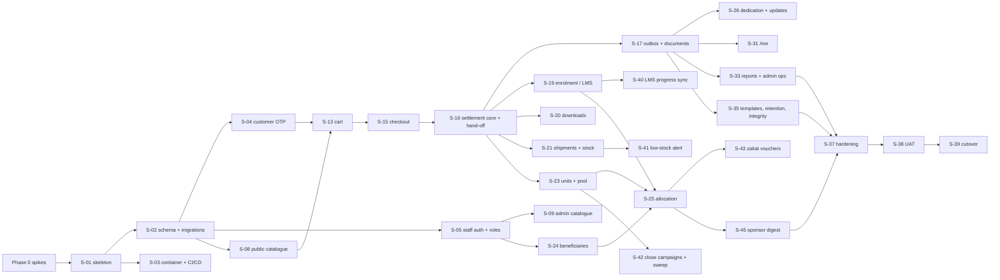

# 14 — Backend Implementation Plan (.NET)

**Revision:** S1 draft r2 · 30 September 2026 — payment service carved out (see §0)
**Repository:** `repos/ta3lom-store-api` (new) · **Stack:** .NET 10 · ASP.NET Core Minimal APIs · EF Core 10 + Npgsql · PostgreSQL 18 · Quartz.NET · QuestPDF
**Builds on:** [09 — Backend guide](09-backend-dotnet.md) (how the code is shaped) · [11 — API contract](11-api-contract.md) (what it exposes) · [12 — Implementation plan](12-implementation-plan.md) (both repos, calendar) · [database/](database/01-database-design.md) (schema and transactions) · [03 — Business rules](03-business-rules.md) (what it must enforce)

This is the **execution plan for the backend only**: the order of work, what each session builds
file by file, the tests that prove it, the gate that closes it, and a ready-to-paste Claude Code
prompt. Session IDs (`S-nn`) are the same as in 12, so the two plans stay in step. Frontend
sessions are listed only where the backend unblocks them.

---

## 0. Scope change r2 — the payment service is a separate piece of work

The **payment service** will be designed and built in its own session. This plan now covers
everything **except** payment processing. The split:

| Stays in this plan | Moves to the payment service |
|---|---|
| Catalogue prices, cart, checkout quote, order creation (`pending_payment`), VAT and totals (RUL-24 … RUL-31) | Payment gateway port and adapters, hosted payment page, provider sandbox spike (old P0-1) |
| **Settlement core**: what happens when an order *is* paid (RUL-35, RUL-39), exposed as a hand-off contract `IOrderSettlement` | Webhooks, signature check, `payment_event` inbox, `payment` rows (RUL-32 … RUL-34) |
| Order expiry and stock release (RUL-29, RUL-30) | Payment methods, retry, reconciliation job (RUL-36 … RUL-38) |
| All paid-order effects: enrolment, downloads, shipments, units, pooling, allocation, dedication cards, goal counters, zakat ledger | Payment review **resolution** (accept / refund), refunds and their reversals (RUL-56 … RUL-58), credit notes and cancellation receipts |
| Invoices and donation receipts issued on settlement (RUL-59), zakat ledger and vouchers (RUL-20) | Live keys, webhook URL, gateway monitoring |

The hand-off is specified in **[15 — Payment service hand-off](15-payment-service-handoff.md)**. Until the
payment service exists, orders are settled on staging through a test-only trigger
(`POST /dev/orders/{ref}/confirm-payment`, Development and Staging only). The fulfilment and giving
sessions can therefore be built and demonstrated without a gateway.

Removed from this plan: P0-1, the gateway half of S-16, all of S-29, endpoints #43, #44, #89, #90–#92
and the `ReconcilePayments` job. Session IDs are unchanged so the plan stays aligned with 12.

---

## Contents

1. [Outcome and scope](#1-outcome-and-scope)
2. [Milestones](#2-milestones)
3. [Order of work and dependencies](#3-order-of-work-and-dependencies)
4. [Working method](#4-working-method)
5. [Phase 0 — backend spikes](#5-phase-0--backend-spikes)
6. [Phase 1 — foundation](#6-phase-1--foundation-s-01-s-05)
7. [Phase 2 — catalogue](#7-phase-2--catalogue-s-08-s-09)
8. [Phase 3 — cart, checkout, payments, documents](#8-phase-3--cart-checkout-payments-documents-s-13-s-17)
9. [Phase 4 — fulfilment](#9-phase-4--fulfilment-s-19-s-21-s-40-s-41)
10. [Phase 5 — giving](#10-phase-5--giving-s-23-s-26-s-42-s-43)
11. [Phase 6 — account, reporting, operations](#11-phase-6--account-reporting-operations-s-31-s-33-s-35-s-45)
12. [Phase 7 — hardening, UAT, cutover](#12-phase-7--hardening-uat-cutover-backend-share-of-s-37-s-39)
13. [Coverage maps](#13-coverage-maps)
14. [Risks and mitigations](#14-risks-and-mitigations)
15. [Backend launch checklist](#15-backend-launch-checklist)

---

## 1. Outcome and scope

When this plan is complete, `store-api.ta3lom.sa` runs in production with:

| Deliverable | Count / source |
|---|---|
| REST endpoints | 130 of the 136 in 11 §12 (#43, #44, #89, #90, #91, #92 belong to the payment service) |
| Tables / views | 49 / 4 ([001_store_schema.sql](../../database/store/001_store_schema.sql)), owned by EF Core migrations |
| Business rules enforced and tested | RUL-01 … RUL-63 ([03](03-business-rules.md)) **except** RUL-32 … RUL-34, RUL-36 … RUL-38 and RUL-56 … RUL-58 (payment service); each rule has at least one test tagged `[Rule("RUL-nn")]` |
| Background jobs | 12 scheduled Quartz jobs plus the outbox dispatcher (09 §6, without `ReconcilePayments`) |
| Outbox message types | 18 (09 §4.9) |
| Documents | Sales invoice, donation receipt, packing slip (PDF, bilingual). Credit notes and cancellation receipts go with refunds to the payment service |
| External adapters | SMS, SMTP, LMS, file storage (each with a fake for dev and tests). The payment gateway is out of scope |
| Environments | local (compose), CI (Testcontainers), staging and production on the VPS |

**Out of scope here:** the payment service (§0); ZATCA Phase 2 API (`IEInvoicingGateway` interface only), BNPL,
recurring giving, coupons (01 §4).

### Effort

| Block | Dev-days |
|---|---|
| Phase 0 backend spikes (VPS, PDF Arabic, watermark) | 2.0 |
| Store-API sessions (26 sessions; S-16 reduced to settlement core 2.0 d, S-29 removed, S-17 −0.25) | 43.75 |
| Backend share of hardening, UAT, cutover (S-37 … S-39) | 3.25 |
| **Backend build** | **49.0** |
| Contingency 15% | 7.35 |
| **Backend total (without payments)** | **≈ 56 developer-days** |

At about four productive days a week that is **≈ 14 weeks of backend work**. The payment service
is estimated separately in its own plan. The parts removed here came to about 5.25 d in r1:
gateway, webhooks, retry and reconciliation 2.0; refunds 1.75; sandbox spike 1.0; credit-note layouts 0.25;
live-payment cutover items 0.25.

---

## 2. Milestones

Each milestone ends with a **demo on staging**, not on a laptop.

| # | Milestone | Sessions | Demo that proves it | Unblocks (frontend) |
|---|---|---|---|---|
| M0 | Ready to build | Phase 0 | Arabic invoice PDF renders; watermark timing known; VPS serves TLS | — |
| M1 | Walking skeleton | S-01, S-02, S-03 | `git push` → CI green → image in GHCR → migration applied → `/health/ready` green on staging; rollback to the previous tag works | S-06 (typed client) |
| M2 | Identity | S-04, S-05 | OTP sign-in with the fake SMS sink, refresh rotation, reuse detection revokes the family; staff login with TOTP; role policies return 403 correctly | S-07 |
| M3 | Catalogue | S-08, S-09 | A store manager creates and publishes a course, a book and a cause through the API; public endpoints serve them with ETags; the seed catalogue appears | S-10, S-11, S-12 |
| M4 | **First settled order** | S-13, S-15, S-16, S-17 | Guest cart → OTP → checkout → `pending_payment` → test trigger `confirm-payment` → `paid` → invoice and donation receipt PDFs → SMS and email in the sinks. The same confirmation sent twice changes nothing; a wrong amount → `payment_review` | S-14, S-18 (up to the redirect) |
| M5 | Fulfilment | S-19, S-20, S-21, S-40, S-41 | Paid course → enrolment; digital book → watermarked download; print → shipment shipped and delivered; stock ledger equals counters | S-22 |
| M6 | Giving | S-23, S-24, S-25, S-26, S-42, S-43 | 5 seats + a 100 SAR share → units and pool; allocation batch → beneficiary invited → enrolment; dedication card SMS; campaign close sweeps the pool | S-27, S-28, S-44 |
| M7 | Operations-complete | S-31, S-33, S-35, S-45 | `/v1/me` complete (export, delete); reports equal integrity-check sums; all 13 jobs and the dispatcher running; digest email | S-32, S-34, S-36 |
| M8 | Launch-ready | S-37 … S-39 | ZAP baseline clean, k6 targets met, restore drill timed, UAT signed, production cutover | Launch |

---

## 3. Order of work and dependencies



**Critical path:** S-01 → S-02 → S-04 → S-13 → S-15 → **S-16** → S-23 → S-25 → S-37 → S-39.
S-16 (settlement core) is still the riskiest session in this plan: every fulfilment and giving
effect hangs off it. It no longer waits for Q-01, because orders are settled through the hand-off
contract and the test trigger. **Production launch still depends on the payment service** (15 §6).

### Suggested backend order in the week plan

| Week (backend days ≈ 4/wk) | Sessions |
|---|---|
| 1 | Phase 0 spikes, S-01 |
| 2 | S-02, S-03 |
| 3 | S-04, S-05 |
| 4 | S-08, S-09 |
| 5 | S-09 (end), S-13, S-15 |
| 6 | S-16, S-17 |
| 8 | S-19, S-20, S-40 |
| 9 | S-21, S-41, S-23 |
| 10 | S-24, S-25 |
| 11 | S-25 (end), S-26, S-42, S-43 |
| 12 | S-31 |
| 13 | S-33, S-35, S-45 |
| 13–14 | Hardening, UAT fixes, contingency; cutover once the payment service is ready |

In the full-stack calendar (12), each backend milestone is followed by its frontend sessions
before the next backend block starts. The order above stays the same; only the gaps between
blocks change.

---

## 4. Working method

### 4.1 One session = one branch = one pull request

```
main ── feat/s-16-payments ──► PR (CI green, self-review, Claude review) ──► squash-merge ──► auto-deploy staging
```

- Branch name `feat/s-nn-short-name`; the PR title starts with `S-nn`.
- A session is **finished** only when its *Done when* list is ticked on staging, not locally.
- A session that runs past 1.5× its estimate stops. Split the rest into `S-nn.b` and record the reason in the PR.
- Migrations are named by intent and only ever added. A merged migration is never edited.

### 4.2 Running a session with Claude Code

Every session prompt below follows this frame. Paste the frame, then the session-specific part.

```text
You are working in repos/ta3lom-store-api. Read, in this order:
1. CLAUDE.md (repo rules — non-negotiable)
2. ../../Docs/store/03-business-rules.md — only the RUL ids listed below
3. ../../Docs/store/09-backend-dotnet.md — the sections listed below
4. ../../Docs/store/11-api-contract.md — the endpoints listed below (numbers from §12)
5. ../../Docs/store/database/01-database-design.md — the sections listed below
Do not invent rules. If the docs are silent or disagree, stop and list the question.
Work test-first: write the failing tests for each RUL first, then the code.
Finish with: dotnet build -warnaserror && dotnet test, then summarise what changed,
which RUL/FR are now covered, and anything left open.
--- Session ---
<session prompt>
```

### 4.3 Fakes first — never blocked by a third party

| Port (Application) | Fake (dev/test) | Real adapter | Real one needed by |
|---|---|---|---|
| `ISmsSender` | `SinkSmsSender`: writes to the `dev_sms` log and the console, viewable at `/dev/sms` | Unifonic / Taqnyat | S-04 staging demo; launch needs the approved sender ID |
| `IEmailSender` | Mailpit container (SMTP) | Hostinger SMTP or a transactional provider | S-17 |
| `ILmsGateway` | `InternalAccessLmsGateway` (grants access in our DB; progress set manually) | Decided in Q-05 | S-19 |
| `IFileStorage` | `LocalFileStorage` on a temp folder | Same class on `/srv/store/files` | — |
| `IClock` | `FakeClock` (settable) | `SystemClock` | — |
| `IEInvoicingGateway` | `NoopEInvoicingGateway` | ZATCA (S2) | S2 |

| `IPaymentInitiator` (checkout → payment service) | `NullPaymentInitiator`: returns no redirect; the order waits in `pending_payment` for the test trigger | Implemented by the payment service (15 §3) | Payment session |

`/dev/*` endpoints (including `POST /dev/orders/{ref}/confirm-payment`) are mapped **only** when `ASPNETCORE_ENVIRONMENT=Development` or `Staging`.
An architecture test fails if they are reachable in Production.

### 4.4 Quality gates (CI blocks the merge)

| Gate | Tool | Threshold |
|---|---|---|
| Build | `dotnet build -warnaserror` | 0 warnings (analyzers, nullable, banned APIs) |
| Format | `dotnet format --verify-no-changes` | clean |
| Unit + application tests | xUnit v3 | 100% pass; Domain ≥ 90% line coverage, Application ≥ 80% (NFR-S) |
| Integration tests | Testcontainers `postgres:18` | 100% pass, migrations applied from scratch |
| Architecture tests | NetArchTest | layer rules, no MediatR, no `Database.Migrate`, `/dev` not in Production |
| RUL coverage test | reflection over `[Rule]` attributes | every RUL implemented so far has ≥ 1 test (the list grows per session; §13.1) |
| OpenAPI diff | `openapi/v1.json` committed | an unreviewed contract change fails the build |
| Vulnerable packages | `dotnet list package --vulnerable` | no High / Critical |
| Container | Trivy on the image | no High / Critical with a fix available |

### 4.5 Definition of done (every session)

- [ ] Code follows 09's layer rules. Endpoints bind → call handler → map `Result`, with no logic.
- [ ] Every RUL listed for the session has a failing-then-passing test tagged `[Rule]`.
- [ ] Every endpoint listed has an integration test for the success path, validation (400), auth (401/403) and at least one business error `code`.
- [ ] Migration added (if the model changed) and the idempotent script generated. `001_store_schema.sql` and the data dictionary regenerated (`database/store/tools`).
- [ ] `openapi/v1.json` updated and matching 11. Any deviation is fixed in 11 in the same PR.
- [ ] Structured logs have no PII (mobile masked, no names, no tokens). Checked by the log-redaction test.
- [ ] Deployed to staging; the *Done when* items verified there.
- [ ] PR description lists RUL / FR / endpoint numbers covered and open questions.

### 4.6 Human review focus (Claude writes, Lotfi reviews)

Review time goes where mistakes cost money or trust. These are the parts to read line by line:

| Area | What to check |
|---|---|
| Settlement (S-16) | One transaction; `FOR UPDATE` on the order; status check makes a repeated confirmation a no-op **before** any effect; amount check (RUL-35); no external call inside the transaction |
| Money | `decimal` only; rounding `MidpointRounding.AwayFromZero` at 2 dp; VAT formula exactly RUL-27; JSON money as strings |
| Pooling / allocation (S-23, S-25) | FIFO order; `SKIP LOCKED`; invariants `balance = Σ remaining`; all-or-nothing batch |
| Auth (S-04, S-05) | OTP hash with a pepper; constant-time compare; refresh reuse → revoke the family; cookie attributes; audience separation |
| PII (S-24) | Encrypted before `SaveChanges`; `reveal` audited; never in logs or donor DTOs |

---

## 5. Phase 0 — backend spikes

Throw-away code in `ta3lom-store-api/spikes/`. Notes go in `docs/spikes/NN-name.md`. Nothing here is merged into `src/`.

| Spike | Question it answers | Output | Est |
|---|---|---|---|
| P0-2 VPS | Does the stack run on the plan? | VPS hardened, Docker, Caddy TLS for `store-api` and `store-api-staging`, Tailscale for CI (08 §4) | 1.0 |
| P0-3 Arabic PDF | Does QuestPDF shape Arabic, mix RTL/LTR numbers and render tables and the QR correctly with IBM Plex Sans Arabic? Is the Community licence valid for the association? | Two sample PDFs (invoice, receipt) + licence note | 0.5 |
| P0-4 Watermark | Can PdfSharp stamp an Arabic name on every page of a 300-page book fast enough? | Timing and size results, go/no-go | 0.5 |

**Gate M0:** Q-02, Q-05 and Q-08 answered or dated; VPS reachable; repo created. (Q-01 moves to the payment session.)

---

## 6. Phase 1 — foundation (S-01 … S-05)

### S-01 — Solution skeleton · 1.5 d

**Goal:** an empty but production-shaped API.
**Depends on:** repo created. **Traces:** FR-S83, 09 §1–§3, §7, §8.

**Build**

| Layer | Items |
|---|---|
| Root | `global.json` (.NET 10 SDK), `Directory.Build.props` (nullable, warnings as errors, analyzers, `InvariantGlobalization=false`), `Directory.Packages.props` (all versions pinned), `.editorconfig`, `BannedSymbols.txt` (double/float money, `DateTime.Now`, `Database.Migrate`), `Ta3lom.Store.slnx`, `CLAUDE.md` (09 §12), `README.md` |
| Domain | `Common/`: `Entity`, `AggregateRoot` (domain events list), `Money` (09 §5.1), `DomainException`, `Guard` |
| Application | `Abstractions/`: `ICommand`, `IQuery`, handler interfaces, `Result<T>`, `Error` (code + type), `IUnitOfWork`, `IClock`, `ICurrentActor`, `ISettingsProvider`; `ValidatingCommandHandler`, `LoggingCommandHandler` decorators; Scrutor registration |
| Infrastructure | `DependencyInjection.cs` (empty ports wired to fakes), `SystemClock`, Quartz host (no jobs yet) |
| Api | `Program.cs` (Serilog, OpenTelemetry, ProblemDetails with the `code` extension, rate-limiter skeleton, CORS for `ta3lom.sa` / `www.ta3lom.sa` with credentials, security headers, OpenAPI + Scalar at `/docs` in non-prod), `Endpoints/` convention (`MapXxxEndpoints` extension per module), `Http/ResultExtensions.ToHttp()`, health checks |
| Tests | Four test projects created; `ArchitectureTests` with the layer rules and "no MediatR" test; `RuleAttribute` + RUL coverage test (initially empty list) |

**Endpoints:** #134 `GET /health/live`, #135 `GET /health/ready` (DB check added in S-02).

**Done when:** `dotnet build -warnaserror && dotnet test` pass; `/health/live` returns 200; an
unknown route returns RFC 9457 ProblemDetails; the architecture tests fail if Domain references EF Core (proven with a deliberate break).

**Prompt:** *Create the solution exactly as the tree in 09 §1 and the patterns in 09 §3. Implement Money (09 §5.1) with tests for rounding and the SAR-only guard. Wire Serilog, OpenTelemetry, ProblemDetails with a `code` extension, CORS and security headers per 08 §3. Add health endpoints #134–135. Add the architecture tests from 09 §10 and the RUL coverage test infrastructure. No business features yet.*

---

### S-02 — Persistence: schema, migrations, seed · 2.75 d

**Goal:** EF Core owns the 49-table schema, identical to the reference DDL.
**Depends on:** S-01. **Traces:** database/01 §2, §5, §6; database/03 §2–§3.

**Build**

| Layer | Items |
|---|---|
| Domain | Entity classes for all tables, grouped by module (09 §1 tree). Behaviour comes in later sessions; here only state, constructors and invariants that the DB also enforces |
| Infrastructure | `StoreDbContext` (schema `store`, `UseSnakeCaseNamingConvention`, `UseXminAsConcurrencyToken` on `orders`, `book_format`, `sponsored_unit`, `sponsorship_pool`, `goal_progress`); one `IEntityTypeConfiguration<T>` per table (09 §5.13); `SnakeCaseEnumConverter`; `ProtectedStringConverter` (Data Protection, purpose `Store.Beneficiary.Pii.v1`, keys at `/srv/store/keys`); `HasCheckConstraint` for every CHECK; partial unique indexes via `HasFilter`; `migrationBuilder.Sql` for `ar_normalize()`, the generated `search_vector`, views, sequences and grants; `AuditSaveChangesInterceptor` (writes `audit_log` for staff actors); `SeedRunner` (settings, templates incl. keys missing from the SQL seed, document counters, dedication templates) |
| Tests | Testcontainers fixture (`postgres:18`) shared per collection; **schema-parity test**: build a DB from migrations, dump the schema with `pg_dump --schema-only`, and compare its tables, columns, types, nullability, CHECKs and indexes with a DB built from `database/store/001_store_schema.sql`, failing on any difference; seed idempotency test; the smoke scenario (`database/store/tests/smoke_scenario.sql`) passes against the migrated DB |
| Tools | `tools/scripts/regenerate-schema-sql.sh`; dictionary generator wired to CI as an artifact |

**Done when:** schema-parity test green; `/health/ready` checks the DB; `create-admin` CLI stub
compiles (finished in S-05); the idempotent migration script runs twice on staging with no error.

**Review focus:** every CHECK and partial index present; `xmin` mapped; the PII converter never logs values.

**Prompt:** *Model all 49 tables of database/store/001_store_schema.sql as EF Core entities and configurations following database/01 §2 and §6 and 09 §5.13. Add the initial migration, including raw SQL for ar_normalize, views, sequences and grants. Write the schema-parity integration test first: it must compare a migrated database with one built from the reference DDL. Add SeedRunner for settings, templates, counters and dedication templates (seed file + 09 §4.9 missing keys).*

---

### S-03 — Container, compose, CI/CD · 1.5 d

**Goal:** every merge to `main` deploys to staging automatically; production on approval.
**Depends on:** S-01, P0-2. **Traces:** 08 §4–§5, 09 §11, database/03 §1–§2.

**Build:** `deploy/Dockerfile` (multi-stage, `chiseled-extra` runtime for ICU and tzdata, non-root, read-only root FS); `compose.dev.yml` (postgres, mailpit); `compose.yml` for staging/prod (caddy, store-api blue/green, postgres:18, backup sidecar); `Caddyfile`; `.github/workflows/ci.yml` (all quality gates in §4.4); `deploy.yml` (build → GHCR by git SHA → Tailscale SSH → run `migrate.sql` as `store_owner` → start the new colour → health check → switch Caddy upstream → keep the previous colour for rollback); `tools/scripts/rollback.sh`; `env/*.env.example`.

**Done when:** a PR shows every gate; merge → staging updated in < 10 min; `rollback.sh` returns to the previous SHA in < 2 min; the image has no High/Critical CVEs; `postgres` is not reachable from the internet (nmap from outside).

**Prompt:** *Implement 09 §11 and 08 §4–§5: Dockerfile, compose files, Caddyfile, the ci.yml gates from plan 14 §4.4, and deploy.yml with migrate-then-switch blue/green and a rollback script. Migrations run only from the pipeline, never at startup.*

---

### S-04 — Customer identity (OTP) · 2.0 d

**Goal:** a customer signs in with mobile + SMS code and keeps a safe session.
**Depends on:** S-02. **Traces:** FR-S21, FR-S28; RUL-60, RUL-61 (blocked); ADR-S04; 09 §5.7–§5.8, §5.15.

**Build**

| Layer | Items |
|---|---|
| Domain | `Customer` (create by mobile, block/unblock, anonymise stub), `OtpChallenge` (attempts, expiry, consume), `RefreshToken` (family, rotate, revoke) |
| Application | `RequestOtp`, `VerifyOtp` (creates the customer on first login and merges the guest cart once S-13 exists; leave a hook), `RefreshSession`, `Logout`, `LogoutAll`; validators for Saudi mobile `05XXXXXXXX` → E.164 |
| Infrastructure | `OtpHasher` (HMAC-SHA256 with a pepper from secrets, constant-time compare); `JwtIssuer` (audience `store-customer`, 15 min); `RefreshTokenService` (60 days, rotation, reuse detection → revoke family); `SinkSmsSender` + real SMS adapter behind a config switch; `PruneOtp` job |
| Api | `/v1/auth/*` group; cookie helper (`t3s_rt`, HttpOnly, Secure, SameSite=Lax, `Path=/v1/auth`); rate-limit policies `otp-mobile` (3/15 min) and `otp-ip` (10/h); Origin check on cookie endpoints |

**Endpoints:** #16–#20.
**Tests:** RUL-60 (expiry, 5 wrong attempts, per-mobile and per-IP limits, hash not reversible, code never logged); RUL-61 (blocked customer cannot verify); refresh reuse revokes the family; the cookie has the exact attributes; OTP SMS is sent directly, not via the outbox (RUL-63 exception).

**Done when:** sign-in works on staging with the sink; the 4th code within 15 minutes returns `otp.rate_limited`; replaying an old refresh token logs out every session of that customer.

**Prompt:** *Implement customer OTP identity per RUL-60/61, ADR-S04, 09 §5.7–§5.8 and §5.15, endpoints #16–#20 of 11. Write the RUL-60 tests first. The plain OTP is never stored or logged; the SMS goes directly through ISmsSender (not the outbox). Leave a clearly marked hook in VerifyOtp for the cart merge that S-13 will fill.*

---

### S-05 — Staff identity and authorisation · 1.75 d

**Goal:** staff sign in with password + TOTP and every admin endpoint is protected by role.
**Depends on:** S-02. **Traces:** FR-S70, FR-S71, FR-S78 (write side); RUL-62; 09 §5.14.

**Build:** `StaffUser` (password hash, lockout matching main FR-53, TOTP secret encrypted with Data Protection, roles array); `StaffLogin` → MFA token, `EnrolTotp` (otpauth URI + QR), `VerifyTotp` (issues audience `store-staff`, 10 min, and refresh 8 h in `t3s_srt` with `Path=/v1/admin/auth`); `StorePolicies` with the policy table in 09 §5.14, including **segregation of duties** (`staff:refund`, `staff:allocate`, `staff:reveal-pii` are *not* satisfied by `admin`); staff CRUD, reset password/TOTP, unlock; `ICurrentActor` from claims (feeds `audit_log.actor`); the `create-admin` CLI (one-time password, TOTP enrolment forced).

**Endpoints:** #47–#52, #123–#128.
**Tests:** RUL-62 (policy matrix test: every endpoint group × every role → expected 200/403; this test grows with each later session); lockout; TOTP window ±1 step; the staff and customer tokens are not interchangeable (audience).

**Done when:** `create-admin` works on staging; a `viewer` gets 403 on every write; an `admin` without `allocation_officer` gets 403 on the (future) allocate route. The policy test holds a placeholder route for it.

**Prompt:** *Implement staff identity and authorisation per RUL-62, 09 §5.14 and endpoints #47–#52 and #123–#128. Build the role × endpoint policy-matrix test as a data-driven test that later sessions extend. Enforce segregation of duties exactly as RUL-62 states.*

**M1 + M2 demo** after S-05.

---

## 7. Phase 2 — catalogue (S-08, S-09)

### S-08 — Public catalogue API · 2.0 d

**Goal:** everything the prerendered store pages and live widgets read.
**Depends on:** S-02. **Traces:** FR-S01–S09; RUL-02, RUL-03, RUL-08, RUL-09, RUL-23, RUL-55; 09 §4.1; 11 §2.

**Build**

| Layer | Items |
|---|---|
| Domain | `Product` (published / purchasable checks, `IsCampaignOpen(now)` for RUL-09), `GoalProgress.Percent` (floor, cap 100 on the bar, RUL-08), `SponsorshipOffer.IsOpen(now)` |
| Application | Queries: `GetHome`, `ListProducts` (type, category, sort, page, `fields=slug` projection for prerender), `GetProductBySlug`, `GetLiveFigures(slugs)` from `v_goal` + stock, `GetProductUpdates`, `GetGiftFeed` (anonymised per RUL-23), `GetCatalogConfig` (presets, min gift, dedication templates, VAT flag) |
| Infrastructure | Read models via `AsNoTracking` projections to Contracts DTOs (no entity leaks); search SQL using `search_vector @@ plainto_tsquery('simple', ar_normalize(@q))` plus trigram fallback on `ar_normalize(title_ar)` |
| Api | `/v1/catalog/*` group; ETag + `Cache-Control` per 11 §1 (content 60 s + SWR, live 15 s); `If-None-Match` → 304; output caching keyed by locale-free URL |

**Endpoints:** #1–#7, #9 (and #3 with `fields=slug`).
**Tests:** RUL-02 (draft invisible, archived visible in history only), RUL-08 (floor and cap), RUL-09 (ended campaign flagged), RUL-23 (feed never shows a name when anonymous); Arabic search finds `مكتبة` for `مكتبه` and `حكايات` for `حكايات` with tashkeel; ETag round trip; the seed catalogue returns 15 products.

**Done when:** staging serves the seed catalogue; p95 < 150 ms for the product endpoint at 20 rps (quick k6 smoke); S-10/S-11 can start against staging.

**Prompt:** *Implement the public catalogue queries and endpoints #1–#7 and #9 of 11 §2, with ETag caching per 11 §1. Search must normalise input with ar_normalize exactly like the stored vector. Money as string decimals. Tests first for RUL-02, 08, 09 and 23.*

---

### S-09 — Admin catalogue API · 2.5 d

**Goal:** staff manage every product type without a developer.
**Depends on:** S-05, S-08. **Traces:** FR-S50, FR-S58, FR-S72, FR-S76; RUL-01 … RUL-07, RUL-10; BR-S10.

**Build:** commands for product create/update (type immutable after the first order, RUL-01), course detail, curriculum replace, book detail, formats (print stock only via movements, digital needs a private `book_file`), cause detail (unit/label pairing, general-fund uniqueness), publish/archive (validation: Arabic fields, cover alt, price or formats, offer/cause dates), preview, goal seed (`goal_progress.seed_*`, audited), sponsorship offers (one active, dates, `beneficiary_group` key, close → `is_active=false`; sweep is S-42), categories, media upload (type and size allow-list, image alt required, `book_file` private, EXIF stripped, stored via `IFileStorage`), settings read/update with typed validation per key (RUL §M).

**Endpoints:** #54–#77, #118–#119 (and #71 without sweep).
**Tests:** RUL-01 (type change after an order → `product.type_locked`), RUL-03 (publish without `title_ar` fails), RUL-04 (compare-at ≤ price rejected), RUL-05 (digital without file rejected), RUL-06 (second active offer → 409), RUL-07 (unit without label rejected, second general fund rejected), RUL-10 (`close_on_target` honoured in `IsOpen`); audit rows written for publish, price change, seed change; policy-matrix rows added.

**Done when:** on staging a `store_manager` creates, publishes and archives one course, one book (print + digital) and one cause from scratch; public endpoints show them within 60 s.

**Prompt:** *Implement the admin catalogue use cases and endpoints #54–#77 and #118–#119 of 11 §9 per RUL-01…07 and RUL-10. Media upload must enforce the allow-list and private storage for book files. Every mutation is audited through ICurrentActor. Extend the policy-matrix test.*

**M3 demo** after S-09.

---

## 8. Phase 3 — cart, checkout, payments, documents (S-13 … S-17)

### S-13 — Cart · 1.5 d

**Goal:** a server-side cart that enforces every line rule before checkout does it again.
**Depends on:** S-04, S-08. **Traces:** FR-S10–S20; RUL-11 … RUL-19, RUL-21; 09 §5.9.

**Build:** `Cart` aggregate with `AddLine` (kind × mode × product matrix, RUL-12; course ownership and in-cart check, RUL-13; merge identical lines, RUL-14; limits 50 lines / 100,000 SAR, RUL-18; intent only on eligible causes, RUL-19; dedication validation, RUL-21), `UpdateQuantity`, `RemoveLine`, `Clear`, `MergeInto(customerCart)` (RUL-17); guest cookie `t3s_cart` (HttpOnly, Secure, SameSite=Lax, 30 days) issued lazily; fill the S-04 hook: merge on OTP verify; `ExpireGuestCarts` job (RUL-16); summary endpoint for the header badge (count + total, no auth required).

**Endpoints:** #10–#15.
**Tests:** one test per RUL-11 … RUL-19 and RUL-21, including edge cases: print qty 21 rejected; digital qty forced to 1; `amount` line never merges; a dedicated line never merges; zakat on a non-eligible cause → `cart.zakat_not_allowed`; campaign ended → `cart.campaign_ended`; the merge drops an owned course with a notice.

**Done when:** from Scalar on staging a guest adds the prototype's mixed cart, signs in and keeps it. FR-S12's acceptance holds: a 100 SAR share of a 350 SAR seat → one `amount` line; 5 seats → a `units` line of 1,750 SAR.

**Prompt:** *Implement the Cart aggregate and endpoints #10–#15 per RUL-11…19 and RUL-21, 09 §5.9. Fill the cart-merge hook left in VerifyOtp (S-04). Write one failing test per rule first. Prices in the cart are indicative only (RUL-15).*

---

### S-15 — Checkout and order creation · 2.25 d

**Goal:** turn a cart into an immutable order, safely and exactly once.
**Depends on:** S-13. **Traces:** FR-S30–S32; RUL-13, RUL-15, RUL-24 … RUL-31; database/01 §4.2–§4.3; 09 §4.3, §5.2, §5.16.

**Build:** `CheckoutQuote` (reprices from the catalogue, returns per-line errors and `priceChanged`); `PlaceOrder`: re-validates everything (RUL-24), also rejects a course in an unpaid order (RUL-13), requires `acceptTerms: true` → `terms_accepted_at`, requires a shipping address only with print lines (RUL-26), computes VAT (RUL-27, `VatCalculator`), shipping and totals (RUL-31), allocates the reference `T3-YY-NNNNNN` (RUL-28), snapshots lines and dedications, reserves print stock with the conditional `UPDATE … WHERE available ≥ q` (RUL-30), sets `payment_due_at`, marks the cart `converted`; after commit calls `IPaymentInitiator.StartAsync(order)` (hand-off 15 §3; in this plan `NullPaymentInitiator`, so the response carries no redirect URL yet); `Idempotency-Key` filter backed by `idempotency_key` (09 §5.16); per-order **status token** (HMAC of the order id) returned for #42; `GET /v1/orders/{ref}/status` (bearer or status token; never anonymous by reference alone).

**Endpoints:** #40, #41, #42.
**Tests:** RUL-24 matrix (unpublished, ended, closed offer, stock out, limit, owned course); RUL-27 exact VAT on 350 SAR at 15% → 45.65 / 304.35; RUL-28 format; RUL-30 two concurrent checkouts for the last copy → exactly one succeeds; RUL-31 `ck_order_total` never violated; the same `Idempotency-Key` + same body → the same response; + a different body → 422; order status without a token → 401/404.

**Done when:** on staging the prototype cart becomes order `T3-26-…` in `pending_payment`, with stock reserved and a status token.

**Prompt:** *Implement checkout quote and order placement per RUL-13, RUL-15 and RUL-24…31, database/01 §4.3 and endpoints #40–#42. Use the idempotency_key table for the Idempotency-Key filter. Stock reservation must be a conditional UPDATE inside the transaction. No payment code: after commit call IPaymentInitiator (NullPaymentInitiator for now) — the order stops at pending_payment.*

---

### S-16 — Settlement core and payment hand-off · 2.0 d  *(critical)*

**Goal:** when the payment service confirms an order, the order becomes `paid` exactly once and
every paid-order effect runs. No gateway code.
**Depends on:** S-15. **Traces:** FR-S34 (settlement part); RUL-13 (race), RUL-20 (in), RUL-29, RUL-30, RUL-35, RUL-39, RUL-53; database/01 §4.4; 09 §5.3; hand-off [15](15-payment-service-handoff.md).

**Build**

| Layer | Items |
|---|---|
| Application | **`IOrderSettlement`** (the hand-off contract, 15 §2): `SettleAsync(PaymentConfirmation)` → `SettlementOutcome` (`Paid`, `AlreadyPaid`, `PaymentReview`, `NotFound`). Implemented by the `SettleOrder` handler = the settlement transaction of database/01 §4.4 **without** the `payment_event` inbox step. Per-line effects sit behind **`ILineSettlementEffect`**, registered by line kind. This session implements the order state change, goal counters, donor count, zakat ledger `in`, dedication and order-paid outbox messages, and document number reservation. S-19, S-20, S-21 and S-23 each add one effect without touching the handler. `IPaymentInitiator` port (implemented by the payment service). `CancelOrder` (staff, from `pending_payment`/`payment_failed` only). `ExpireOrder` |
| Domain | `Order.MarkPaid(captured, now)` with the RUL-29 transition table, and `payment_review` on an amount mismatch or on a confirmation after `expired`/`cancelled` (RUL-35). Only the *detection*: resolving a review belongs to the payment service. `Order.Expire()` with line restore to the active cart and stock release (RUL-30) |
| Infrastructure | Raw row-lock helpers (`FOR UPDATE`); execution strategy with retry on serialization failure; job `ExpireUnpaidOrders` (order side only: status, stock, cart restore); `NullPaymentInitiator` |
| Api | Admin cancel (#87); test trigger `POST /dev/orders/{ref}/confirm-payment` (Development/Staging only) with body `{ amount?, confirmationId? }` so testers can simulate success, a repeat and a wrong amount |

**Endpoints:** #87 (+ the dev trigger). #43, #44 and #89 belong to the payment service.
**Tests:**
- Idempotency: the same `PaymentConfirmation` 5× → one state change and one set of effects (outcome `AlreadyPaid` after the first).
- Two confirmations for the same order in parallel → one settlement (concurrency test).
- Amount mismatch → `payment_review`, no effects; confirmation after expiry → `payment_review` (RUL-35).
- Expiry releases stock and restores the lines to the cart (RUL-29/30).
- A duplicate course paid in a race → no second enrolment, the line flagged, `FinanceAlert` (RUL-13).
- A donate line with zakat → `zakat_ledger` `in` (RUL-20).
- Goal counters: raised amount and donor count change once per product per order.
- An architecture test proves `IOrderSettlement` is the **only** code path that can set an order to `paid`.

**Done when:**
- On staging the dev trigger settles an order → `paid`, with effects and outbox messages.
- Repeating the trigger changes nothing.
- A wrong amount parks the order in `payment_review`.
- Killing the API mid-settlement leaves no partial state.
- The contract in 15 §2 matches the code; 15 is updated in the same PR if not.

**Review focus:** §4.6 settlement row. Read `SettleOrder` completely before merging.

**Prompt:** *Implement the settlement core per database/01 §4.4 (without the payment_event inbox step), 09 §5.3, RUL-13, 20, 29, 30, 35, 39 and 53, and the hand-off contract in Docs/store/15-payment-service-handoff.md §2–§3: IOrderSettlement, PaymentConfirmation, SettlementOutcome, IPaymentInitiator with NullPaymentInitiator. Structure settlement as an orchestrator plus ILineSettlementEffect per line kind; implement only the order state, goal counters, zakat-in, outbox messages and document number reservation now. Add endpoint #87, the ExpireUnpaidOrders job and the dev-only trigger POST /dev/orders/{ref}/confirm-payment. Write the idempotency, concurrency, mismatch and expiry tests first. Do NOT write any gateway, webhook, reconciliation, retry or refund code — that is the payment service.*

---

### S-17 — Outbox, notifications and documents · 2.5 d

**Goal:** everything that happens *after* commit is reliable, and every paid order has correct paperwork.
**Depends on:** S-16, P0-3. **Traces:** FR-S62, FR-S63, FR-S80, FR-S81; RUL-59, RUL-63; 09 §4.8–§4.9, §5.10–§5.11, §9.

**Build:**
- `OutboxDispatcher` (hosted service, `FOR UPDATE SKIP LOCKED`, batch of 20, exponential backoff up to 24 h, poison after N attempts → staff alert).
- Outbox handlers for `OrderPaid`, `DedicationCard` (sending itself is completed in S-26), `RenderDocuments` and `FinanceAlert` (raised by settlement for reviews and races).
- `ScribanRenderer` and `MessageTemplate` lookup (key, channel, locale with an ar fallback).
- `notification` rows with `outbox_message_id`; `ux_notification_once` prevents re-sends on retry.
- `SmtpEmailSender` (Mailpit in dev).
- `DocumentNumberAllocator` (`document_counter` `FOR UPDATE`, gapless per series and year).
- QuestPDF documents: sales invoice (simplified tax invoice with the Phase-1 TLV QR when `vat_enabled`), donation receipt (zakat shown separately, licence number, the real donor name even when anonymous — RUL-23). Credit notes and cancellation receipts are built with refunds in the payment service, on the same document framework.
- PDFs stored as private `media_asset` rows.
- Admin resend documents (#88).

**Endpoints:** #88 (plus document download in S-31).
**Tests:** RUL-59 (mixed order → one INV + one DR, never one mixed document; numbers gapless under 20 parallel settlements); outbox retry does not duplicate an SMS (`ux_notification_once`); template fallback to Arabic; the QR decodes to the five TLV fields; a PDF snapshot test (text extraction contains the reference, totals and Arabic name correctly shaped).

**Done when:** an order settled through the dev trigger on staging produces both PDFs, the SMS lands in the sink and the email in Mailpit; stopping the SMS provider → messages retry and are delivered after it recovers.

**Prompt:** *Implement the outbox dispatcher, notification pipeline and document generation per RUL-59 and RUL-63, 09 §5.10, §5.11 and §9, and endpoint #88. Documents are generated from the outbox after commit, never inside settlement. Gapless numbering via document_counter FOR UPDATE inside settlement (the number is reserved in the transaction; the PDF is rendered later).*

**M4 demo — first settled order** after S-17.

---

## 9. Phase 4 — fulfilment (S-19 … S-21, S-40, S-41)

### S-19 — Course enrolment and LMS adapter · 1.5 d

**Depends on:** S-16, Q-05. **Traces:** FR-S40, FR-S23 (launch); RUL-42; 09 §4.5.
**Build:** `ILmsGateway` (enrol, revoke, launch URL, progress); `InternalAccessLmsGateway` (default) or the chosen LMS adapter; `CourseEnrolmentEffect : ILineSettlementEffect` (creates `enrolment` source `purchase`, outbox `LmsEnrol`); `pending_sync` on LMS failure, with retry through the outbox; `POST /v1/me/enrolments/{id}/launch` (#29) returns a short-lived launch URL.
**Tests:** RUL-42 (lifetime vs `access_days`; LMS down → `pending_sync` → recovers; never a second enrolment, `ux_enrolment_live`).
**Done when:** a paid course on staging shows as active and launches; with the LMS adapter forced to fail, it becomes active after recovery.
**Prompt:** *Add ILmsGateway with InternalAccessLmsGateway and the CourseEnrolmentEffect settlement effect per RUL-42, plus endpoint #29. LMS calls happen only from the outbox.*

### S-20 — Digital downloads · 1.5 d

**Depends on:** S-16, P0-4. **Traces:** FR-S41, FR-S24; RUL-41.
**Build:** `DigitalBookEffect` (creates `download_grant`, 5 downloads); `CreateDownloadLink` (#32 — signed token, 10 min, bound to the grant and customer); `GET /v1/downloads/{token}` (#46 — checks limit and revocation, streams the watermarked PDF: buyer name, masked mobile, order reference, via `PdfSharpWatermarker`, cached per grant); `download_log`; staff reset (#94).
**Tests:** RUL-41 (6th download refused; expired link refused; another customer's token refused; the watermark text is present on every page).
**Done when:** download works on staging with an Arabic name; a 300-page file streams in under the P0-4 time.
**Prompt:** *Implement digital book grants, signed links and watermarked streaming per RUL-41 and endpoints #32, #46 and #94. #32 is implemented here and later re-used by S-31.*

### S-21 — Shipments, stock and admin orders · 2.5 d

**Depends on:** S-16. **Traces:** FR-S42, FR-S43, FR-S73 (base); RUL-26, RUL-30, RUL-40.
**Build:**
- `PrintBookEffect`: commits the reservation (`stock_on_hand −= q`, `stock_reserved −= q`), writes a `stock_movement` (`sale`) and upserts the `shipment` (`preparing`).
- Shipment state machine: ship with carrier and tracking, deliver, return. Outbox `ShipmentShipped` / `ShipmentDelivered`.
- Packing slip PDF.
- Stock list, movements and manual restock/adjustment with a reason.
- Admin order search (reference, mobile, status, date) and order detail: lines, payments, events, documents, notifications, shipment.
- Fulfilment status roll-up to `fulfilled` (RUL-40).

**Endpoints:** #78–#80, #85, #86, #95–#99.
**Tests:** RUL-30 (reserve/commit/release ledger equals counters, integrity check 3 = 0 rows); RUL-40 roll-up; a `fulfilment`-role user can ship, `finance` cannot; policy matrix extended.
**Done when:** on staging a print order goes preparing → shipped → delivered with SMS, and the order reaches `fulfilled`.
**Prompt:** *Implement the PrintBookEffect, shipments, stock movements and admin order search/detail per RUL-26, 30 and 40, endpoints #78–#80, #85, #86 and #95–#99.*

### S-40 — `LmsProgressSync` job · 1.0 d

**Depends on:** S-19 (and S-25 for sponsored units; build the unit hook with a test double). **Traces:** FR-S23, FR-S55; RUL-42, RUL-50.
**Build:** hourly job that pulls progress and completion → `enrolment.progress_pct`, `started_at`, `completed_at`, `certificate_no`; for `sponsored` enrolments, moves the unit to `completed` with a `sponsored_unit_event` and outbox `SponsorUnitCompleted`.
**Tests:** idempotent over two runs; completion propagates to the unit exactly once.
**Prompt:** *Implement LmsProgressSync per 09 §6 and RUL-50; idempotent; completion updates the sponsored unit once.*

### S-41 — `LowStockAlert` job · 0.5 d

**Depends on:** S-21. **Traces:** FR-S43.
**Build:** daily 08:00 Riyadh; `available ≤ coalesce(low_stock_threshold, setting)` → outbox `LowStockAlert`, at most one per format per day.
**Prompt:** *Implement LowStockAlert per 09 §6 with the per-format override and the setting fallback.*

**M5 demo** after S-41.

---

## 10. Phase 5 — giving (S-23 … S-26, S-42, S-43)

### S-23 — Sponsored units and pooling · 1.5 d

**Depends on:** S-16. **Traces:** FR-S51; RUL-43 … RUL-45; ADR-S06; database/01 §4.5; 09 §5.5.
**Build:** `SponsorUnitsEffect` (N `sponsored_unit` rows `full` + events, RUL-43, over target allowed, RUL-44); `PoolContributionEffect` (`pool_contribution` + `SponsorshipPool.Add` with the FIFO conversion loop, `unit_funding`, `has_zakat` propagation, RUL-45; pool row locked `FOR UPDATE`); `funded_units` counter update.
**Tests:** property-based test (FsCheck): for random contribution sequences `balance = Σ remaining` and `units × seat price = Σ converted`; the documented example 100 + 150 + 120 with a 350 seat → 1 unit, 20 SAR remaining, funding split 100/150/100; parallel contributions to the same pool → no lost update.
**Prompt:** *Implement the sponsorship settlement effects and the pooling algorithm exactly as database/01 §4.5 and 09 §5.5, RUL-43…45. Property-based tests for the invariants are required.*

### S-24 — Beneficiary register · 1.5 d

**Depends on:** S-05. **Traces:** FR-S52; RUL-51; PDPL (NFR-S).
**Build:** create/update with encrypted `full_name_enc`, `mobile_enc`, `guardian_name_enc` (ProtectedStringConverter) and `mobile_hash` for lookup; code `B-000123` from the sequence; eligibility transitions (`pending/approved/rejected/inactive`) with verifier and time; zakat flag; masked list and detail DTOs; **reveal** (#105, `staff:reveal-pii` only, audited with the reason); CSV import (#107) with a row-level validation report and dry-run; template download (#108); invite (#106, used after allocation).
**Endpoints:** #100–#108.
**Tests:** a DB dump contains no plaintext name or mobile; reveal writes `audit_log`; an `admin` without `allocation_officer` cannot reveal (RUL-62); import is atomic per file with a dry-run; a duplicate mobile is rejected via `mobile_hash`.
**Prompt:** *Implement the beneficiary register per RUL-51 and endpoints #100–#108. PII is encrypted at the converter, masked in every list DTO, revealed only through #105 with audit. Never log PII.*

### S-25 — Allocation · 2.75 d

**Depends on:** S-19, S-23, S-24. **Traces:** FR-S53–S55, FR-S57, FR-S61 (sponsorship out); RUL-20, RUL-47 … RUL-50, RUL-52; database/01 §4.6; 09 §5.6.
**Build:**
- Backlog (#109, `v_allocation_backlog`), FIFO unit list (#110) and candidate search (#111: approved, group match, region, zakat-only filter, excluding people who already hold a live enrolment).
- `AllocateUnits` (#112): **all-or-nothing** batch; units taken `FOR UPDATE SKIP LOCKED` in `funded_at` order; RUL-47 (a)–(e) checked for every pair.
- For course seats the batch finds or creates the beneficiary's `customer` by mobile, sets `beneficiary.customer_id`, creates the `sponsored` enrolment and queues `BeneficiaryInvite`. For books it creates a `distribution` row.
- Zakat `out` in `zakat_ledger` for the zakat share of the unit.
- `SponsorUnitAllocated` outbox message.
- Batch view (#113) and manual complete (#114, books with proof).
- `AllocationAlerts` job (30/90 days, RUL-49) and `LapseUnits` job: lapsed unit → back to `awaiting_allocation` with its original `funded_at`, enrolment `revoked`, outbox `UnitLapsed` SMS (RUL-50).

**Endpoints:** #109–#114.
**Tests:**
- One test per RUL-47 (a)–(e).
- The batch rolls back entirely on one failure.
- Two officers allocating the same product in parallel never get the same unit.
- A zakat-funded unit is rejected for a non-zakat beneficiary.
- A seat without a mobile → `allocation.mobile_required`.
- Lapse → re-queue at the front; invite SMS in the sink.

**Done when:** on staging an allocation officer allocates 10 seats from the backlog; the beneficiary receives an invite, signs in with OTP and sees the course; the sponsor's giving status shows `allocated`.
**Review focus:** §4.6 pooling/allocation row.
**Prompt:** *Implement allocation per database/01 §4.6, 09 §5.6, RUL-20, 47…50 and 52, endpoints #109–#114, and the AllocationAlerts and LapseUnits jobs. The batch is all-or-nothing; units are locked with FOR UPDATE SKIP LOCKED in FIFO order; the beneficiary customer is created at allocation. Tests first for each RUL-47 clause.*

### S-26 — Dedication cards and cause updates · 1.5 d

**Depends on:** S-17. **Traces:** FR-S59, FR-S60; RUL-22, RUL-54.
**Build:** complete the `DedicationCard` outbox handler (sends once, sets `sms_status`/`sent_at`, `card_token` of 22 url-safe characters); public card endpoint #45 (name, message, sender or "فاعل خير" rules, product title, **never the amount**, `noindex` header); staff resend with an optional mobile correction (#93); cause updates CRUD (#81–#84) with a photo via media; `notify_donors` → outbox `CauseUpdatePublished` to distinct paid donors of the product, once per update.
**Tests:** RUL-22 (card only after payment; retry never re-sends; card DTO has no amount field — tested by reflection); RUL-54 (private update not public; notify sends once per donor).
**Prompt:** *Implement dedication card delivery and the public card endpoint #45, staff resend #93, and cause updates #81–#84 per RUL-22 and RUL-54.*

### S-42 — Close campaigns, pool sweep, goal corrections · 1.0 d

**Depends on:** S-23. **Traces:** FR-S56, FR-S58; RUL-09, RUL-46.
**Build:** `CloseCampaigns` job (00:05 Riyadh) and offer close (#71): deactivate; sweep each pool remainder to the general fund as a `goal_adjustment` pair (`pool_sweep_out` / `pool_sweep_in`, shared `pair_id`), set `swept_to_fund_at`, outbox `PoolSwept` (account note); zakat is never swept; finance `correction` adjustments (#136, #137), audited.
**Tests:** after a sweep, integrity checks 4 and 6 return 0 rows; running the job twice sweeps once.
**Prompt:** *Implement CloseCampaigns, the offer close sweep and goal corrections per RUL-46 and database/03 §5, endpoints #71, #136 and #137, keeping integrity checks 4 and 6 clean.*

### S-43 — Zakat ledger and disbursement vouchers · 0.75 d

**Depends on:** S-25. **Traces:** FR-S61; RUL-20.
**Build:** zakat ledger view per product (#115, `v_zakat_balance`); disbursement voucher (#116, `staff:finance`): `zakat_ledger` `out` with a voucher reference, amount, date and purpose; rejected if above the balance.
**Tests:** a voucher above the balance → `zakat.balance_insufficient`; `v_zakat_balance` is never negative (integrity check 7).
**Prompt:** *Implement the zakat ledger view and disbursement vouchers per RUL-20, endpoints #115–#116.*

**M6 demo** after S-43.

---

## 11. Phase 6 — account, reporting, operations (S-31, S-33, S-35, S-45)

### S-31 — Customer account `/v1/me` · 2.0 d

**Depends on:** S-17 (and the effects of S-19 … S-25 for full data). **Traces:** FR-S22 … FR-S27; RUL-50 (status view), RUL-61.
**Build:** profile get/update; addresses CRUD and default (Saudi National Address validation); enrolments (#28) and certificate (#30); books and downloads (#31, re-uses #32); giving summary and line detail (#33, #34: unit statuses with **group and region only**, pooled share "x of 1 seat", sweep note, cause update timeline); orders and detail (#35, #36); document download (#37, owner-checked, private file stream); data export (#38, JSON of everything personal); delete (#39): anonymise per database/03 §7, revoke tokens, keep financial rows.
**Endpoints:** #21 … #39.
**Tests:** a donor DTO never contains a beneficiary name or mobile (reflection + snapshot); export contains every personal field; after delete, sign-in with the old mobile creates a new empty account and the orders show "محذوف / deleted"; another customer's document → 404.
**Prompt:** *Implement /v1/me endpoints #21–#39 per FR-S22…27 and RUL-61, database/03 §7 for export and delete. Donor-facing DTOs must never include beneficiary identity.*

### S-33 — Dashboard, reports and admin operations · 1.5 d

**Depends on:** S-17. **Traces:** FR-S74, FR-S75, FR-S78, FR-S79; BR-S11.
**Build:** dashboard (#53: today/7/30-day sales and gifts, top products, campaign progress, allocation backlog, open alerts); reports (#117: `sales-vat`, `gifts-by-product`, `zakat`, `allocation`, `shipments`; the `refunds` report is added by the payment service), each as screen JSON and CSV (UTF-8 with BOM for Excel Arabic), date-range bounded, Riyadh days; audit log query (#133); customer lookup, detail, block/unblock (#129–#132).
**Tests:** report totals equal the integrity-check sums on seeded scenarios; the CSV opens with Arabic intact (BOM present); blocked customer → OTP verify refused (RUL-61).
**Prompt:** *Implement the dashboard, reports, audit query and customer admin, endpoints #53, #117 and #129–#133. Reports are read-only SQL over the views and ledgers; CSV with BOM.*

### S-35 — Templates, retention, integrity and remaining events · 1.0 d

**Depends on:** S-17. **Traces:** FR-S77, FR-S80; RUL-63; database/03 §5–§7.
**Build:** template list, update and test send (#120–#122, Scriban validated on save); jobs `IntegrityChecks` (the queries in `003_integrity_checks.sql` → staff alert on any row), `Retention`, `PruneIdempotencyKeys`; debounced `repository_dispatch` to rebuild ta3lom-web after publish/archive; the remaining RUL-63 events verified end to end.
**Tests:** an invalid template is rejected at save; the integrity job raises an alert on a deliberately corrupted counter; retention scrubs `payment_event.payload` older than 18 months.
**Prompt:** *Implement template admin #120–#122, the IntegrityChecks, Retention and PruneIdempotencyKeys jobs, and the debounced rebuild trigger, per database/03 §5–§7.*

### S-45 — `SponsorDigest` job · 1.0 d

**Depends on:** S-25. **Traces:** RUL-63, FR-S25.
**Build:** monthly (1st, 09:00 Riyadh): per sponsor, unit status changes since the last digest (group and region only), pooled shares, sweeps and cause updates; email, with an SMS fallback without email; skips sponsors with no change; records the last digest time.
**Tests:** a digest never contains beneficiary identity; running twice in a month sends once.
**Prompt:** *Implement SponsorDigest per 09 §6 and RUL-63; idempotent per month; no beneficiary identity.*

**M7 demo** after S-45.

---

## 12. Phase 7 — hardening, UAT, cutover (backend share of S-37 … S-39)

| Work | Detail | Est |
|---|---|---|
| Security review | Walk the STRIDE table (08 §6.2) against the code; OWASP ZAP baseline on staging; header scan; secrets rotation drill; dependency and image scan; check that no `/dev` endpoints are reachable in Production | 1.0 |
| Load test | k6 (09 §10.6): catalogue p95, 50 concurrent checkouts up to `pending_payment`, a burst of 50 settlements/s through the dev trigger; tune the pool size and indexes from `pg_stat_statements` | 0.5 |
| Restore drill | Restore the latest backup to staging, run integrity checks, decrypt one beneficiary with the restored key ring, and record the RTO | 0.5 |
| UAT support | Fix defects by severity; enter opening `goal_progress.seed_*`; staff role walkthroughs | 1.0 |
| Cutover | Approved SMS sender ID; `create-admin` on production; seed settings; monitoring and alert routing on; dev trigger confirmed absent in production. Live payment steps follow the payment service's checklist | 0.25 |

**Gate M8:** §15 fully ticked **and** the payment service's own launch gate passed (15 §6).

---

## 13. Coverage maps

### 13.1 Business rules → session where the rule and its test land

| RUL | Session | RUL | Session | RUL | Session |
|---|---|---|---|---|---|
| 01–07 | S-09 | 22 | S-26 | 43–45 | S-23 |
| 08 | S-08 | 23 | S-08, S-15, S-17 | 46 | S-42 |
| 09 | S-08, S-13, S-42 | 24–28 | S-15 | 47–48 | S-25 |
| 10 | S-09 | 29–31 | S-15, S-16 | 49–50 | S-25, S-40 |
| 11–12 | S-13 | 32–34, 36–38 | **payment service** | 51 | S-24 |
| 13 | S-13, S-15, S-16 | 35, 39 | S-16 (39: + effects S-19, S-20, S-21, S-23) | 52 | S-25 |
| 14–19 | S-13 | 40 | S-19, S-20, S-21 | 53 | S-16 |
| 20 | S-16 (in), S-25 (out), S-43 (vouchers) | 41 | S-20 | 54 | S-26 |
| 21 | S-13, S-15 | 42 | S-19 | 55 | S-08 |
| 56–58 | **payment service** | 59 | S-17 | 60–61 | S-04 (+ S-31 data rights) |
| 62 | S-05 | 63 | S-17 (+ S-35, S-45; OTP exception S-04) | | |

The RUL coverage test (§4.4) reads this table as its expected list. A session that closes without its rules covered fails CI.

### 13.2 Endpoints → session

| Session | Endpoints (11 §12) |
|---|---|
| S-01 | #134, #135 |
| S-04 | #16–#20 |
| S-05 | #47–#52, #123–#128 |
| S-08 | #1–#7, #9 |
| S-09 | #54–#77, #118, #119 |
| S-13 | #10–#15 |
| S-15 | #40–#42 |
| S-16 | #87 (+ dev trigger) |
| S-17 | #88 |
| S-19 | #29 |
| S-20 | #32, #46, #94 |
| S-21 | #78–#80, #85, #86, #95–#99 |
| S-24 | #100–#108 |
| S-25 | #109–#114 |
| S-26 | #45, #81–#84, #93 |
| S-31 | #21–#28, #30, #31, #33–#39 |
| S-33 | #53, #117, #129–#133 |
| S-35 | #120–#122 |
| S-42 | #71 (sweep), #136, #137 |
| S-43 | #115, #116 |

130 endpoints are assigned here. #43, #44, #89, #90, #91 and #92 are assigned to the payment service (15 §4).

### 13.3 Jobs → session

| Job | Session | Job | Session |
|---|---|---|---|
| `OutboxDispatcher` | S-17 | `LapseUnits` | S-25 |
| `ExpireUnpaidOrders` | S-16 | `ExpireGuestCarts` | S-13 |
| `ReconcilePayments` | payment service | `LmsProgressSync` | S-40 |
| `CloseCampaigns` | S-42 | `SponsorDigest` | S-45 |
| `AllocationAlerts` | S-25 | `LowStockAlert` | S-41 |
| `PruneOtp` | S-04 | `PruneIdempotencyKeys` | S-35 |
| `IntegrityChecks` | S-35 | `Retention` | S-35 |

### 13.4 Settlement effects (`ILineSettlementEffect`) → session

| Line | Effect | Session |
|---|---|---|
| any gift | goal counters, donor count, zakat `in`, dedication outbox | S-16 |
| `buy` course | `CourseEnrolmentEffect` | S-19 |
| `buy` digital | `DigitalBookEffect` | S-20 |
| `buy` print | `PrintBookEffect` | S-21 |
| `sponsor` units | `SponsorUnitsEffect` | S-23 |
| `sponsor` amount | `PoolContributionEffect` | S-23 |
| `donate` | counters only (RUL-53) | S-16 |

09 §5.3 shows these effects as one `switch` inside the settlement handler. The plan implements the **same dispatch and behaviour** through `ILineSettlementEffect` (one class per case, resolved by line kind, all executed inside the same transaction), so that each effect lands and is reviewed in its own session. The handler's order of operations after the loop (goal progress, zakat in, dedication cards, document numbers, fulfilment roll-up, `OrderPaid`) is unchanged.

Until an effect exists, settlement of that line kind is rejected in staging with a clear
`settlement.effect_missing` error (internal: logged and raised as a `FinanceAlert`, never shown to customers; the check is removed once S-23 is merged). This keeps a half-built pipeline from marking an order paid
without fulfilling it.

---

## 14. Risks and mitigations

| # | Risk | Likelihood | Impact | Mitigation |
|---|---|---|---|---|
| B-01 | The payment service is late | Medium | Launch slips (everything else can be finished and demonstrated) | Hand-off contract fixed early (15); the dev trigger keeps fulfilment and giving testable; payment work can run in parallel |
| B-02 | A settlement bug double-fulfils or fulfils without payment | Medium | Money and trust | Order row lock and status check first; idempotency and concurrency tests; `IOrderSettlement` is the only path to `paid` (architecture test); nightly integrity checks; line-by-line review |
| B-03 | Arabic PDF rendering issues | Medium | Receipts unusable | P0-3 spike before S-17; snapshot tests with real names |
| B-04 | SMS sender ID not approved by launch | Medium | No OTP → no checkout | File in week 1; keep the provider's generic sender as a fallback for OTP only |
| B-05 | LMS decision (Q-05) late | Medium | Enrolment without delivery | `InternalAccessLmsGateway` ships S1; adapter swap later |
| B-11 | Hand-off contract changes during the payment session | Medium | Rework in S-16 | Contract versioned in 15; any change goes through 15 and a contract test on both sides |
| B-06 | EF Core model drifts from the reference DDL | Medium | Silent constraint loss | Schema-parity test in CI (S-02) |
| B-07 | Pooling/allocation race conditions | Low | Wrong unit counts | `FOR UPDATE` / `SKIP LOCKED`; property-based and parallel tests |
| B-08 | Loss of the Data Protection key ring | Low | Beneficiary PII unreadable | Daily backup separate from DB dumps; restore drill decrypts a record |
| B-09 | Scope creep from admin requests | High | Plan overrun | Changes go through 03/04 first; new work becomes a new session with an estimate |
| B-10 | One developer, bus factor 1 | High | Stalls | Docs as source of truth, CLAUDE.md, sessions small and reviewable, runbooks in `docs/` |

---

## 15. Backend launch checklist

- [ ] All sessions merged; RUL coverage test lists every rule assigned to this plan (§13.1); policy matrix covers every admin route.
- [ ] Integrity checks return 0 rows on staging after UAT data and on production after the first live orders.
- [ ] Payment service launch gate passed (15 §6); the first live order is settled through `IOrderSettlement` and its effects and documents are correct.
- [ ] `/dev/orders/{ref}/confirm-payment` returns 404 in production (checked from outside).
- [ ] SMS sender ID approved; OTP and dedication templates approved if the provider requires it.
- [ ] SMTP SPF/DKIM/DMARC for the sending domain; a receipt email lands in Gmail and Outlook inboxes.
- [ ] Settings reviewed with finance: `vat_enabled`, `vat_rate`, `seller_vat_no`, shipping fee, windows (RUL §M).
- [ ] Backups running; restore drill done within the last 30 days; key ring backed up.
- [ ] Monitoring: uptime on `/health/ready`, alerts for outbox lag, integrity rows, 5xx rate, backup age.
- [ ] `create-admin` done; each staff member enrolled in TOTP with the right roles (segregation of duties).
- [ ] No `/dev` endpoint reachable in production; Scalar `/docs` disabled in production.
- [ ] Rollback rehearsed: previous image tag, and the migration is backward-compatible (expand/contract).
- [ ] Opening `goal_progress.seed_*` entered and audited.
