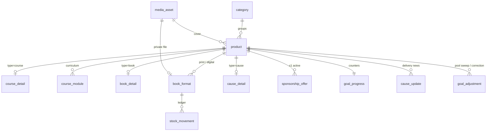
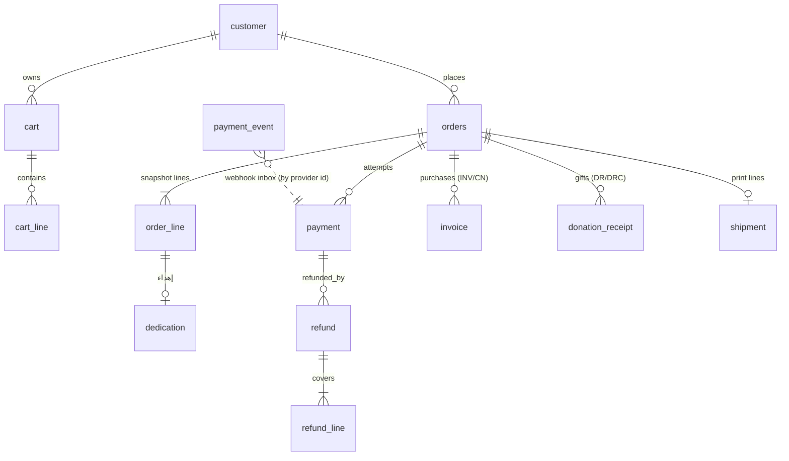
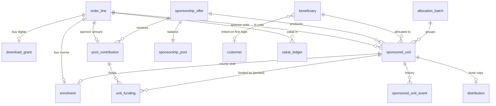

# Store Database Design

**Engine:** PostgreSQL 18 · **ORM:** EF Core 10 + Npgsql · **Schema:** `store`
**DDL:** [`database/store/001_store_schema.sql`](../../../database/store/001_store_schema.sql) · **Seed:** [`002_store_seed.sql`](../../../database/store/002_store_seed.sql)
**Dictionary:** [02-data-dictionary.md](02-data-dictionary.md) · **Operations:** [03-database-operations.md](03-database-operations.md)
**Decision record:** [ADR-S02 — PostgreSQL for the store](../adr/ADR-S02-postgresql.md)

The DDL was executed and verified on PostgreSQL: 49 tables, 4 views, seed loaded, all constraints
active, and a smoke scenario (`database/store/tests/smoke_scenario.sql`) passes all integrity checks. On PostgreSQL 16 or 17, `uuidv7()` needs a shim. Production uses 18, where it is built in.

---

## 1. Principles

1. **The database enforces the rules it can.** Money sums, state values, one live enrolment per course, one active offer per product, and gift lines carrying no VAT are CHECK constraints or partial unique indexes, not only C# code. The code is the first line of defence; the database is the last.
2. **Orders are snapshots.** Titles, prices, VAT and addresses are copied into `orders`, `order_line` and `shipment`. Editing a product never changes history.
3. **Money is exact.** `numeric(12,2)` (`numeric(14,2)` for campaign totals), SAR only. In C#: `decimal`. Never `double`.
4. **Ledgers over counters, counters for speed.** Stock, zakat, pool and unit status each have a ledger or history table. Counters (`goal_progress`, `book_format.stock_on_hand`, `sponsorship_pool.balance`) exist for fast reads and are reconciled against the ledgers nightly.
5. **Personal data is minimised and encrypted.** Beneficiary names and mobiles are encrypted with ASP.NET Core Data Protection before they reach the database. Donors never read them.
6. **One transaction per business event.** Payment settlement, allocation, refund and pooling each commit atomically, with their outbox messages in the same transaction.

---

## 2. Conventions

| Topic | Convention |
|---|---|
| Schema | Everything in `store`. The app's DB user owns only this schema |
| Names | `snake_case`, singular tables (`orders` is the exception: `order` is reserved). Generated by `EFCore.NamingConventions` → `UseSnakeCaseNamingConvention()` |
| Primary keys | `uuid DEFAULT uuidv7()`, time-ordered for index locality. Generated in .NET with `Guid.CreateVersion7()` so ids are known before `SaveChanges` |
| Ledger tables | `bigint GENERATED ALWAYS AS IDENTITY` (audit, events, movements) |
| Enums | `text` + `CHECK (x IN (…))`. C# enums are stored as strings (`HasConversion<string>()`, lower snake case) |
| Time | `timestamptz`, UTC in storage. Campaign end dates are entered in Asia/Riyadh and converted |
| Booleans | `is_*`, `has_*`, `allow_*` |
| Bilingual | `*_ar NOT NULL`, `*_en NULL` (ADR-003 pattern) |
| Concurrency | `xmin` as a concurrency token on `orders`, `book_format`, `sponsored_unit`, `sponsorship_pool`, `goal_progress` |
| JSON | `jsonb` only for snapshots (address), transient data (cart dedication) and settings. Never for data that is queried relationally |
| Deletes | Hard delete only for cart data and drafts. Financial rows are never deleted. `ON DELETE CASCADE` only from a parent to children that have no meaning alone |

---

## 3. Entity-relationship model

### 3.1 Catalogue



### 3.2 Cart, order, payment, documents



### 3.3 Fulfilment and giving



### 3.4 Identity and notifications

`customer` → `customer_address`, `otp_challenge` (by mobile), `refresh_token` (subject_type = customer).
`staff_user` → `refresh_token` (subject_type = staff), `audit_log.actor` (by email string, as on the main site).
`outbox_message` → `notification` (produced by the worker), rendered from `message_template`.

---

## 4. How the model implements the rules

### 4.1 Product type specialisation (RUL-01)

Table-per-type with a shared `product` row. EF Core maps the `*_detail` tables as **owned or
one-to-one dependents** rather than TPT inheritance. TPT queries join every subtype, which is slow
and awkward. A listing reads `product` plus one detail table chosen by `type`.

### 4.2 Cart vs order (RUL-15, RUL-24)

`cart_line.unit_price` is for display only. `CheckoutService` rebuilds each line from the
catalogue, compares it to the cart and returns `priceChanged: true` if anything moved. Only then
does it insert `orders` and `order_line`.

### 4.3 Checkout transaction (order creation)

```
BEGIN
  SELECT … FROM book_format WHERE id = ANY(@print) FOR UPDATE;          -- lock print stock
  UPDATE book_format SET stock_reserved = stock_reserved + @q
         WHERE id = @f AND stock_on_hand - stock_reserved >= @q;         -- 0 rows ⇒ out of stock
  INSERT orders (reference = 'T3-' || to_char(now(),'YY') || '-' || lpad(nextval('order_ref_seq')::text,6,'0'), …);
  INSERT order_line …; INSERT dedication …;
  INSERT payment (status = 'initiated');
  UPDATE cart SET status = 'converted';
COMMIT
→ call the gateway (outside the transaction) → store provider_payment_id
```

### 4.4 Settlement transaction (RUL-33, RUL-39) — the most important unit of work

Triggered by a verified webhook or by reconciliation. Runs in `SERIALIZABLE`, or `READ COMMITTED`
with the row locks below. Retry on serialization failure (Npgsql `EnableRetryOnFailure`).

```
BEGIN
  INSERT payment_event … ON CONFLICT (provider, provider_event_id) DO NOTHING;   -- idempotency
  IF no row inserted → COMMIT; return 200                                         -- duplicate
  SELECT * FROM orders WHERE id = @o FOR UPDATE;                                  -- serialise per order
  IF orders.status = 'paid' → mark event processed; COMMIT
  IF captured_amount <> grand_total → status = 'payment_review'; outbox(FinanceAlert); COMMIT
  UPDATE payment SET status = 'captured'; UPDATE orders SET status = 'paid', paid_at = now();

  FOR each line:
    buy/course      → INSERT enrolment (source 'purchase')          -- ux_enrolment_live guards doubles
    buy/digital     → INSERT download_grant
    buy/print       → UPDATE book_format SET stock_on_hand -= q, stock_reserved -= q;
                      INSERT stock_movement(reason 'sale'); UPSERT shipment
    sponsor/units   → INSERT N sponsored_unit (source 'full', status 'awaiting_allocation')
                      + sponsored_unit_event
    sponsor/amount  → INSERT pool_contribution; run POOLING (4.5)
    donate          → nothing per unit (RUL-53)
    gifts           → UPSERT goal_progress (raised += amount, funded_units += units, donor_count += 1 per order per product)
    zakat           → INSERT zakat_ledger (direction 'in')
    dedicated       → outbox(DedicationCard)

  IF purchase lines → next number FROM document_counter ('INV', year) FOR UPDATE → INSERT invoice
  IF gift lines     → next number ('DR', year)                         → INSERT donation_receipt
  outbox(OrderPaid), outbox(RenderDocuments)
  UPDATE payment_event SET processed_at = now()
COMMIT
```

PDF rendering, SMS, email and LMS calls happen **after** commit, from the outbox. A failed SMS
never un-pays an order.

### 4.5 Pooling algorithm (RUL-45)

```
SELECT balance FROM sponsorship_pool WHERE sponsorship_offer_id = @offer FOR UPDATE;
balance += contribution.amount
WHILE balance >= seat_price:
    unit = INSERT sponsored_unit (source 'pooled', unit_price = seat_price)
    need = seat_price
    FOR c IN pool_contribution WHERE offer = @offer AND remaining > 0 ORDER BY created_at   -- FIFO
        take = min(c.remaining, need)
        INSERT unit_funding (unit, c, take); c.remaining -= take; need -= take
        IF c.is_zakat THEN unit.has_zakat = true
        EXIT WHEN need = 0
    balance -= seat_price
UPDATE sponsorship_pool SET balance = @balance
```

Invariant (checked nightly): `sponsorship_pool.balance = Σ pool_contribution.remaining` for the offer.

### 4.6 Allocation (RUL-47, RUL-48)

```
SELECT … FROM sponsored_unit
 WHERE product_id = @p AND status = 'awaiting_allocation'
 ORDER BY funded_at LIMIT @n FOR UPDATE SKIP LOCKED;        -- FIFO; two officers never collide
-- validate each beneficiary: approved, group = offer.beneficiary_group,
--   zakat_eligible if unit.has_zakat, no live enrolment (ux_enrolment_live)
INSERT allocation_batch; UPDATE sponsored_unit SET status='allocated', beneficiary_id, …;
INSERT sponsored_unit_event; INSERT enrolment (source 'sponsored') | distribution;
IF has_zakat → INSERT zakat_ledger (direction 'out', amount = zakat share of the unit)
outbox(BeneficiaryInvite), outbox(SponsorUnitAllocated)
```

### 4.7 Refund (RUL-57, RUL-58)

Reverse effects in one transaction: `goal_progress` decremented, `sponsored_unit.status = 'cancelled'`
(only `awaiting_allocation`), `pool_contribution.remaining` reduced (only the unconverted part),
`zakat_ledger` `refund`, enrolment `revoked`, `download_grant.revoked_at`. Then a credit note or a
cancellation receipt is issued. The gateway call happens first; the database change is applied on
the gateway's refund webhook or success response.

---

## 5. Indexing strategy

| Query | Index |
|---|---|
| Catalogue listing by type and status | `ix_product_listing (type, status, sort)` |
| Search (Arabic and English) | `ix_product_search` GIN on the generated `tsvector` built from `ar_normalize(...)` (alef/taa/yaa unified, tashkeel stripped) + `ix_product_trgm` on `ar_normalize(title_ar)` for fuzzy titles. Queries normalise input with the same function |
| Customer's orders | `ix_order_customer (customer_id, placed_at DESC)` |
| Expiring unpaid orders (job) | partial `ix_order_due … WHERE status IN ('pending_payment','payment_failed')` |
| Reconciliation (job) | partial `ix_payment_reconcile … WHERE status = 'initiated'` |
| FIFO allocation | partial `ix_unit_fifo (product_id, funded_at) WHERE status = 'awaiting_allocation'` |
| FIFO pooling | partial `ix_pool_fifo … WHERE remaining > 0` |
| Outbox worker | partial `ix_outbox_pending (next_attempt_at) WHERE processed_at IS NULL` |
| One live enrolment | partial unique `ux_enrolment_live` |
| One active offer / one general fund / one default address / one active customer cart | partial unique indexes |

Expected volume in year 1: under 50k orders, under 150k lines, under 20k units. A single VPS
PostgreSQL handles this with room to spare. No partitioning is needed before 5M rows in `audit_log`
or `outbox_message`; those are pruned by retention (see operations doc).

---

## 6. EF Core mapping

| DB | C# |
|---|---|
| `uuid` | `Guid` (`Guid.CreateVersion7()`) |
| `numeric(12,2)` | `decimal` with `HasPrecision(12,2)` |
| `text` + CHECK | C# `enum` + `HasConversion<string>()` via a snake_case converter; CHECK added in the migration with `HasCheckConstraint` |
| `timestamptz` | `DateTimeOffset` (UTC) |
| `date` | `DateOnly` |
| `jsonb` | `OwnsOne(… ).ToJson()` for typed snapshots (`ShippingAddress`, `DedicationDraft`); `JsonDocument` for settings |
| `text[]` | `string[]` (staff roles) |
| `citext` | `string` with `HasColumnType("citext")` |
| `bytea` encrypted | `string` in the domain; `ValueConverter` calling `IDataProtector` (purpose `Store.Beneficiary.Pii.v1`) |
| `xmin` | `uint RowVersion` + `.IsRowVersion()` |
| generated `tsvector` | `NpgsqlTsVector` shadow property, `HasComputedColumnSql(…, stored: true)` |
| views | Keyless entities `ToView("v_goal")` for read models |

Configuration lives in one `IEntityTypeConfiguration<T>` per table under
`Ta3lom.Store.Infrastructure/Persistence/Configurations/`. Partial unique indexes use
`HasIndex(…).IsUnique().HasFilter("…")`.

---

## 7. Security in the database

| Control | Implementation |
|---|---|
| Least-privilege DB roles | `store_owner` runs migrations only (CI). `store_app` has DML on `store.*`, no DDL. `store_report` is read-only on views, for BI |
| Network | PostgreSQL listens on the Docker network only; no public port. Admin access over an SSH tunnel |
| Encryption at rest | VPS disk encryption, plus column encryption for beneficiary PII; backups encrypted with `age` before leaving the server |
| Secrets | Connection strings and Data Protection keys come from environment/secret files, never from the repo |
| Audit | `audit_log` written by an EF Core `SaveChangesInterceptor` for staff-originated changes |
| Append-only tables | `audit_log`, `payment_event`, `zakat_ledger`, `stock_movement`, `sponsored_unit_event`: `store_app` is granted `INSERT, SELECT` only |

---

## 8. Relationship to the main-site database

The main site (NestJS, Prisma, MySQL on Hostinger shared hosting) and the store (PostgreSQL on the
VPS) **do not share tables or connections**. The store never reads MySQL. Integration is by HTTP:

| Need | Direction | Mechanism |
|---|---|---|
| Header cart count, "Store" nav link | web → store API | `GET /v1/cart/summary` (CORS, credentials) |
| `/donate` → store general fund | web routing | Link to `/store/p/education-fund` (Q-09) |
| Legacy `donation_intents` history | one-off | If FR-40 ever went live, export settled intents into `goal_progress.seed_*` of the general fund |
| Impact stats on the homepage | store → web rebuild | Store calls the existing `repository_dispatch` rebuild after campaign changes (optional) |
