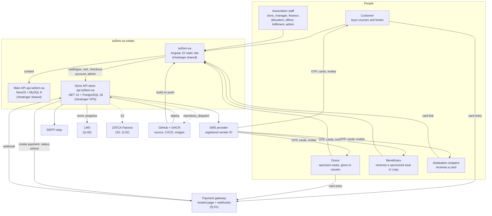
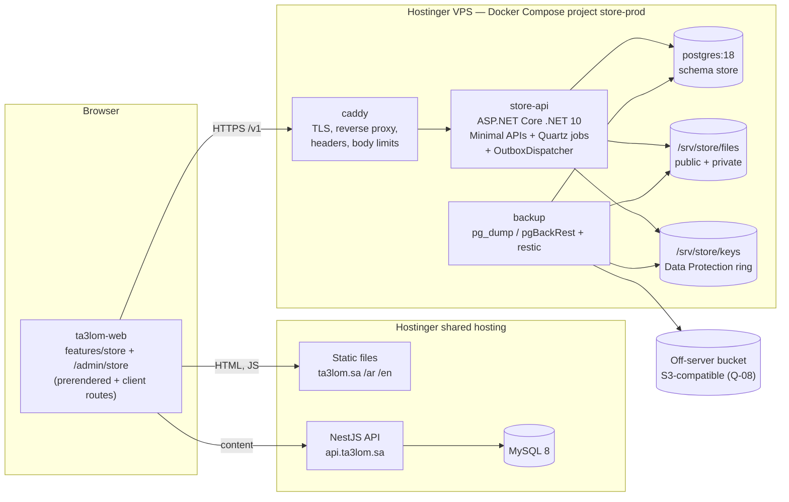
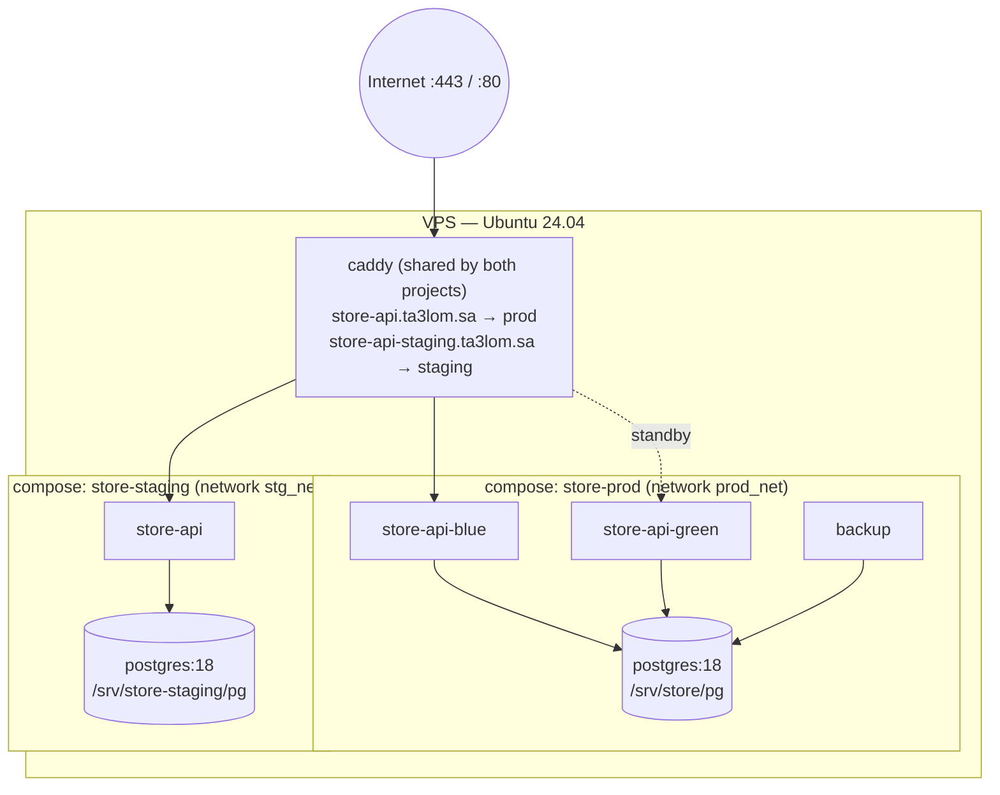
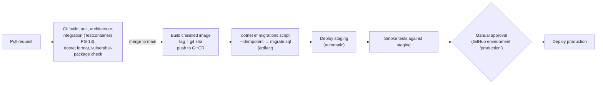

# 08 — Solution Architecture

**Revision:** S1 draft · 29 September 2026

How the store fits next to ta3lom.sa: the systems it talks to, the containers it runs in, how the
browser reaches two APIs, how it is deployed and operated on the VPS, and how it is secured.

Decisions referenced here are recorded in [adr/](adr/README.md). Business behaviour is defined in
[03-business-rules.md](03-business-rules.md) and is not repeated.

---

## 1. System context (C4 level 1)

| External system | Direction | Purpose | Rule / FR |
|---|---|---|---|
| Payment gateway | both | Hosted payment page, capture status, refunds, signed webhooks | RUL-32–38, FR-S33–S38, FR-S64 |
| SMS provider | out | OTP, order confirmation, dedication cards, beneficiary invitations, shipment and refund notices | RUL-22, RUL-52, RUL-60, RUL-63 |
| SMTP relay | out | Receipts, digests, cause updates | RUL-63 |
| LMS | both | Grant access, read progress and completion | RUL-42, RUL-50, FR-S40, FR-S55 |
| ZATCA Fatoora | out | Phase 2 reporting/clearance (S2) | BR-S13, FR-S65 |
| GitHub / GHCR | both | Source, CI, container registry; store asks ta3lom-web to rebuild | §9 |
| Main API | none | No direct call. The store never reads MySQL (database design §8) | — |

---

## 2. Containers (C4 level 2)

| Container | Technology | Responsibility |
|---|---|---|
| `ta3lom-web` (store feature) | Angular 22, prerender static output | Store pages, cart, checkout, account, `/admin/store`. Talks to the store API only for store data |
| `caddy` | Caddy 2 | Automatic TLS (Let's Encrypt), HTTP→HTTPS, reverse proxy to the active `store-api` colour, security headers, request-body limits, access log |
| `store-api` | ASP.NET Core .NET 10, chiselled image | All store endpoints (`/v1/...`), webhooks, health; hosts Quartz.NET jobs and the `OutboxDispatcher` in the same process (ADR-S08) |
| `postgres` | `postgres:18` | Schema `store` (49 tables, 4 views, function `ar_normalize`); roles `store_owner`, `store_app`, `store_report` (database design §7) |
| `backup` | pgBackRest / `pg_dump` + restic, cron | Dumps every 6 h, WAL archiving, daily files and key-ring backup (database operations §4) |

In-process background work (database operations §5):

| Job | Schedule | Rule |
|---|---|---|
| `OutboxDispatcher` | continuous, 1 s poll | RUL-63 (all messages except the OTP SMS, which is sent directly) |
| `ReconcilePayments` | every 5 min, payments `initiated` > 5 min until `payment_due_at` + 24 h | RUL-38 |
| `ExpireUnpaidOrders` | every 5 min; restores lines to the customer's active cart on final expiry | RUL-29/30 |
| `CloseCampaigns` | 00:05 Riyadh; pool sweep recorded as a `goal_adjustment` pair | RUL-09, RUL-46 |
| `AllocationAlerts` / `LapseUnits` | 07:00 / 02:00 Riyadh; lapse revokes the enrolment and sends a short SMS | RUL-49, RUL-50 |
| `LmsProgressSync` | hourly | RUL-42, RUL-50 |
| `SponsorDigest` | monthly | RUL-63 |
| `LowStockAlert` | daily 08:00 Riyadh; `book_format.low_stock_threshold` or setting `low_stock_default_threshold` | FR-S43 |
| `PruneIdempotencyKeys` | hourly (keys older than 24 h) | — |
| `ExpireGuestCarts`, `PruneOtp`, `IntegrityChecks`, `Retention` | as database operations §5 | RUL-16, PDPL |

One API process runs the web endpoints and the background work. Jobs use Quartz with a PostgreSQL
job store only if a second instance is ever added; with one instance the RAM store is sufficient,
and the outbox is safe for concurrent workers anyway (`FOR UPDATE SKIP LOCKED`).

---

## 3. Browser to two APIs

The browser at `https://ta3lom.sa` talks to `api.ta3lom.sa` (content) and `store-api.ta3lom.sa`
(store). Both are subdomains of the same registrable domain `ta3lom.sa`, so every request between
them is **same-site** (though cross-origin).

### 3.1 CORS

| Setting | Value |
|---|---|
| Allowed origins (prod) | `https://ta3lom.sa`, `https://www.ta3lom.sa` |
| Allowed origins (staging API) | `https://staging.ta3lom.sa`, plus `http://localhost:4200` only in the Development environment |
| Credentials | `true` (cookies `t3s_rt`, `t3s_srt`, `t3s_cart`) |
| Methods | `GET, POST, PUT, PATCH, DELETE` |
| Headers | `Authorization, Content-Type, Idempotency-Key, Accept-Language` |
| Exposed | `ETag, Retry-After, Location, Idempotent-Replayed` (same list as 11 §1.2) |
| Preflight cache | `Access-Control-Max-Age: 600` |
| Not covered | `/v1/payments/webhooks/*` (server-to-server, no CORS), `/health/*` |

### 3.2 Cookies

| Cookie | Set by | Attributes | Why |
|---|---|---|---|
| `t3s_rt` | `store-api.ta3lom.sa` | HttpOnly, Secure, **SameSite=Lax**, `Path=/v1/auth`, no `Domain` (host-only) | Rotating refresh token (ADR-S04). Host-only so it is never sent to `api.ta3lom.sa` |
| `t3s_srt` | `store-api.ta3lom.sa` | HttpOnly, Secure, SameSite=Lax, `Path=/v1/admin/auth`, host-only, 8 h | Staff rotating refresh token (ADR-S04). Separate name and path so a staff member who is also a customer keeps two independent sessions; staff auth endpoints are `/v1/admin/auth/*` |
| `t3s_cart` | `store-api.ta3lom.sa` | HttpOnly, Secure, SameSite=Lax, `Path=/v1`, host-only, 30 days | Guest cart id (RUL-11, RUL-16) |

SameSite=Lax works because `ta3lom.sa` and `store-api.ta3lom.sa` are the same site: a `fetch`
from the page with `credentials: 'include'` carries the cookies. Lax rather than Strict is chosen
so that the first requests after a cross-site top-level navigation (return from the gateway, a
link opened from SMS or WhatsApp) are never treated as cross-site by any browser. CSRF is still
covered: state-changing endpoints require either the `Authorization` header (not a cookie) or a
JSON body (which forces a CORS preflight), and CORS rejects foreign origins.

The main site's refresh cookie is set with `Domain=.ta3lom.sa` (main 05-security-architecture), so
browsers also send it to `store-api.ta3lom.sa`. The store ignores it; Serilog redacts the `Cookie`
header.

The Angular interceptor adds `withCredentials` **only** for requests to the `STORE_API_URL` token
and attaches the store access token only to that origin. The main-site token and the store token
never cross.

### 3.3 Content Security Policy changes in ta3lom-web

The CSP lives in `ta3lom-web/deploy/.htaccess` (CLAUDE.md non-negotiable 15). Additions:

| Directive | Add | Reason |
|---|---|---|
| `connect-src` | `https://store-api.ta3lom.sa` (staging build: `https://store-api-staging.ta3lom.sa`) | All store XHR |
| `img-src` | `https://store-api.ta3lom.sa` | Product covers and cause-update photos served from the public files area |
| `form-action` | Gateway hosted-page origin (e.g. `https://*.moyasar.com` — exact host per Q-01) | Only if the adapter hands off by form POST rather than `location.assign` |
| `connect-src`, `script-src`, `frame-src` | Gateway SDK origins | **Only if** an embedded SDK/sheet is chosen instead of the redirect (ADR-S05). Not needed for the recommended redirect flow |

`script-src` stays hash-only with no `'unsafe-inline'`. No store script is inlined.

### 3.4 Static hosting of client-rendered routes

Client-rendered store routes (`/store/cart`, `/store/checkout`, `/store/orders/:ref/thanks`,
`/store/account/**`, `/store/card/:token`, `/store/login`, `/admin/store/**`) have no prerendered
HTML. `deploy/.htaccess` rewrites them to the locale's CSR entry (`/ar/index.csr.html`,
`/en/index.csr.html`), the same way `/admin` is served today.

---

## 4. Deployment view

### 4.1 VPS

| Item | Value |
|---|---|
| Plan | Hostinger VPS **KVM 2**: 2 vCPU, 8 GB RAM, 100 GB NVMe |
| OS | Ubuntu 24.04 LTS, Docker Engine + Compose plugin |
| Location | Nearest Hostinger data centre to KSA that the association accepts; **no KSA location exists** (Q-08, ADR-S03) |
| Compose projects | `store-prod` and `store-staging`, separate networks, volumes, DB roles and secrets |

Caddy runs in its own small compose project (`edge`) attached to both `prod_net` and `stg_net`,
because only one process can bind 80/443. Postgres publishes no port; admin access is an SSH
tunnel to the container network.

### 4.2 Compose services (production)

| Service | Image | Volumes | Limits | Health |
|---|---|---|---|---|
| `store-api-blue` / `store-api-green` | `ghcr.io/<owner>/ta3lom-store-api:<git-sha>` | `/srv/store/files:/srv/store/files`, `/srv/store/keys:/srv/store/keys` (same paths inside the container as on the host) | 1 GB RAM | `GET /health/ready` |
| `postgres` | `postgres:18` | `/srv/store/pg:/var/lib/postgresql/data` | 4 GB RAM | `pg_isready` |
| `backup` | pgBackRest + restic (pinned tag) | `/srv/store/pg` (ro, for WAL), `/srv/store/files` (ro), `/srv/store/keys` (ro) | 512 MB | last-success timestamp file checked by the uptime monitor via the API's `/health/ready` |
| `seq` (optional) | `datalust/seq` | `/srv/store/seq` | 1 GB | — |

Staging uses the same compose file with `/srv/store-staging/*` paths, one colour only, 512 MB for
the API, gateway sandbox keys and a separate SMS sender or a sink.

| Host path | Contents | Backed up |
|---|---|---|
| `/srv/store/files/public` | Product images, cause-update photos (served at `/files/public/...`) | restic daily |
| `/srv/store/files/private` | Book files, rendered invoices and receipts, packing slips | restic daily |
| `/srv/store/pg` | PostgreSQL data directory | pgBackRest (WAL) + `pg_dump` every 6 h |
| `/srv/store/keys` | ASP.NET Core Data Protection key ring | restic daily. **Without it, beneficiary PII and staff TOTP secrets cannot be decrypted** |
| `/srv/store/logs` | Serilog rolling JSON files (14 days) | not backed up |
| `/srv/store/secrets/` | `prod.env` (0600 root) — connection strings, gateway keys, SMS keys, JWT signing key, pepper | offline copy held by the association (sealed) |

### 4.3 DNS and TLS

| Record | Type | Value |
|---|---|---|
| `store-api.ta3lom.sa` | A (+ AAAA if the VPS has IPv6) | VPS IP |
| `store-api-staging.ta3lom.sa` | A | VPS IP |
| `ta3lom.sa` CAA | CAA | `0 issue "letsencrypt.org"` added alongside whatever Hostinger shared hosting uses, so both certificates keep issuing |

Caddy obtains and renews certificates automatically (HTTP-01). HSTS
`max-age=31536000; includeSubDomains` matches the main site.

### 4.4 Host hardening

| Control | Setting |
|---|---|
| Firewall (ufw) | Default deny incoming. Allow 80/tcp, 443/tcp from anywhere. Allow 22/tcp **only** from the developer's IP and the `tailscale0` interface |
| CI access | GitHub-hosted runners have no fixed IPs. The deploy job joins a Tailscale tailnet as an ephemeral node and SSHs over it (open point OP-2 for the fallback) |
| SSH | Keys only (`PasswordAuthentication no`), `PermitRootLogin no`, `AllowUsers ops deploy`. `deploy` key restricted with `command="/usr/local/bin/store-deploy"`, `no-port-forwarding,no-pty` |
| Docker | `deploy` is **not** in the `docker` group (that is root-equivalent). `store-deploy` is the one command it may run via sudo |
| fail2ban | `sshd` jail (5 failures / 10 min → 1 h ban); Caddy access-log jail for repeated 401/429 on `/v1/auth/*` and `/v1/admin/*` |
| Updates | `unattended-upgrades` for security updates, automatic reboot window 04:30 Riyadh with Docker `restart: unless-stopped` |
| Time | `chrony`, UTC host clock |
| Disk | Hostinger full-disk encryption if offered on the plan; otherwise rely on column encryption + encrypted backups (open point OP-3) |
| Docker log driver | `local` with rotation (10 MB × 5 per container) |

---

## 5. CI/CD

### 5.1 Deploy steps (`store-deploy <env> <sha>`, run on the VPS)

1. `docker pull ghcr.io/<owner>/ta3lom-store-api:<sha>`.
2. Take a pre-deploy `pg_dump` (production only).
3. Run `migrate.sql` with `psql -v ON_ERROR_STOP=1` as `store_owner` in a one-off `postgres:18`
   container. Stop on the first error. Migrations are expand-only within a release
   (database operations §2), so the running image keeps working against the new schema.
4. Start the idle colour (`green` if `blue` is live) with the new tag.
5. Poll `http://store-api-green:8080/health/ready` on the internal network for up to 60 s.
6. On success: rewrite Caddy's upstream to the new colour and `caddy reload` (graceful; in-flight
   requests finish). Record `<sha>` in `/srv/store/deploy/current` and the old one in `previous`.
7. Stop the old colour after 30 s.
8. On failure at 5: stop the new colour, keep the old one live, exit non-zero.

### 5.2 Rollback

`store-deploy prod rollback` starts the image in `previous`, health-checks and switches. No
database step: because migrations are expand-only, the previous image is compatible. A contract
migration (drop/rename) ships only in the release **after** the one that stopped using the column,
so rolling back one release is always safe. Restoring the database is a separate, manual
decision (runbook in database operations §4).

### 5.3 Secrets in CI

| Secret | Where | Scope |
|---|---|---|
| GHCR push | `GITHUB_TOKEN` (`packages: write`) | build job |
| Tailscale auth key | GitHub environment secret, ephemeral + tagged `ci` | deploy jobs |
| SSH private key for `deploy` | GitHub environment secret per environment | deploy jobs |
| App secrets | **Never in GitHub.** Only on the VPS in `/srv/store/secrets/*.env` | — |

The VPS pulls from GHCR with a read-only token (`read:packages`) stored in `/root/.docker/config.json`.

---

## 6. Security architecture

### 6.1 Posture

Unlike the main site, the store holds customer accounts, order history, beneficiary PII and money
flows. It still holds **no card data**. The main-site controls (headers, CORS allow-list, no
`localStorage` tokens, audit log, rate limits, uniform auth errors) all carry over; this section
adds what is new.

### 6.2 Threat model (STRIDE)

| Area | S — Spoofing | T — Tampering | R — Repudiation | I — Information disclosure | D — Denial of service | E — Elevation of privilege |
|---|---|---|---|---|---|---|
| **Checkout** | Order placed as someone else → OTP-verified mobile required (RUL-25, RUL-60); `blocked` customers cannot sign in or check out (RUL-61). Double submit → `Idempotency-Key` stored in `idempotency_key` (24 h) | Client-side price edits → server reprices every line (RUL-15, RUL-24); totals are `numeric(12,2)` and checked by CHECK constraints | "I never ordered" → order, lines, snapshots, IP hash, `audit_log` | Order status by guessing refs → `GET /v1/orders/{ref}/status` requires the customer's bearer **or** the per-order status token (HMAC of the order id) returned by `POST /v1/checkout`; never anonymous by reference alone. The thanks page uses the bearer, restored from `t3s_rt` after the gateway redirect | Stock hoarding by unpaid orders → 60-min expiry (RUL-29/30), cart limits (RUL-18), rate limit on `POST /v1/checkout` | Buying an archived/draft product → server validation (RUL-02, RUL-24); a course already owned or in an unpaid order is rejected (RUL-13) |
| **Webhook** | Forged "paid" event → signature/secret verified per provider; payment re-fetched from the gateway API before settlement | Amount altered → captured amount compared with `grand_total`, mismatch → `payment_review`; a capture on an `expired`/`cancelled` order also → `payment_review` (RUL-29, RUL-35) | Disputed settlement → every event stored in `payment_event` with payload and `signature_valid` (append-only) | Payload with PII in logs → payload stored in DB only, redacted in logs, emptied after 18 months | Replay flood → idempotency on `(provider, provider_event_id)` (RUL-34); Caddy body limit 64 KB; per-IP rate limit | Webhook path used to trigger other effects → endpoint only enqueues settlement for an existing `payment` row |
| **OTP** | SIM swap / code interception → short validity (5 min), 5 attempts, codes hashed with pepper; the OTP SMS is sent directly (the one exception to the outbox), so the plain code is never stored (RUL-60, RUL-63) | Code brute force → attempts per code + lockout | Disputed login → `otp_challenge` rows with `ip_hash`, `customer.last_login_at` | Mobile enumeration → uniform response for any mobile | **SMS pumping (toll fraud)** → only `+9665` numbers, 3 codes/mobile/15 min, 10/IP/hour, daily global cap with alert, CAPTCHA-free proof-of-work or Turnstile fallback (open point OP-4) | Beneficiary invite used to hijack an account → the `customer` row is found or created for the beneficiary's (or guardian's) mobile **at allocation** (RUL-47e, RUL-52); the invite carries no credential, and the first OTP login simply signs in |
| **Admin** | Stolen staff password → mandatory TOTP (RUL-62), lockout as FR-53, 10-min access token | Unauthorised catalogue/price edits → role policies per endpoint group (FR-S71), `audit_log` with diff | "I didn't refund that" → refunds, allocations, disbursement vouchers and PII reveals audited with actor email | Staff browsing beneficiary PII → masked by default; reveal requires `allocation_officer` and writes `audit_log` (FR-S52) | Admin endpoints hammered → rate limit per user + IP | Role escalation → only `admin` edits `staff_user.roles`; **segregation of duties** (RUL-62): `admin` does not implicitly refund, allocate or reveal PII — those need `finance` / `allocation_officer` explicitly, and granting them is audited; checked server-side; Angular guards are UX only |
| **PII** | — | Beneficiary data altered → audited updates | — | DB dump leak → beneficiary names/mobiles and TOTP secrets encrypted with Data Protection; backups encrypted; keys backed up separately from dumps | — | App role reading more than needed → `store_app` DML on `store.*` only; append-only tables `INSERT, SELECT` only |

### 6.3 Controls summary

| Control | Implementation |
|---|---|
| Transport | TLS 1.2+ at Caddy, HSTS, HTTP→HTTPS |
| API headers | `X-Content-Type-Options: nosniff`, `X-Frame-Options: DENY`, `Referrer-Policy: strict-origin-when-cross-origin`, `Cache-Control: no-store` on `/v1/me`, `/v1/auth`, `/v1/admin`, `/v1/checkout` |
| Idempotency | `Idempotency-Key` on `POST /v1/checkout` and admin refunds stored in `idempotency_key` (`scope`, `key`, `request_hash`, `status_code`, `response`); same key + different body → 422; pruned after 24 h |
| Input | FluentValidation on every request DTO; unknown JSON properties rejected (`UnmappedMemberHandling.Disallow`); max lengths on all strings |
| Errors | ProblemDetails (RFC 9457) with a stable `code`; no stack traces or SQL in responses |
| Rate limiting | ASP.NET Core rate limiter: OTP request/verify (RUL-60), checkout, admin login, webhooks, public catalogue (generous). Client IP from `X-Forwarded-For` trusted only from Caddy |
| Secrets | Env files on the VPS only; JWT signing key rotated by adding a new `kid` |
| PII encryption | Data Protection purpose `Store.Beneficiary.Pii.v1`; staff TOTP secret under its own purpose |
| Files | Private files served only through a signed, 10-minute URL (RUL-41); uploads: MIME allow-list, magic-byte check, size caps, randomised storage keys |
| Dependencies | `dotnet list package --vulnerable` in CI, Dependabot for NuGet, npm and Docker base images |
| Audit | `audit_log` via `SaveChangesInterceptor` for staff actions; security events (login, lockout, token reuse, PII reveal) |
| Logging | Serilog destructuring policy redacts `Authorization`, `Cookie`, `Set-Cookie`, OTP codes, `*_enc`, mobile (masked `05******12`) |

### 6.4 PCI DSS scope: SAQ-A

The store qualifies for **SAQ-A** if, and only if, every element of the payment page comes from
the PCI-compliant gateway:

- Card entry happens on the gateway's hosted page reached by **full redirect** (recommended), or
  inside a gateway-served iframe. RUL-32.
- No script on ta3lom.sa can read or alter card fields. With a redirect, there are none on our
  origin at all.
- Our servers receive only a payment id, status and amount, never a PAN, CVV or expiry.

A JavaScript SDK that renders card inputs **in our page's DOM** and posts from the browser
would move the merchant to **SAQ A-EP** (the merchant page affects payment-page security). That
is why ADR-S05 prefers the redirect, and why the CSP additions for gateway scripts are listed as
conditional. Apple Pay and mada on the hosted page are within the gateway's scope.

The association still submits the SAQ-A annually to its acquirer and keeps the website's TLS and
admin access controls in order; the checklist in [12-implementation-plan.md](12-implementation-plan.md#launch-checklist) covers this.

---

## 7. Integration with the main site

| Integration | Mechanism | FR |
|---|---|---|
| "Store" item in the main nav and footer links | `layout/` header and footer in ta3lom-web; static links to `/{locale}/store` | FR-S82 |
| Cart badge on every page | Header component reads `GET /v1/cart/summary` (credentials) after hydration; hidden on error; not part of prerendered HTML | FR-S19 |
| `/donate` | Becomes a redirect to `/{locale}/store/p/education-fund` (the general fund, `cause_detail.is_general_fund`) once Q-09 is confirmed | FR-S82, Q-09 |
| Prerendered store pages refresh | After a staff publish/price/campaign change, the store API sends `repository_dispatch` (type `content-published`, same as the main site's nightly workflow) to ta3lom-web, debounced to at most once per 10 minutes. Optional: the nightly rebuild already catches up, and live figures load at runtime anyway (FR-S07) | FR-S07 |
| Build-time slugs | The **existing** `scripts/routes.mjs` → `routes.txt` mechanism is extended to also fetch `GET /v1/catalog/products?fields=slug`; no second mechanism. If the store API is unreachable, the build **fails**, so a stale or empty product list is never shipped silently | FR-S09 |
| Impact numbers on the main homepage | Unchanged in S1 (main-site stats). A later change may read `v_goal` totals via a public store endpoint | — |
| Staff login | `/admin/store/**` authenticates against the store API as staff (separate audience, TOTP). Staff who use both admins log in twice | FR-S70 |

### 7.1 Proposed main-site revision R3

To be recorded in the main-site `CHANGELOG.md` once Q-09 is answered "yes".

| Main-site item | Proposed change | Replaced by |
|---|---|---|
| FR-40 Donation flow | **Superseded**. One-off and zakat giving move to the store; monthly and waqf deferred to store S2 | FR-S13, FR-S30–S35; BR-S14 (S2) |
| FR-41 Donation intent recording | **Superseded** | FR-S32 (`orders`, `order_line`) |
| FR-42 Settlement webhook | **Superseded** | FR-S34, RUL-33/34 |
| FR-43 Thank-you page | **Superseded** | FR-S35 |
| FR-44 Donation receipt | **Superseded** | FR-S63, RUL-59, RUL-63 |
| FR-45 Interim fallback | **Kept until store go-live**, then `/donate` redirects to the general fund. Bank details remain on the contact page | FR-S82 |
| `DonationIntent` model (main API) | Left in place, unused; removed in a later contract migration. Any settled rows go to `goal_progress.seed_*` (database design §8) | — |
| Main CSP | `connect-src` and `img-src` additions in §3.3 | — |
| Main nav, footer, header | Store link and cart badge | FR-S19, FR-S82 |

---

## 8. Observability

| Signal | Tooling | Where |
|---|---|---|
| Logs | Serilog, compact JSON, enriched with `TraceId`, `RequestId`, `OrderRef` when present | stdout (Docker `local` driver) + rolling file `/srv/store/logs` (14 days). Optional sink: **Seq** on the VPS (OTLP) or **Grafana Loki** (Grafana Cloud free tier) |
| Traces | OpenTelemetry: ASP.NET Core, HttpClient (gateway, SMS, LMS), Npgsql, Quartz | OTLP to Seq when enabled; otherwise sampled off |
| Metrics | OpenTelemetry meters: `store.orders.paid`, `store.payments.failed`, `store.webhooks.invalid_signature`, `store.outbox.backlog`, `store.outbox.oldest_age_s`, `store.otp.sent`, `store.sms.failed` | Seq/Grafana when enabled; key values also in `/health/ready` details (staff-authenticated) |
| Health | `/health/live` (process), `/health/ready` (DB, outbox lag < 30 min, disk free, last backup < 7 h) | Caddy, deploy script, uptime monitor |
| Uptime | External monitor (UptimeRobot or Better Stack free tier) every 1 min on `store-api.ta3lom.sa/health/ready`, `ta3lom.sa/ar/store`, and a keyword check on a product page | Alert channels below |
| Business checks | Nightly integrity checks (database operations §6) | Staff alert on any row |

### 8.1 Alert routing

| Alert | Severity | Goes to |
|---|---|---|
| API down / `ready` failing > 3 min | P1 | Developer (SMS + email), association IT contact |
| Invalid webhook signatures > 5 in 10 min; payment failure rate > 30% over 30 min | P1 | Developer, finance lead |
| Order in `payment_review` (amount mismatch, late capture after expiry/cancel, duplicate paid course per RUL-13) | P2 | Finance (email + admin dashboard) |
| Low stock (`LowStockAlert`) | P3 | Fulfilment (email + dashboard) |
| `LmsProgressSync` failing > 3 runs; enrolments stuck in `pending_sync` > 1 h | P2 | Developer |
| Outbox backlog > 500 or oldest > 30 min; SMS provider failures | P2 | Developer |
| Backup older than 7 h; restore drill overdue; disk > 80% | P2 | Developer |
| Integrity-check row | P2 | Developer + finance |
| Units awaiting allocation 30 / 90 days (RUL-49) | P3 | Allocation officer / manager (admin alert, email) |
| OTP daily cap reached (possible SMS pumping) | P1 | Developer |

---

## 9. Capacity and cost

### 9.1 Load assumptions

Year 1 (database design §5): < 50k orders, < 150k lines, < 20k units. Peaks in Ramadan and at
campaign launches: design target **50 concurrent checkouts** and **300 catalogue requests/s**
at the API (most catalogue traffic hits static prerendered HTML, not the API).

| Resource | Budget on KVM 2 |
|---|---|
| RAM | PostgreSQL ~3 GB (`shared_buffers = 2GB`), store-api prod 2 × 1 GB during switch, staging API 0.5 GB + PG 1 GB, Seq 1 GB, Caddy + backup 0.5 GB — fits 8 GB |
| CPU | PDF rendering and watermarking are the heaviest work; the outbox limits concurrent renders to 2 |
| Disk | PG < 5 GB in year 1; files 10–20 GB (book PDFs dominate); logs < 2 GB; headroom > 60 GB |

Upgrade path: KVM 4 (4 vCPU / 16 GB) is a plan change on the same host, no code change.

### 9.2 Running cost (indicative — all figures **to confirm** with suppliers)

| Item | Estimate | Notes |
|---|---|---|
| Hostinger VPS KVM 2 | ~USD 9–20 / month | Promotional vs renewal pricing differ; to confirm |
| Off-server backup bucket (≤ 100 GB) | ~USD 1–6 / month | Provider and region depend on Q-08 |
| Seq / Grafana Cloud / uptime monitor | USD 0 on free tiers | Seq single-user licence terms to confirm |
| SMS | ~0.05–0.12 SAR per segment | Arabic uses UCS-2: 70 chars per segment. ~3–4 SMS per order (OTP, paid, shipping, card) → roughly 0.2–0.5 SAR per order |
| SMS sender ID registration | one-off fee, supplier-dependent | To confirm |
| Payment gateway — mada | ~1.0–1.75% per transaction | To confirm (Q-01) |
| Payment gateway — Visa/Mastercard/Apple Pay | ~2.2–2.9% + ~1 SAR | To confirm |
| Payment gateway — STC Pay | ~1.5–2.5% | To confirm |
| Gateway setup / annual fees | 0 – several thousand SAR | Non-profit rates to be requested |
| QuestPDF | USD 0 under the Community licence if the association is eligible | To confirm eligibility |
| Domain / TLS | USD 0 | Existing domain; Let's Encrypt |

---

## 10. Risks

| # | Risk | Likelihood | Impact | Mitigation |
|---|---|---|---|---|
| R-01 | Q-08 requires KSA hosting after build | Medium | High | Everything is containerised; moving is a compose file and DNS change (ADR-S03). Ask before Phase 1 |
| R-02 | Gateway onboarding for a non-profit takes weeks | High | High | Start in Phase 0; adapter lets development continue on a fake gateway; sandbox first |
| R-03 | SMS sender ID approval delayed | High | High (no login) | Apply in week 1; staging uses the provider's default sender; email OTP is **not** a fallback (would change RUL-60) — escalate instead |
| R-04 | Single VPS is a single point of failure | Medium | High | 6-hourly dumps + WAL, tested restore (RTO ≤ 4 h), prerendered catalogue stays readable when the API is down; cart/checkout show a maintenance notice |
| R-05 | Lost Data Protection key ring | Low | High | Keys backed up daily, separate from DB dumps; restore drill includes decrypting one beneficiary |
| R-06 | SMS pumping fraud drives cost | Medium | Medium | Saudi-only numbers, per-mobile/IP/global caps, alert (§6.2) |
| R-07 | Arabic shaping issues in PDFs | Medium | Medium | Phase 0 QuestPDF spike with the real fonts and mixed-direction text |
| R-08 | Webhook missed or delayed | Medium | Medium | Reconciliation every 5 min for payments `initiated` > 5 min → `paid` within about 10 min (RUL-38); thanks page polls |
| R-13 | Store API outage during a ta3lom-web build blocks a main-site content release | Low | Medium | Build fails loudly by design (§7); retry after the API recovers; uptime alert fires first |
| R-09 | One developer (bus factor) | High | High | Everything in repo docs, CLAUDE.md, runbooks; staff trained on admin; association holds sealed secrets |
| R-10 | Prerendered pages stale after catalogue changes | High | Low | Live figures at runtime (FR-S07), optional rebuild dispatch, nightly rebuild |
| R-11 | Two admins, two logins confuse staff | Medium | Low | Clear labelling in the admin nav; training |
| R-12 | Hostinger VPS network egress to KSA gateway/SMS APIs is slow | Low | Medium | Measure in Phase 0 spike; resilience policies with timeouts and retries |

---

## Open points

| # | Point | Proposed |
|---|---|---|
| OP-1 | Exact gateway domains for `form-action` / SDK CSP | Fill after Q-01 |
| OP-2 | CI reach to SSH if Tailscale is not accepted | Fallback: open 22 to all, key-only, forced-command `deploy`, fail2ban. Or a pull-based deploy agent on the VPS |
| OP-3 | VPS disk encryption availability on Hostinger KVM | Confirm with Hostinger; not a blocker given column + backup encryption |
| OP-4 | Bot protection on OTP request beyond rate limits | Cloudflare Turnstile (adds a third-party script and CSP entries) — decide in hardening |
| OP-5 | Should the ta3lom-web build fail if the store API is unreachable during prerender? | Resolved — see _changes-r1 §16: the build fails. (Still worth confirming that Hostinger keeps the previous build live on a failed build) |
| OP-6 | Seq on the VPS vs Grafana Cloud (data leaves the VPS; Q-08) | Seq on the VPS by default |
| OP-7 | Access to `/v1/orders/{ref}/status` | Resolved — see _changes-r1 §15: bearer or per-order status token (§6.2) |
